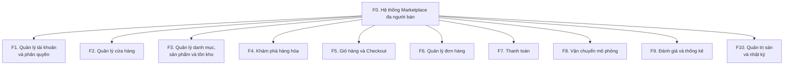
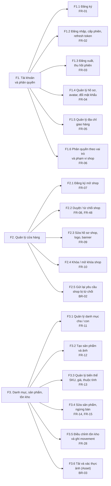
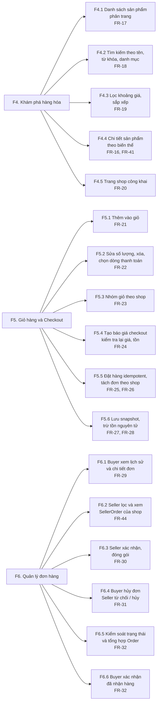
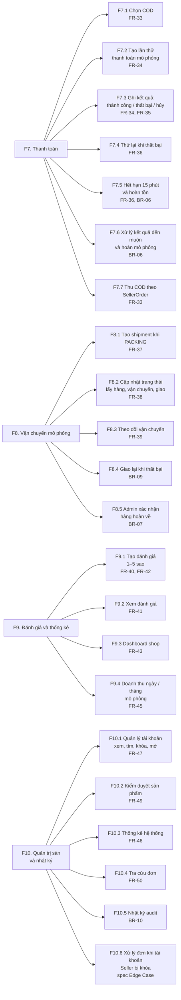

# BFD — Sơ đồ phân rã chức năng (Business Function Diagram)

**Dự án:** Multi-vendor Marketplace MVP
**Nguồn:** `specs/001-marketplace-mvp/spec.md` (FR-01–FR-50, BR-01–BR-10), `docs/requirements/srs.md`
**Phạm vi:** Phân rã hệ thống từ mức gốc xuống các chức năng lá. Mỗi chức năng lá gắn mã FR để truy vết.

> Quy ước mã: **F0** = hệ thống, **F1…F10** = nhóm chức năng cấp 1, **F1.1…** = chức năng cấp 2.
> Nhóm chức năng cấp 1 ánh xạ logic với module backend trong `apps/api/src/modules/*`: một nhóm có thể dùng nhiều module, và một module có thể phục vụ nhiều nhóm (xem bảng cuối tài liệu).

---

## 1. BFD cấp 1 — các nhóm chức năng của hệ thống

---

## 2. BFD cấp 2 — phân rã chi tiết

### 2.1. F1 Tài khoản · F2 Cửa hàng · F3 Danh mục/Sản phẩm/Tồn kho

### 2.2. F4 Khám phá · F5 Giỏ hàng/Checkout · F6 Đơn hàng

### 2.3. F7 Thanh toán · F8 Vận chuyển · F9 Đánh giá/Thống kê · F10 Quản trị

---

## 3. Bảng ánh xạ nhóm chức năng ↔ vai trò ↔ module

| Nhóm | Tên | Vai trò sử dụng | FR | Module backend (`apps/api/src/modules`) | Trạng thái code* |
| --- | --- | --- | --- | --- | --- |
| F1 | Tài khoản và phân quyền | Guest, Buyer, Seller, Admin | FR-01–06 | `identity` | Có controller |
| F2 | Quản lý cửa hàng | Buyer/Seller, Admin | FR-07–10, 48 | `shop` | Có controller |
| F3 | Danh mục, sản phẩm, tồn kho | Admin, Seller | FR-11–15, 28, 49 | `catalog`, `inventory` | Có route |
| F4 | Khám phá hàng hóa | Guest, Buyer | FR-16–20 | `catalog` (discovery) | Có controller |
| F5 | Giỏ hàng và Checkout | Buyer | FR-21–28 | `cart`, `order` | Có controller |
| F6 | Quản lý đơn hàng | Buyer, Seller, Admin | FR-29–32, 44, 50 | `order` | Có route (xem đơn, hủy, từ chối, confirm, pack, receive) |
| F7 | Thanh toán | Buyer, Seller, System | FR-33–36 | `payment` (+ `jobs` cho expiry) | Có controller |
| F8 | Vận chuyển mô phỏng | Seller, Admin, Buyer | FR-37–39 | `shipping` | Có route (module `shipping`) |
| F9 | Đánh giá và thống kê | Buyer, Seller | FR-40–45 | `review` | Chưa có (US8): reviews, thống kê, doanh thu |
| F10 | Quản trị sàn và nhật ký | Admin | FR-46–50 | `admin` (+ `shop`/`catalog`/`order` admin routes) | Có route (users, products, orders, stats, audit, recovery) |

\* Đối chiếu với **77 route thực tế** trong các `*.controller.ts` tại `main` (commit `8ee488a`). Module `review` còn trống (US8). Đây là đối chiếu mã nguồn, **không** phải kết quả chạy test hay nghiệm thu.

## 4. Độ phủ FR

Các nhóm F1–F10 phủ đủ FR-01–FR-50 của spec. Ngoài FR, BFD ghi thêm ba chức năng hỗ trợ từ BR/Edge Case để không bị bỏ sót khi thiết kế: **F2.5** (gửi lại shop bị từ chối), **F7.6** (kết quả thanh toán đến muộn), **F10.6** (Admin xử lý đơn khi tài khoản Seller bị khóa).
