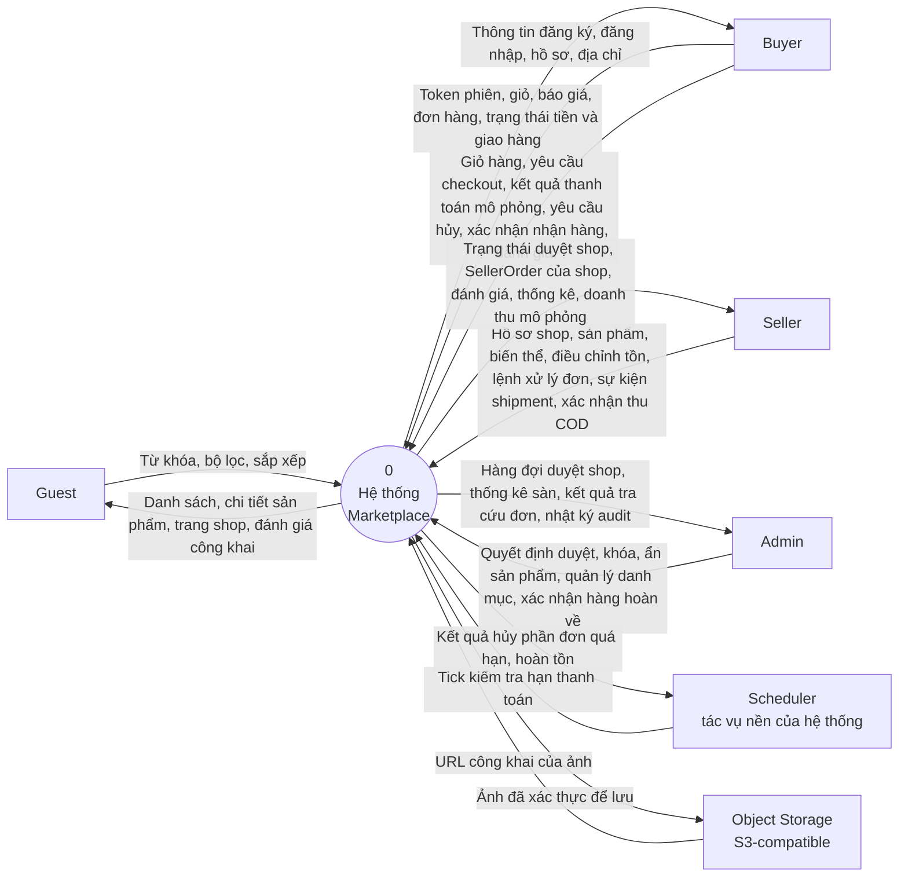
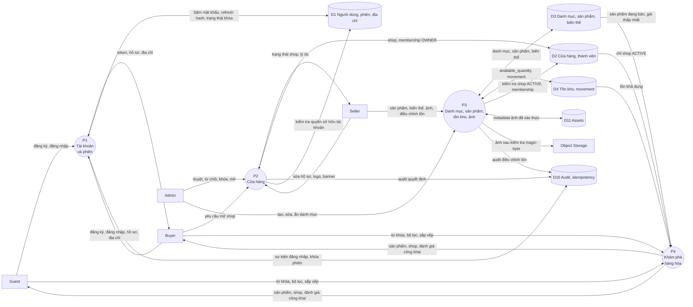
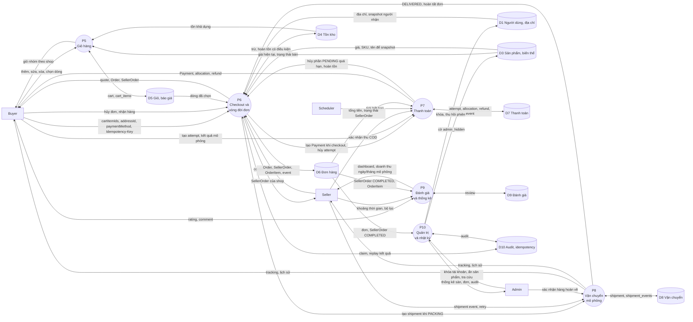
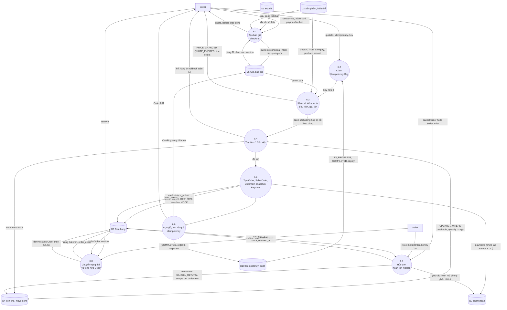
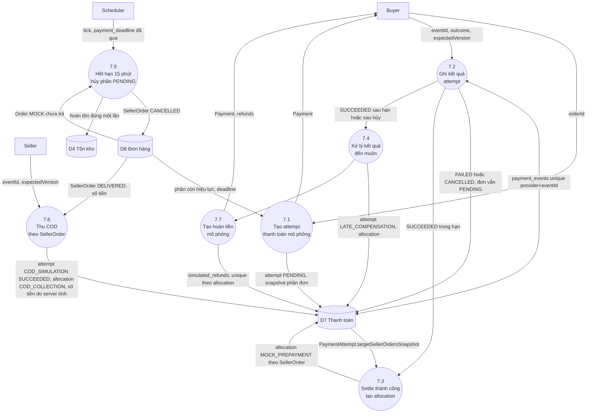

# DFD — Sơ đồ luồng dữ liệu (Data Flow Diagram)

**Dự án:** Multi-vendor Marketplace MVP
**Nguồn:** `spec.md`, `plan.md`, `data-model.md`, `contracts/api.md`, `apps/api/prisma/schema.prisma`
**Cấp độ:** Mức 0 (context) → Mức 1 (10 tiến trình) → Mức 2 (Checkout/Đơn hàng và Thanh toán, hai vùng có ràng buộc toàn vẹn cao nhất).

**Ký hiệu dùng trong Mermaid**

| Hình | Ý nghĩa |
| --- | --- |
| Hình chữ nhật `[ ]` | Tác nhân ngoài (external entity) |
| Hình tròn `(( ))` | Tiến trình (process) |
| Hình trụ `[( )]` | Kho dữ liệu (data store) |
| Mũi tên có nhãn | Luồng dữ liệu |

---

## 1. DFD mức 0 — sơ đồ ngữ cảnh

Hệ thống là một khối duy nhất (một Modular Monolith NestJS + PostgreSQL). Cổng thanh toán và vận chuyển đều **mô phỏng bên trong hệ thống**, không có tác nhân ngoài là ngân hàng hay hãng vận chuyển thật.

### Từ điển luồng dữ liệu mức 0

| Mã | Từ → Đến | Nội dung | FR liên quan |
| --- | --- | --- | --- |
| DF0-01 | Guest → Hệ thống | `q`, `categoryId`, `minPrice`, `maxPrice`, `sort`, `page` | FR-17–20 |
| DF0-02 | Hệ thống → Guest | Danh sách sản phẩm đủ điều kiện bán, chi tiết, shop ACTIVE, review | FR-16–20, 41 |
| DF0-03 | Buyer → Hệ thống | Email, mật khẩu, họ tên, địa chỉ, `cartItemIds`, `addressId`, `paymentMethod`, `Idempotency-Key` | FR-01–05, 21–25 |
| DF0-04 | Buyer → Hệ thống | Kết quả thanh toán mô phỏng (`SUCCEEDED/FAILED/CANCELLED`), yêu cầu hủy, nhận hàng, review | FR-31–36, 40 |
| DF0-05 | Hệ thống → Buyer | Access token, giỏ nhóm theo shop, quote (tổng tiền do server tính), Order, Payment, Shipment | FR-02, 23–25, 29, 39 |
| DF0-06 | Seller → Hệ thống | `ShopWrite`, `ProductCreate`, `InventoryAdjust`, lệnh confirm/pack/reject, `ShipmentEvent`, `CodCollection` | FR-07, 09, 12–15, 28, 30, 33, 38 |
| DF0-07 | Hệ thống → Seller | Trạng thái shop, SellerOrder (chỉ phần của shop mình), thống kê, doanh thu mô phỏng | FR-08, 43–45 |
| DF0-08 | Admin → Hệ thống | Duyệt/từ chối/khóa shop, `CategoryWrite`, khóa tài khoản, ẩn sản phẩm, xác nhận hàng hoàn về | FR-08, 10, 11, 15, 47–49 |
| DF0-09 | Hệ thống → Admin | Hàng đợi shop PENDING, thống kê sàn, đơn, audit | FR-46, 50 |
| DF0-10 | Scheduler → Hệ thống | Tick quét `payment_deadline` | FR-36, BR-06 |
| DF0-11 | Hệ thống ↔ Object Storage | Ảnh đã kiểm tra magic-byte/kích thước; URL công khai | BR-03 |

---

## 2. DFD mức 1 — 10 tiến trình chính

### Danh mục tiến trình

| Mã | Tiến trình | Module |
| --- | --- | --- |
| P1 | Quản lý tài khoản và phiên | `identity` |
| P2 | Quản lý cửa hàng | `shop` |
| P3 | Quản lý danh mục, sản phẩm, tồn kho, ảnh | `catalog`, `inventory` |
| P4 | Khám phá hàng hóa | `catalog` (discovery) |
| P5 | Quản lý giỏ hàng | `cart` |
| P6 | Checkout và vòng đời đơn hàng | `order` |
| P7 | Thanh toán, hoàn tiền mô phỏng | `payment` |
| P8 | Vận chuyển mô phỏng | `shipping` |
| P9 | Đánh giá và thống kê | `review` |
| P10 | Quản trị và nhật ký | `admin` |

### Danh mục kho dữ liệu

| Mã | Kho dữ liệu | Bảng PostgreSQL |
| --- | --- | --- |
| D1 | Người dùng và phiên | `users`, `sessions`, `addresses` |
| D2 | Cửa hàng | `shops`, `shop_members` |
| D3 | Danh mục và sản phẩm | `categories`, `products`, `product_images`, `product_variants` |
| D4 | Tồn kho | `inventory`, `inventory_movements` |
| D5 | Giỏ và báo giá | `carts`, `cart_items`, `checkout_quotes` |
| D6 | Đơn hàng | `marketplace_orders`, `seller_orders`, `order_items`, `order_events` |
| D7 | Thanh toán | `payments`, `payment_attempts`, `payment_allocations`, `simulated_refunds`, `payment_events` |
| D8 | Vận chuyển | `shipments`, `shipment_events` |
| D9 | Đánh giá | `reviews` — **đã thiết kế, chưa có trong `schema.prisma` (Sprint 6)** |
| D10 | Audit và idempotency | `audit_events`, `idempotency_records` |
| D11 | Tài nguyên ảnh | `assets` (+ object storage) |

### 2.1. DFD mức 1A — Định danh, Cửa hàng, Danh mục/Sản phẩm, Khám phá

### 2.2. DFD mức 1B — Giỏ hàng, Đơn hàng, Thanh toán, Vận chuyển, Đánh giá, Quản trị

---

## 3. DFD mức 2

### 3.1. P6 — Checkout và vòng đời đơn hàng

Đây là tiến trình quan trọng nhất của sàn (SC-003, SC-004): một Order tổng, nhiều SellerOrder, trừ tồn nguyên tử, idempotent.

Thứ tự P64–P65 thể hiện luồng logic, không áp đặt thứ tự ghi. Trong `CheckoutService.create`, `MarketplaceOrder` và `SellerOrder` được tạo trước khi P64 gọi `tx.inventory.updateMany`; nếu cập nhật tồn thất bại, transaction rollback cả các dòng đã tạo trước đó.

### 3.2. P7 — Thanh toán và hoàn tiền mô phỏng

---

## 4. Quy tắc nhất quán khi đọc DFD

1. **Tiền luôn do server tính.** Mọi luồng tiền tệ ra khỏi P6/P7 là chuỗi VND nguyên (`"150000"`), không nhận số tiền từ client (FR-24, contract).
2. **Dữ liệu lịch sử không bị ghi đè.** OrderItem/Shipment/Payment event chỉ thêm, snapshot không đổi theo catalog hoặc hồ sơ.
3. **Thứ tự khóa:** Idempotency → User/Cart → Quote → Order → Payment → SellerOrders → Shop → Category → Product → Variant → Inventory → Shipment (xem `docs/database/data-design.md`). DFD mức 2 tuân theo thứ tự này.
4. **Không gọi mạng/S3 trong transaction DB.** Luồng "ảnh → Object Storage" của P3 chạy ngoài transaction; sau khi lưu object thành công, service tạo asset trực tiếp ở trạng thái VERIFIED.
5. **D9 (đánh giá) chưa có trong schema thực tế**; P9 vì vậy vẫn là thiết kế. Các luồng đến D9 sẽ bắt đầu hoạt động từ Sprint 6.
