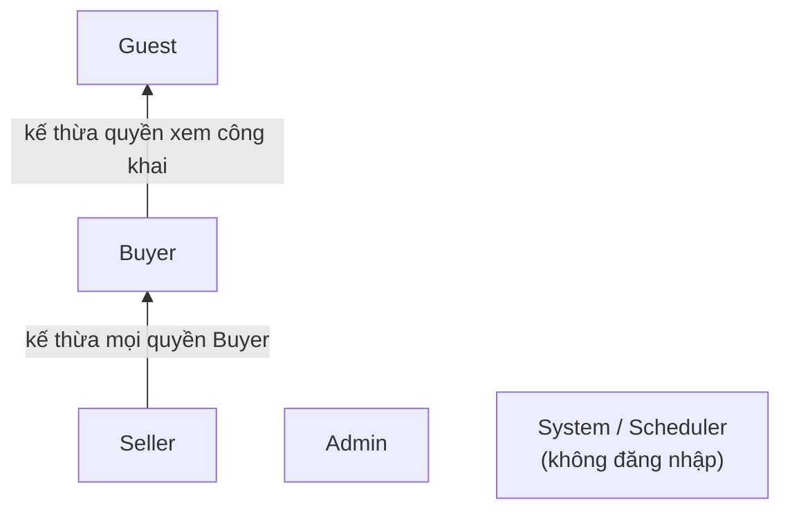
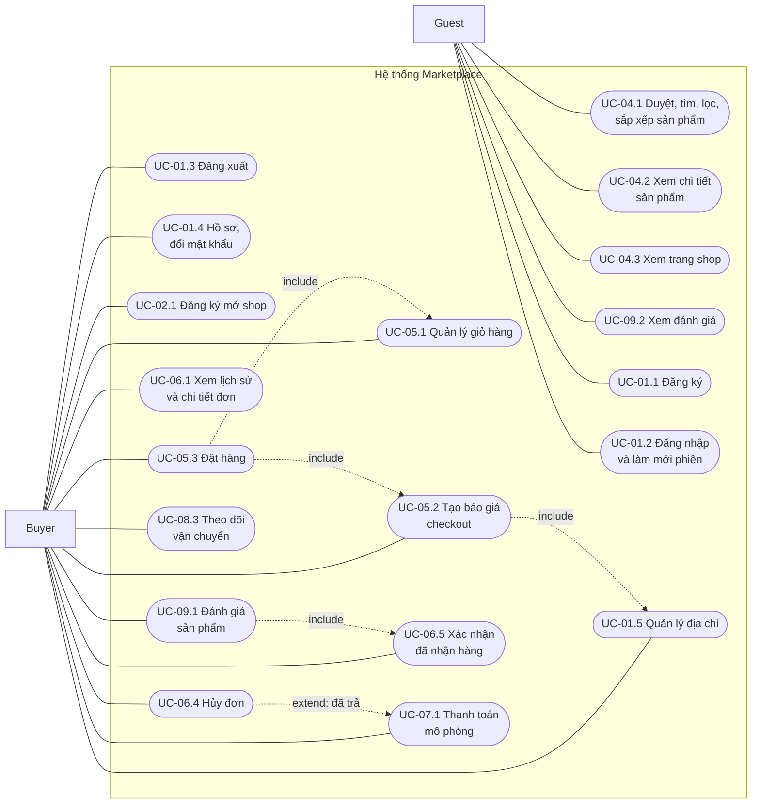
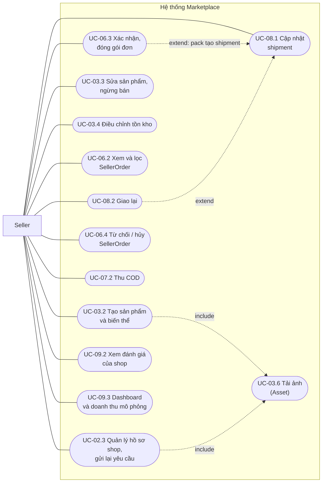
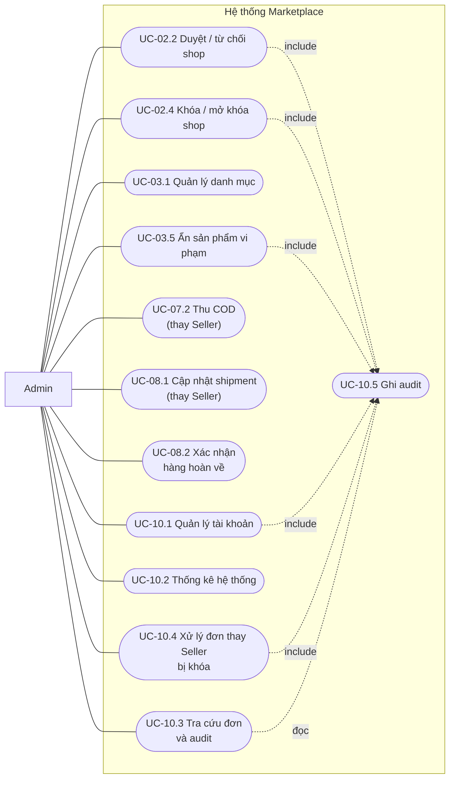
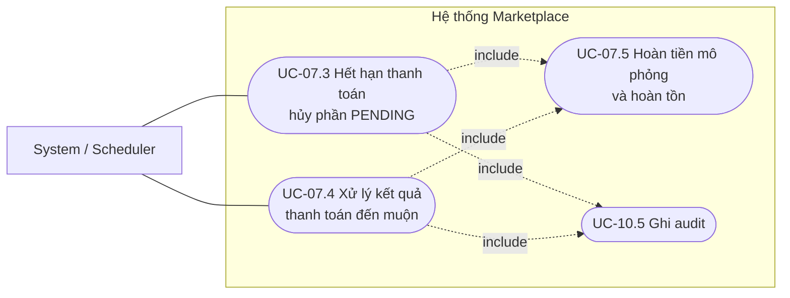

# Use Case — Sơ đồ và đặc tả

**Dự án:** Multi-vendor Marketplace MVP
**Nguồn:** `spec.md` (US1–US10, FR-01–50, BR-01–10), `docs/requirements/srs.md` (UC-01–UC-11), `contracts/api.md`
**Mục đích:** `srs.md` mới liệt kê 11 use case mức nhóm. Tài liệu này **phân rã thành 42 use case chi tiết** (UC-xx.y), có sơ đồ theo từng tác nhân và đặc tả luồng chính, luồng thay thế, tiền/hậu điều kiện, API và quy tắc nghiệp vụ.

> Quy ước: `UC-05.3` = use case thứ 3 của nhóm UC-05 trong SRS. Mã nhóm UC-01…UC-11 giữ nguyên theo `srs.md` để không lệch tài liệu.

---

## 1. Tác nhân (Actor)

| Actor | Mô tả | Cách xác định trong hệ thống |
| --- | --- | --- |
| Guest | Người chưa đăng nhập; chỉ duyệt dữ liệu công khai | Không có access token |
| Buyer | Người dùng đã đăng nhập; mua hàng, quản lý hồ sơ/địa chỉ/giỏ/đơn của mình | `users.system_role = BUYER`, `status = ACTIVE` |
| Seller | Buyer có thêm membership shop; **vẫn giữ mọi quyền Buyer** | `shop_members.status = ACTIVE`, vai trò `OWNER` hoặc `MANAGER`; quyền luôn kiểm tra lại trong DB theo `shopId` |
| Admin | Quản trị sàn; không tự đăng ký công khai | `users.system_role = ADMIN` |
| System / Scheduler | Tác vụ nền tin cậy: hết hạn thanh toán, xử lý kết quả muộn, ghi audit. **Không phải actor đăng nhập** | Job trong `modules/payment/jobs` |

---

## 2. Sơ đồ use case theo tác nhân

### 2.1. Guest và Buyer

### 2.2. Seller

### 2.3. Admin

### 2.4. System / Scheduler

---

## 3. Danh mục use case

| UC | Tên | Actor chính | FR | Module | Trạng thái code* |
| --- | --- | --- | --- | --- | --- |
| UC-01.1 | Đăng ký tài khoản | Guest | FR-01 | identity | Có controller |
| UC-01.2 | Đăng nhập và làm mới phiên | Guest | FR-02 | identity | Có controller |
| UC-01.3 | Đăng xuất | Buyer/Seller/Admin | FR-03 | identity | Có controller |
| UC-01.4 | Quản lý hồ sơ, đổi mật khẩu | Buyer | FR-04 | identity | Có controller |
| UC-01.5 | Quản lý địa chỉ | Buyer | FR-05 | identity | Có controller |
| UC-02.1 | Đăng ký mở shop | Buyer | FR-07 | shop | Có controller |
| UC-02.2 | Duyệt / từ chối shop | Admin | FR-08, 48 | shop | Có controller |
| UC-02.3 | Quản lý hồ sơ shop, gửi lại yêu cầu | Seller | FR-09 | shop | Có controller |
| UC-02.4 | Khóa / mở khóa shop | Admin | FR-10 | shop | Có controller |
| UC-03.1 | Quản lý danh mục | Admin | FR-11 | catalog | Có controller |
| UC-03.2 | Tạo sản phẩm và biến thể | Seller | FR-12, 13 | catalog | Có controller |
| UC-03.3 | Sửa sản phẩm, ngừng bán | Seller | FR-14, 15 | catalog | Có controller |
| UC-03.4 | Điều chỉnh tồn kho | Seller | FR-28 | inventory | Có controller |
| UC-03.5 | Ẩn sản phẩm vi phạm | Admin | FR-15, 49 | admin | Có route |
| UC-03.6 | Tải và xác thực ảnh | Buyer/Seller | BR-03 | identity + catalog/media | Có route |
| UC-04.1 | Duyệt, tìm, lọc, sắp xếp | Guest/Buyer | FR-17–19 | catalog | Có controller |
| UC-04.2 | Xem chi tiết sản phẩm | Guest/Buyer | FR-16, 41 | catalog | Một phần: có chi tiết, chưa có `/products/{id}/reviews` |
| UC-04.3 | Xem trang shop công khai | Guest/Buyer | FR-20 | shop/catalog | Có controller |
| UC-05.1 | Quản lý giỏ hàng | Buyer | FR-21–23 | cart | Có controller |
| UC-05.2 | Tạo báo giá checkout | Buyer | FR-24 | order | Có controller |
| UC-05.3 | Đặt hàng (checkout) | Buyer | FR-25–28 | order | Có controller |
| UC-06.1 | Xem lịch sử, chi tiết đơn | Buyer | FR-29 | order | Có controller |
| UC-06.2 | Xem và lọc SellerOrder | Seller | FR-44 | order | Có route |
| UC-06.3 | Xác nhận, đóng gói đơn | Seller | FR-30, 32 | order | Có route |
| UC-06.4 | Hủy đơn / từ chối đơn | Buyer, Seller | FR-31 | order | Có route (Buyer hủy đơn/phần, Seller reject) |
| UC-06.5 | Xác nhận đã nhận hàng | Buyer | FR-32 | order | Có route |
| UC-07.1 | Thanh toán mô phỏng | Buyer | FR-34–36 | payment | Có controller |
| UC-07.2 | Thu COD | Seller/Admin | FR-33 | payment | Có controller |
| UC-07.3 | Hết hạn thanh toán | System | FR-36 | payment/jobs | Có job |
| UC-07.4 | Kết quả thanh toán đến muộn | System | FR-35, 36 | payment | Có controller |
| UC-07.5 | Hoàn tiền mô phỏng và hoàn tồn | System | FR-28, 31 | payment, order | Có service |
| UC-08.1 | Cập nhật shipment | Seller/Admin | FR-37, 38 | shipping | Có route |
| UC-08.2 | Giao lại; xác nhận hàng hoàn về | Seller, Admin | FR-38, BR-07 | shipping | Có route |
| UC-08.3 | Theo dõi vận chuyển | Buyer/Seller | FR-39 | shipping | Có route |
| UC-09.1 | Đánh giá sản phẩm | Buyer | FR-40, 42 | review | Chưa có (US8) |
| UC-09.2 | Xem đánh giá | Guest/Seller | FR-41 | review | Chưa có (US8) |
| UC-09.3 | Dashboard và doanh thu mô phỏng | Seller | FR-43, 45 | review/stats | Chưa có (US8) |
| UC-10.1 | Quản lý tài khoản | Admin | FR-47 | admin | Có route |
| UC-10.2 | Thống kê hệ thống | Admin | FR-46 | admin | Có route |
| UC-10.3 | Tra cứu đơn và audit | Admin | FR-50 | admin | Có route |
| UC-10.4 | Xử lý đơn thay Seller bị khóa | Admin | Edge Case | admin, order | Có route (`admin/seller-orders/:id/confirm`, `pack`, `reject`) |
| UC-10.5 | Ghi audit | System | BR-10 | common | Có model |

\* Đối chiếu với **78 route thực tế** trong các `*.controller.ts` tại `main` (commit `8ee488a`). Contract còn thiếu 5/80 route, đều thuộc US8 (reviews, thống kê và doanh thu Seller). "Có route" nghĩa là endpoint tồn tại trong mã; **không** phải kết quả chạy test hay xác nhận nghiệm thu (xem `docs/testing/us*-evidence.md`).

---

## 4. Đặc tả use case

> Chung cho mọi API ghi: lỗi theo envelope `{error:{code,message,details?,requestId}}`; 401 thiếu/hết phiên, 403 thiếu quyền hoặc tài khoản khóa, 404 với tài nguyên riêng không thuộc quyền đọc. Ghi nhạy cảm cần header `Idempotency-Key` (UUID). Hành động đổi trạng thái cần `expectedVersion`.

### UC-01 — Tài khoản và phân quyền

#### UC-01.1 Đăng ký tài khoản

| Mục | Nội dung |
| --- | --- |
| Actor | Guest |
| Yêu cầu | FR-01 · BR-01 |
| API | `GET /auth/csrf` (Web) → `POST /auth/register` |
| Tiền điều kiện | Chưa đăng nhập. Web: có CSRF token và Origin nằm trong allowlist. |
| Kích hoạt | Guest chọn "Đăng ký". |
| Luồng chính | 1. Guest nhập email, mật khẩu (12–128 ký tự, được chứa khoảng trắng), họ tên (1–120), `clientPlatform`. 2. Hệ thống chuẩn hóa email (trim, lowercase). 3. Kiểm tra định dạng và email chưa tồn tại. 4. Tạo `User` (role BUYER, status ACTIVE), lưu hash mật khẩu. 5. Tạo `Session`, cấp access JWT 10 phút; refresh token đặt trong cookie HttpOnly (Web) hoặc trả trong body (native). 6. Trả 201 `Tokens`. |
| Luồng thay thế | 3a. Email đã tồn tại (không phân biệt hoa/thường) → 409 `EMAIL_TAKEN`. 3b. Dữ liệu sai định dạng/độ dài → lỗi theo từng trường. 3c. Body chứa trường lạ (ví dụ cố gán role) → bị từ chối. |
| Hậu điều kiện | Có một User và một Session. Không có role ADMIN nào được cấp qua API này. |
| Ghi chú | Admin chỉ được tạo bằng quy trình seed/thiết lập có kiểm soát. |

#### UC-01.2 Đăng nhập và làm mới phiên

| Mục | Nội dung |
| --- | --- |
| Actor | Guest |
| Yêu cầu | FR-02 · BR-01 |
| API | `POST /auth/login`, `POST /auth/refresh` |
| Tiền điều kiện | Tài khoản tồn tại; Web có CSRF token. |
| Luồng chính | 1. Guest gửi email, mật khẩu, `clientPlatform`. 2. Hệ thống tìm user theo email chuẩn hóa, so khớp hash. 3. Tạo Session mới, cấp access token (10 phút) và refresh token (7 ngày). 4. Khi access token hết hạn, client gọi `/auth/refresh`; hệ thống **rotate** refresh token (token cũ gắn `replaced_by_session_id`). |
| Luồng thay thế | 2a. Sai email hoặc mật khẩu → 401 `INVALID_CREDENTIALS` (thông báo chung, không lộ email có tồn tại). 2b. Tài khoản LOCKED → 403. 2c. Vượt giới hạn tần suất → 429. 4a. Refresh token cũ bị dùng lại → thu hồi cả `family_id`, trả 401 `REFRESH_REUSE`. |
| Hậu điều kiện | Có Session hợp lệ; refresh cũ không dùng lại được. |
| Ghi chú | Native lưu refresh token trong SecureStore (Mobile) hoặc Stronghold (Desktop); Web giữ access token trong bộ nhớ, không dùng localStorage. |

#### UC-01.3 Đăng xuất

| Mục | Nội dung |
| --- | --- |
| Actor | Buyer / Seller / Admin |
| Yêu cầu | FR-03 · BR-01 |
| API | `POST /auth/logout` |
| Luồng chính | 1. Người dùng chọn đăng xuất. 2. Hệ thống thu hồi (`revoked_at`) Session tương ứng. 3. Trả 204; client xóa cache query của user/shop. |
| Luồng thay thế | Gửi lại yêu cầu với access token của phiên đã thu hồi → `AccessGuard` từ chối với 401 `INVALID_ACCESS_TOKEN`. |
| Hậu điều kiện | Session không thể refresh. |

#### UC-01.4 Quản lý hồ sơ và đổi mật khẩu

| Mục | Nội dung |
| --- | --- |
| Actor | Buyer / Seller / Admin |
| Yêu cầu | FR-04 · BR-01 |
| API | `GET/PATCH /users/me`, `POST /users/me/password`, `POST /users/me/assets` (avatar) |
| Tiền điều kiện | Đã đăng nhập. |
| Luồng chính | 1. Người dùng sửa họ tên (1–120), số điện thoại (8–20), ảnh đại diện (đã upload trước, `AVATAR`). 2. Hệ thống chỉ cập nhật các trường được gửi. 3. Đổi mật khẩu: gửi mật khẩu hiện tại + mật khẩu mới (12–128). 4. Hệ thống cập nhật hash, **thu hồi các phiên khác**. |
| Luồng thay thế | 1a. `avatarAssetId` không thuộc user → 404. 1b. Ảnh sai định dạng → 415; quá 5 MB → 413. 3a. Mật khẩu hiện tại sai → 422. |
| Hậu điều kiện | Hồ sơ cập nhật; sau đổi mật khẩu chỉ phiên hiện tại còn hiệu lực. |

#### UC-01.5 Quản lý địa chỉ giao hàng

| Mục | Nội dung |
| --- | --- |
| Actor | Buyer |
| Yêu cầu | FR-05 |
| API | `GET/POST /users/me/addresses`, `PATCH/DELETE /users/me/addresses/{id}` |
| Luồng chính | 1. Buyer thêm/sửa địa chỉ (người nhận, SĐT, địa chỉ, phường, quận, tỉnh, `country = VN`). 2. Buyer có thể đặt một địa chỉ mặc định. 3. Xóa địa chỉ là xóa mềm (`deleted_at`). |
| Luồng thay thế | Hai yêu cầu đặt mặc định đồng thời → chỉ một địa chỉ mặc định thắng. Xóa địa chỉ mặc định → không còn địa chỉ mặc định; Buyer phải chọn lại trước checkout. |
| Hậu điều kiện | Tối đa một địa chỉ mặc định. Snapshot địa chỉ trong đơn đã tạo **không đổi**. |

---

### UC-02 — Cửa hàng

#### UC-02.1 Đăng ký mở shop

| Mục | Nội dung |
| --- | --- |
| Actor | Buyer |
| Yêu cầu | FR-07 · BR-02 |
| API | `POST /users/me/assets` (logo) → `POST /shops` |
| Tiền điều kiện | Đã đăng nhập; đã upload logo (`SHOP_LOGO`) thuộc chính mình. |
| Luồng chính | 1. Buyer nhập tên (1–150), slug (`[a-z0-9]+(-[a-z0-9]+)*`, 3–80), mô tả, logo, địa chỉ liên hệ, số điện thoại. 2. Hệ thống chuẩn hóa slug và kiểm tra duy nhất. 3. Trong một transaction: tạo `Shop` trạng thái PENDING và `ShopMember` (OWNER, ACTIVE). |
| Luồng thay thế | Slug trùng → 409. Logo không hợp lệ hoặc của người khác → từ chối. |
| Hậu điều kiện | Shop PENDING, **chưa** hiển thị công khai và chưa bán được. |

#### UC-02.2 Duyệt hoặc từ chối shop

| Mục | Nội dung |
| --- | --- |
| Actor | Admin |
| Yêu cầu | FR-08, FR-48 · BR-02 |
| API | `GET /admin/shops?status=PENDING`, `POST /admin/shops/{id}/approve`, `POST /admin/shops/{id}/reject` |
| Tiền điều kiện | Shop đang PENDING. |
| Luồng chính | 1. Admin xem hàng đợi. 2. Duyệt: gửi `expectedVersion` → Shop ACTIVE, ghi `approved_at`. 3. Từ chối: gửi lý do (1–500) → Shop REJECTED, lưu `decision_reason`. 4. Ghi audit (ai, lúc nào, đối tượng, lý do). |
| Luồng thay thế | Shop không còn PENDING hoặc `version` cũ → 409 (quyết định trùng bị chặn). |
| Hậu điều kiện | Seller thấy kết quả. Chỉ shop ACTIVE bán công khai. Slug không đổi được sau khi duyệt. |

#### UC-02.3 Quản lý hồ sơ shop và gửi lại yêu cầu

| Mục | Nội dung |
| --- | --- |
| Actor | Seller (thành viên shop) |
| Yêu cầu | FR-09 · BR-02 |
| API | `GET /shops/{id}/management`, `PATCH /shops/{id}` (management), `POST /shops/{id}/resubmit` |
| Luồng chính | 1. Seller sửa tên, mô tả, logo, banner, liên hệ (kèm `expectedVersion`). 2. Nếu shop bị REJECTED, Seller sửa rồi gửi lại → trạng thái về PENDING. |
| Luồng thay thế | Seller của shop A truy cập shop B → 404. Đổi slug sau lần duyệt đầu → từ chối. Xung đột `version` → 409. |
| Hậu điều kiện | Hồ sơ cập nhật; Guest chỉ thấy hồ sơ công khai (không lộ địa chỉ liên hệ, SĐT riêng, lý do từ chối, version). |

#### UC-02.4 Khóa / mở khóa shop

| Mục | Nội dung |
| --- | --- |
| Actor | Admin |
| Yêu cầu | FR-10 · BR-02 |
| API | `POST /admin/shops/{id}/suspend`, `POST /admin/shops/{id}/resume` |
| Luồng chính | 1. Admin khóa shop ACTIVE kèm lý do → SUSPENDED. 2. Admin mở khóa → ACTIVE. |
| Hậu điều kiện | Shop SUSPENDED: sản phẩm không hiển thị/mua mới, checkout mới bị chặn. **Seller vẫn xử lý được đơn cũ** (nếu tài khoản còn hoạt động). Lịch sử không mất. |

---

### UC-03 — Danh mục, sản phẩm, tồn kho

#### UC-03.1 Quản lý danh mục

| Mục | Nội dung |
| --- | --- |
| Actor | Admin |
| Yêu cầu | FR-11 · BR-02 |
| API | `GET/POST /admin/categories`, `PATCH /admin/categories/{id}` |
| Luồng chính | 1. Admin tạo danh mục (tên 1–120, `parentId?`, `visible`). 2. Sửa tên, đổi cha, hoặc ẩn. |
| Luồng thay thế | Cha không tồn tại/đang ẩn → 422. Đặt cha là chính nó hoặc hậu duệ → 409 (chống chu trình). |
| Hậu điều kiện | Cây danh mục không có chu trình. Danh mục ẩn: không chọn cho sản phẩm mới, hàng thuộc danh mục đó không mua mới; đơn cũ giữ nguyên. Không có thao tác xóa danh mục trong MVP. |

#### UC-03.2 Tạo sản phẩm và biến thể

| Mục | Nội dung |
| --- | --- |
| Actor | Seller |
| Yêu cầu | FR-12, FR-13 · BR-03 |
| API | `POST /users/me/assets` (PRODUCT_IMAGE) → `POST /shops/{shopId}/products` |
| Tiền điều kiện | Seller là thành viên ACTIVE của shop; **shop đang ACTIVE**. |
| Luồng chính | 1. Seller upload 1–10 ảnh. 2. Nhập tên (1–200), mô tả, danh mục, trạng thái bán, danh sách biến thể (1–100): SKU, thuộc tính (tối đa 10), giá > 0, tồn ≥ 0. 3. Trong một transaction tạo `Product`, `ProductImage`, `ProductVariant`, `Inventory` và movement `INITIAL`. 4. Trả 201 `Product`. |
| Luồng thay thế | Shop chưa ACTIVE → từ chối. SKU trùng trong shop → 409; tổ hợp thuộc tính trùng trong cùng sản phẩm → 409. Ảnh không thuộc shop/sai định dạng/quá 5 MB → từ chối. Danh mục ẩn/không hợp lệ → 422. |
| Hậu điều kiện | Mọi biến thể có giá và tồn riêng; toàn bộ thành công hoặc không có gì được tạo. |
| Ghi chú | Mỗi sản phẩm có ít nhất một biến thể, kể cả hàng không có lựa chọn. Giá VND là số nguyên dương. |

#### UC-03.3 Sửa sản phẩm, ngừng bán

| Mục | Nội dung |
| --- | --- |
| Actor | Seller |
| Yêu cầu | FR-14, FR-15 · BR-03 |
| API | `PATCH /shops/{shopId}/products/{id}`, `POST .../variants`, `PATCH /shops/{shopId}/variants/{id}` |
| Luồng chính | 1. Seller sửa tên, mô tả, ảnh, giá, danh mục, trạng thái bán; thêm hoặc ngừng bán biến thể (kèm `expectedVersion`). 2. Hệ thống áp dụng thay đổi cho catalog hiện tại. |
| Luồng thay thế | Cố gán sản phẩm sang shop khác → từ chối. Cố sửa tồn qua `VariantPatch` → không có trường này (phải dùng UC-03.4). Cross-shop → 404. |
| Hậu điều kiện | **Đơn cũ giữ nguyên snapshot** (tên, SKU, giá, ảnh). Hàng ngừng bán không mua mới nhưng lịch sử còn. |

#### UC-03.4 Điều chỉnh tồn kho

| Mục | Nội dung |
| --- | --- |
| Actor | Seller |
| Yêu cầu | FR-28 · BR-03, BR-04 |
| API | `GET /shops/{shopId}/variants/{id}/inventory`, `POST .../inventory-adjustments` |
| Luồng chính | 1. Seller gửi `delta` khác 0, lý do (1–500), `expectedVersion`. 2. Hệ thống áp dụng delta, tạo movement `ADJUST`, tăng `version`. |
| Luồng thay thế | Version cũ → 409. Kết quả sẽ âm → từ chối. |
| Hậu điều kiện | Tồn ≥ 0 và truy vết được qua movement. Không có thao tác "ghi đè tuyệt đối" làm mất lượng đã bán. |

#### UC-03.5 Ẩn sản phẩm vi phạm

| Mục | Nội dung |
| --- | --- |
| Actor | Admin |
| Yêu cầu | FR-15, FR-49 |
| API | `GET /admin/products`, `POST /admin/products/{id}/hide` |
| Luồng chính | 1. Admin chọn sản phẩm, nhập lý do. 2. Hệ thống đặt `admin_hidden = true`, lưu `hidden_reason`, ghi audit. |
| Hậu điều kiện | Sản phẩm biến mất khỏi công khai và không mua mới. Seller **không tự gỡ** cờ này. Snapshot đơn cũ nguyên vẹn. |

#### UC-03.6 Tải và xác thực ảnh

| Mục | Nội dung |
| --- | --- |
| Actor | Buyer / Seller |
| Yêu cầu | BR-03 |
| API | `POST /users/me/assets` (multipart, đúng một file) |
| Luồng chính | 1. Client gửi file kèm `purpose` (`AVATAR`, `SHOP_LOGO`, `SHOP_BANNER`, `PRODUCT_IMAGE`) và `shopId` nếu có. 2. Hệ thống kiểm tra magic-byte, MIME (JPEG/PNG/WebP), dung lượng ≤ 5 MB, kích thước ảnh, quyền sở hữu. 3. Lưu object ra storage **ngoài transaction DB**; tạo trực tiếp `Asset` với trạng thái VERIFIED. |
| Luồng thay thế | Sai định dạng → 415; quá lớn → 413; file giả mạo đuôi → từ chối, không công khai. |
| Hậu điều kiện | Chỉ asset VERIFIED mới được gắn vào shop/sản phẩm/hồ sơ. |

---

### UC-04 — Khám phá hàng hóa

#### UC-04.1 Duyệt, tìm kiếm, lọc, sắp xếp

| Mục | Nội dung |
| --- | --- |
| Actor | Guest, Buyer |
| Yêu cầu | FR-17, 18, 19 · BR-03 |
| API | `GET /products?q&categoryId&shopId&minPrice&maxPrice&sort&page&pageSize` |
| Luồng chính | 1. Người dùng nhập từ khóa/chọn danh mục/khoảng giá/sắp xếp (`PRICE_ASC`, `PRICE_DESC`, `NEWEST`). 2. Hệ thống chỉ lấy hàng **đủ điều kiện bán**: sản phẩm ACTIVE, không `admin_hidden`, danh mục VISIBLE, shop ACTIVE, có ít nhất một biến thể ACTIVE. 3. Giá đại diện = giá thấp nhất của các biến thể đang bán; thứ tự luôn thêm `id` làm tie-break. 4. Trả `ProductSummary` có phân trang (mặc định 20, tối đa 100). |
| Luồng thay thế | Khoảng giá sai (min > max) → 400. Không có kết quả → trạng thái rỗng. Hết hàng vẫn xuất hiện nhưng `available = false`. |
| Hậu điều kiện | Không lộ dữ liệu ẩn/khóa hoặc trường quản trị. |

#### UC-04.2 Xem chi tiết sản phẩm

| Mục | Nội dung |
| --- | --- |
| Actor | Guest, Buyer |
| Yêu cầu | FR-16, FR-41 |
| API | `GET /products/{id}`, `GET /products/{id}/reviews` |
| Luồng chính | 1. Người dùng mở sản phẩm. 2. Hệ thống trả tên, ảnh, mô tả, biến thể (giá, tồn khả dụng), shop, điểm trung bình, số đánh giá. 3. Chọn biến thể → UI hiển thị giá/tồn tương ứng. |
| Luồng thay thế | Sản phẩm ẩn/ngừng bán/shop khóa → 404. Hết hàng → xem được, không thêm vào giỏ. |

#### UC-04.3 Xem trang shop công khai

| Mục | Nội dung |
| --- | --- |
| Actor | Guest, Buyer |
| Yêu cầu | FR-20 |
| API | `GET /shops/{id}`, `GET /shops/{id}/products` |
| Luồng chính | Hệ thống trả tên, mô tả, logo và danh sách sản phẩm đang bán của shop ACTIVE. |
| Luồng thay thế | Shop không ACTIVE → 404. |
| Ghi chú | Không trả địa chỉ liên hệ, SĐT riêng, lý do từ chối hay version. |

---

### UC-05 — Giỏ hàng và checkout

#### UC-05.1 Quản lý giỏ hàng

| Mục | Nội dung |
| --- | --- |
| Actor | Buyer |
| Yêu cầu | FR-21, 22, 23 · BR-04 |
| API | `GET /cart`, `POST /cart/items`, `PATCH/DELETE /cart/items/{id}` |
| Luồng chính | 1. Buyer chọn biến thể và số lượng (1–999) để thêm vào giỏ. 2. Thêm lại cùng biến thể → **cộng dồn** (tổng ≤ 999). 3. Buyer tăng/giảm số lượng, xóa dòng, bật/tắt `selected`. 4. Giỏ được nhóm theo shop, có tổng tạm tính của các dòng đã chọn. |
| Luồng thay thế | Biến thể ngừng bán/hết hàng/thiếu tồn → 422. Dòng của người khác → 404. Dòng cũ không còn hợp lệ vẫn hiển thị, kèm `purchasable = false` và lý do. |
| Hậu điều kiện | Giỏ gắn tài khoản, đồng bộ giữa thiết bị sau tải lại. **Không giữ tồn** khi thêm vào giỏ. |

#### UC-05.2 Tạo báo giá checkout

| Mục | Nội dung |
| --- | --- |
| Actor | Buyer |
| Yêu cầu | FR-24 · BR-04, BR-05 |
| API | `POST /checkout/quotes` |
| Tiền điều kiện | Có ít nhất một dòng đã chọn; có địa chỉ giao hàng; chọn `COD` hoặc `MOCK`. |
| Luồng chính | 1. Buyer gửi `cartItemIds`, `addressId`, `paymentMethod`. 2. Hệ thống kiểm tra các dòng và địa chỉ thuộc Buyer. 3. Đọc **giá và tồn hiện tại** từ catalog; tính thành tiền từng dòng, tổng theo shop, phí giao = 0. 4. Chỉ lưu `CheckoutQuote` (cart version, snapshot người nhận, `canonical_hash`, hết hạn sau 5 phút) khi mọi dòng hợp lệ và tổng > 0. 5. Trả kết quả kèm danh sách `issues` theo từng dòng. |
| Luồng thay thế | Dòng không hợp lệ → kết quả `valid = false` và liệt kê đầy đủ lỗi từng dòng, không dừng ở lỗi đầu tiên; không lưu quote. Tổng không lớn hơn 0 cũng không lưu quote. |
| Hậu điều kiện | Chưa tạo đơn, chưa trừ tồn. Giá client gửi lên (nếu có) không được dùng. |

#### UC-05.3 Đặt hàng (Checkout)

| Mục | Nội dung |
| --- | --- |
| Actor | Buyer |
| Yêu cầu | FR-25, 26, 27, 28 · BR-04, BR-05 · SC-003, SC-004 |
| API | `POST /checkout` (`quoteId` + `Idempotency-Key`) |
| Tiền điều kiện | Quote còn hạn, thuộc Buyer. Include UC-05.2. |
| Luồng chính | 1. Buyer xác nhận quote. 2. Trong transaction, hệ thống **claim Idempotency-Key** (nếu key đã COMPLETED thì trả lại đơn cũ). 3. Khóa User, Cart, Quote, Shop, Category, Product, Variant và Inventory theo thứ tự cố định. 4. Kiểm tra lại shop ACTIVE, sản phẩm đang bán, biến thể hợp lệ, giá, tồn so với quote. 5. Tạo `MarketplaceOrder` (deadline +15 phút nếu MOCK), rồi tạo từng `SellerOrder`; với mỗi dòng, **trừ tồn có điều kiện** (`available_quantity >= qty`), tạo `OrderItem` snapshot và movement `SALE`. 6. Tạo `Payment`; checkout chưa tạo attempt COD. 7. Xóa đúng các dòng đã mua khỏi giỏ; lưu kết quả idempotency; commit. 8. Trả 201 `Order`; nếu trừ tồn thất bại, rollback cả đơn và các phần đã tạo. |
| Luồng thay thế | 4a. Giá đổi → 409 `PRICE_CHANGED`; client tạo quote mới qua `POST /checkout/quotes` và Buyer xác nhận lại. 4b. Quote hết hạn → 409 `QUOTE_EXPIRED`. 4c. Thiếu hàng, shop bị khóa, biến thể ngừng bán → báo lỗi theo dòng, **rollback toàn bộ**, không tạo đơn một phần. 2a. Cùng key + cùng nội dung → trả đúng đơn cũ. Cùng key khác nội dung → 409 `IDEMPOTENCY_KEY_REUSED`. 7a. Mất kết nối sau khi xác nhận → UI tra cứu đơn rồi gửi lại cùng key, không tạo đơn thứ hai. |
| Hậu điều kiện | Một Order + N SellerOrder (PENDING); tồn đã trừ; tổng Order = tổng các SellerOrder. Snapshot không đổi khi Seller sửa hàng hoặc Buyer đổi địa chỉ. |
| Ghi chú | 20 yêu cầu đồng thời cho 5 đơn vị tồn → đúng 5 thành công, 15 báo hết hàng, tồn cuối bằng 0. |

---

### UC-06 — Quản lý đơn hàng

#### UC-06.1 Xem lịch sử và chi tiết đơn

| Mục | Nội dung |
| --- | --- |
| Actor | Buyer |
| Yêu cầu | FR-29 · BR-08 |
| API | `GET /orders`, `GET /orders/{id}`, `GET /payments?orderId=` |
| Luồng chính | 1. Buyer xem danh sách đơn (lọc `status`, `paymentStatus`, khoảng ngày). 2. Mở chi tiết: từng SellerOrder (trạng thái riêng), OrderItem, tiền gốc/đã hủy/đã trả/đã hoàn/còn phải trả, shipment. |
| Luồng thay thế | Đơn của người khác → 404 (không lộ sự tồn tại). |
| Ghi chú | Trạng thái Order tổng được **derive** theo BR-08, không nhận từ client. `paymentStatus` ∈ UNPAID, PARTIALLY_PAID, PAID, PARTIALLY_REFUNDED, REFUNDED, tính từ tổng thu/hoàn. |

#### UC-06.2 Seller xem và lọc SellerOrder

| Mục | Nội dung |
| --- | --- |
| Actor | Seller |
| Yêu cầu | FR-44 · FR-26 |
| API | `GET /shops/{shopId}/orders`, `GET /shops/{shopId}/orders/{id}` |
| Luồng chính | Seller lọc theo trạng thái/ngày và xem chi tiết SellerOrder của shop mình. |
| Luồng thay thế | `id` thuộc shop khác → 404. |
| Hậu điều kiện | Không thấy phần đơn của shop khác, không thấy thông tin xác thực thanh toán. |

#### UC-06.3 Xác nhận và đóng gói đơn

| Mục | Nội dung |
| --- | --- |
| Actor | Seller |
| Yêu cầu | FR-30, FR-32 · BR-07 |
| API | `POST /shops/{shopId}/orders/{id}/confirm`, `.../pack` |
| Tiền điều kiện | Seller thuộc shop; SellerOrder đang ở trạng thái đứng trước bước cần chuyển. |
| Luồng chính | 1. Confirm: PENDING → CONFIRMED (với MOCK **phải đã trả**; COD được phép chưa thu). 2. Pack: CONFIRMED → PACKING; trong cùng transaction tạo đúng một `Shipment` WAITING_PICKUP. 3. Ghi `order_event` (ai, lúc nào, từ-đến); cập nhật trạng thái Order tổng. |
| Luồng thay thế | Nhảy bước, đi ngược, thao tác trên CANCELLED/COMPLETED → 409, không đổi dữ liệu. Version cũ → 409. MOCK chưa trả → từ chối. |
| Hậu điều kiện | Chuỗi trạng thái hợp lệ: PENDING → CONFIRMED → PACKING → SHIPPING → DELIVERED → COMPLETED. |

#### UC-06.4 Hủy đơn / từ chối đơn

| Mục | Nội dung |
| --- | --- |
| Actor | Buyer, Seller |
| Yêu cầu | FR-31, FR-28 · BR-07 |
| API | `POST /orders/{id}/cancel`, `POST /orders/{id}/seller-orders/{sid}/cancel`, `POST /shops/{shopId}/orders/{id}/reject` |
| Luồng chính | A. **Buyer hủy cả đơn:** chỉ thành công khi **mọi phần chưa hủy đều PENDING**; hủy nguyên tử tất cả. B. **Buyer hủy riêng một SellerOrder** đang PENDING; phần khác không đổi. C. **Seller từ chối** SellerOrder PENDING, hoặc hủy CONFIRMED trước PACKING, kèm lý do. D. Mỗi lần hủy hợp lệ: chuyển CANCELLED, **hoàn tồn đúng một lần** (movement `CANCEL_RETURN`), nếu phần đó đã trả thì tạo hoàn tiền mô phỏng đúng giá trị. |
| Luồng thay thế | Có phần đã CONFIRMED trở đi → từ chối toàn hành động, trả 409 kèm các phần không đủ điều kiện (Buyer có thể hủy riêng phần PENDING). Sau PACKING không hủy trực tiếp. Phần COD chưa thu → không phát sinh hoàn tiền. Gửi lại cùng `Idempotency-Key` → không hoàn tồn/tiền lần hai. |
| Hậu điều kiện | Giá trị gốc của Order được bảo toàn; hiển thị riêng giá trị hủy/đã trả/hoàn/còn phải trả. Một attempt thanh toán MOCK đang PENDING bị chuyển CANCELLED. |

#### UC-06.5 Xác nhận đã nhận hàng

| Mục | Nội dung |
| --- | --- |
| Actor | Buyer |
| Yêu cầu | FR-32 · BR-09 |
| API | `POST /orders/{id}/seller-orders/{sid}/receive` |
| Tiền điều kiện | SellerOrder DELIVERED **và** đã thanh toán (MOCK) hoặc đã thu COD. |
| Luồng chính | Buyer xác nhận → SellerOrder COMPLETED, ghi `completed_at`; các OrderItem trở nên đủ điều kiện đánh giá; Order tổng được tính lại. |
| Luồng thay thế | Chưa DELIVERED hoặc chưa thu tiền → từ chối. Không có tự động hoàn tất theo thời gian. |

---

### UC-07 — Thanh toán

#### UC-07.1 Thanh toán mô phỏng

| Mục | Nội dung |
| --- | --- |
| Actor | Buyer |
| Yêu cầu | FR-34, 35, 36 · BR-06 |
| API | `POST /payments/mock-attempts`, `POST /payments/{id}/mock-result` |
| Tiền điều kiện | Order dùng MOCK, còn trong hạn 15 phút, chưa có lần thanh toán thành công. |
| Luồng chính | 1. Buyer bắt đầu thanh toán → tạo `PaymentAttempt` PENDING, snapshot các SellerOrder còn hiệu lực, số tiền = tổng các phần chưa hủy. 2. Màn hình cổng giả lập cho chọn **Thành công / Thất bại / Hủy**. 3. Client gửi `eventId` (UUID) + `outcome`. 4. Thành công: khóa Order, chốt allocation theo từng SellerOrder (`MOCK_PREPAYMENT`), attempt SUCCEEDED, mã giao dịch được ghi. 5. Thất bại/Hủy: attempt FAILED/CANCELLED; **Order vẫn PENDING, tồn vẫn đã trừ** đến hết hạn. |
| Luồng thay thế | Order đã hết hạn/đã hủy → 409 `ORDER_EXPIRED`; đã trả → 409 `ALREADY_PAID`. Có attempt đang chờ → trả attempt đó hoặc 409 `ATTEMPT_IN_PROGRESS`. Lặp lại cùng `eventId` cùng nội dung → không ghi nhận tiền lần hai. Kết quả mâu thuẫn không ghi đè một SUCCEEDED đã xác nhận. Thử lại sau thất bại → attempt mới có ID riêng, tối đa một lần thành công. |
| Hậu điều kiện | Không xử lý tiền thật, không thu thập dữ liệu thẻ. |

#### UC-07.2 Thu COD

| Mục | Nội dung |
| --- | --- |
| Actor | Seller (shop sở hữu) hoặc Admin |
| Yêu cầu | FR-33 · BR-06 |
| API | `POST /payments/seller-orders/{id}/cod-collection` |
| Tiền điều kiện | Đơn dùng COD; SellerOrder đang DELIVERED. |
| Luồng chính | 1. Seller xác nhận thu tiền (gửi `eventId`, `expectedVersion`; **không gửi số tiền**). 2. Hệ thống tính số tiền từ SellerOrder, tạo allocation `COD_COLLECTION`. 3. Trạng thái "đã thu" được theo dõi riêng, không suy từ trạng thái đơn. |
| Luồng thay thế | Chưa DELIVERED hoặc đã thu → từ chối; gửi lại cùng key → cùng kết quả (thu đúng một lần). |

#### UC-07.3 Hết hạn thanh toán *(System)*

| Mục | Nội dung |
| --- | --- |
| Actor | System / Scheduler |
| Yêu cầu | FR-36 · BR-06 |
| Luồng chính | 1. Job quét Order MOCK quá `payment_deadline` mà chưa có thanh toán thành công. 2. Với mỗi Order: khóa theo thứ tự chuẩn, hủy mọi SellerOrder còn PENDING, hoàn tồn đúng một lần. 3. Ghi order_event và audit. |
| Luồng thay thế | Chạy lại/chạy song song → unique movement theo OrderItem + version guard khiến không hoàn tồn hai lần. COD không áp dụng thời hạn này. |
| Hậu điều kiện | Hạn lưu cố định lúc tạo đơn; sau khi hết hạn, expiry thắng xử lý chuẩn. |

#### UC-07.4 Xử lý kết quả thanh toán đến muộn *(System)*

| Mục | Nội dung |
| --- | --- |
| Actor | System |
| Yêu cầu | FR-35, FR-36 · BR-06 |
| API | `POST /payments/{id}/mock-result` khi attempt/đơn đã kết thúc |
| Luồng chính | 1. Kết quả SUCCEEDED đến sau khi đơn đã hủy hoặc quá hạn. 2. Hệ thống ghi `PaymentEvent` bất biến. 3. Trong cùng transaction tạo attempt `LATE_COMPENSATION` SUCCEEDED (liên kết attempt gốc), allocation và hoàn tiền mô phỏng **đúng bằng số đã nhận**. 4. Unique `compensates_event_id` làm retry trả cùng kết quả. |
| Hậu điều kiện | **Không mở lại đơn, không fulfill, không trừ tồn lần nữa.** Lịch sử hiển thị cả bản ghi gốc và bản bù trừ. |

---

### UC-08 — Vận chuyển

#### UC-08.1 Cập nhật trạng thái shipment

| Mục | Nội dung |
| --- | --- |
| Actor | Seller (shop) hoặc Admin |
| Yêu cầu | FR-37, 38, 39 · BR-09 |
| API | `POST /shipments/{id}/events` |
| Tiền điều kiện | SellerOrder đã PACKING; shipment đang WAITING_PICKUP hoặc bước kế tiếp hợp lệ. |
| Luồng chính | 1. Gửi `eventId`, `event` ∈ {PICKED_UP, IN_TRANSIT, DELIVERED, FAILED}, `expectedVersion` (FAILED bắt buộc có `reason`). 2. PICKED_UP: shipment → PICKED_UP, SellerOrder → SHIPPING. 3. IN_TRANSIT → DELIVERED: SellerOrder → DELIVERED. 4. Ghi `ShipmentEvent` (append-only). |
| Luồng thay thế | Sai thứ tự → 409. FAILED → shipment FAILED, SellerOrder **giữ SHIPPING**, hiển thị cảnh báo. |
| Hậu điều kiện | Buyer và Seller thấy cùng trạng thái và lịch sử. |

#### UC-08.2 Giao lại và xác nhận hàng hoàn về

| Mục | Nội dung |
| --- | --- |
| Actor | Seller / Admin (giao lại); Admin (xác nhận hoàn về) |
| Yêu cầu | BR-07, BR-09 |
| API | `POST /shipments/{id}/retry`, `POST /admin/shipments/{id}/return-confirmation` |
| Luồng chính | A. **Giao lại:** shipment FAILED → WAITING_PICKUP, tăng `delivery_attempt`, giữ lịch sử, **không trừ tồn thêm**, SellerOrder không đi lùi. B. **Hoàn về:** Admin xác nhận (kèm lý do/bằng chứng) → SellerOrder CANCELLED, hoàn tồn và hoàn tiền mô phỏng đúng một lần. |
| Luồng thay thế | Chưa xác nhận hoàn về → tồn **không** tự tăng. Retry/xác nhận lặp → không hoàn hai lần. |

#### UC-08.3 Theo dõi vận chuyển

| Mục | Nội dung |
| --- | --- |
| Actor | Buyer, Seller, Admin |
| API | `GET /shipments/{id}` |
| Luồng chính | Hiển thị trạng thái, mã vận đơn, lần giao, lịch sử. Người không liên quan → 404. |

---

### UC-09 — Đánh giá và thống kê *(US8, chưa có code)*

#### UC-09.1 Đánh giá sản phẩm

| Mục | Nội dung |
| --- | --- |
| Actor | Buyer |
| Yêu cầu | FR-40, FR-42 · BR-10 |
| API | `POST /reviews` |
| Tiền điều kiện | OrderItem thuộc Buyer, SellerOrder **COMPLETED**. Include UC-06.5. |
| Luồng chính | 1. Buyer chọn dòng hàng, cho điểm 1–5 và nhập bình luận (1–2000). 2. Hệ thống kiểm tra quyền và điều kiện trong cùng transaction. 3. Lưu `Review` với thời điểm tạo; hiển thị trên trang sản phẩm. |
| Luồng thay thế | Đơn chưa COMPLETED → 422. Đã đánh giá dòng này → 409 (unique `order_item_id`). Dòng của người khác → từ chối. Điểm ngoài 1–5 → 400. |
| Hậu điều kiện | Mỗi OrderItem có tối đa một đánh giá; MVP không sửa, xóa, hoặc phản hồi. |

#### UC-09.2 Xem đánh giá

| Mục | Nội dung |
| --- | --- |
| Actor | Guest, Buyer (công khai); Seller kế thừa quyền Buyer |
| Yêu cầu | FR-41 |
| API | `GET /products/{id}/reviews`, `GET /shops/{id}/reviews` |
| Luồng chính | Guest xem đánh giá theo sản phẩm (chỉ hiển thị tên hiển thị của Buyer, không email/địa chỉ). Seller xem và lọc theo sản phẩm của shop mình. |
| Luồng thay thế | Lọc theo sản phẩm của shop khác → từ chối. |

#### UC-09.3 Dashboard và doanh thu mô phỏng

| Mục | Nội dung |
| --- | --- |
| Actor | Seller |
| Yêu cầu | FR-43, FR-45 · BR-05, BR-10 |
| API | `GET /shops/{id}/stats`, `GET /shops/{id}/revenue?groupBy=DAY/MONTH` |
| Luồng chính | 1. Seller chọn shop và khoảng thời gian. 2. Hệ thống trả: số sản phẩm chưa ngừng bán, số đơn PENDING, đang xử lý (CONFIRMED/PACKING/SHIPPING/DELIVERED), COMPLETED. 3. Doanh thu = tổng SellerOrder COMPLETED theo ngày hoàn thành, múi giờ `Asia/Saigon`. |
| Hậu điều kiện | Kết quả gắn nhãn `simulated: true`; không tính đơn hủy hoặc chưa hoàn tất; không lộ số liệu shop khác. |

---

### UC-10 — Quản trị sàn

#### UC-10.1 Quản lý tài khoản

| Mục | Nội dung |
| --- | --- |
| Actor | Admin |
| Yêu cầu | FR-47 · BR-01 |
| API | `GET /admin/users`, `POST /admin/users/{id}/lock`, `.../unlock` |
| Luồng chính | 1. Admin tìm/xem tài khoản (không lộ hash, refresh, secret phiên). 2. Khóa kèm lý do và `expectedVersion` (= `User.version`, tức `auth_version`); **Admin không được tự khóa chính mình**: status LOCKED, tăng `auth_version`, thu hồi toàn bộ phiên. 3. Mở khóa: status ACTIVE, **không** phục hồi phiên cũ. 4. Ghi audit. |
| Hậu điều kiện | Tài khoản bị khóa không đăng nhập, không mua/bán mới; lịch sử giao dịch giữ nguyên. |

#### UC-10.2 Thống kê hệ thống

| Mục | Nội dung |
| --- | --- |
| Actor | Admin |
| Yêu cầu | FR-46 · BR-10 |
| API | `GET /admin/stats` |
| Luồng chính | Trả số người dùng, shop, sản phẩm, tổng Order (theo trạng thái) và giá trị giao dịch mô phỏng. |
| Ghi chú | Giá trị = tổng SellerOrder COMPLETED, **không đếm kép** với Order tổng; gắn nhãn mô phỏng. |

#### UC-10.3 Tra cứu đơn và audit

| Mục | Nội dung |
| --- | --- |
| Actor | Admin |
| Yêu cầu | FR-50 · BR-10 |
| API | `GET /admin/orders`, `GET /admin/orders/{id}`, `GET /admin/audit` |
| Luồng chính | Admin lọc đơn theo buyer/shop/trạng thái/ngày; xem chi tiết kèm tham chiếu audit; tra cứu audit (ai, làm gì, khi nào, đối tượng, lý do). |
| Hậu điều kiện | Chỉ đọc. Admin **không sửa** snapshot, tiền hoặc giao dịch đã hoàn tất. Audit bất biến, đã làm sạch dữ liệu nhạy cảm. |

#### UC-10.4 Xử lý đơn thay Seller bị khóa

| Mục | Nội dung |
| --- | --- |
| Actor | Admin |
| Yêu cầu | Spec Edge Case ("tài khoản đã bị khóa") |
| API | `POST /admin/seller-orders/{id}/confirm`, `.../pack`, `.../reject` |
| Luồng chính | Admin thực hiện confirm/pack/reject cho đơn đang xử lý của shop mà tài khoản Seller đã bị khóa, kèm lý do và `expectedVersion`. |
| Luồng thay thế | Seller của shop **còn hoạt động** (không bị khóa) → 409 `ADMIN_RECOVERY_NOT_REQUIRED`: đây là hành động phục hồi, không thay thế Seller đang làm việc bình thường. |
| Hậu điều kiện | Đi qua **cùng các guard của domain** (không bỏ bước, không đổi tiền tùy ý); mọi hành động có audit. Không có chức năng giả danh (impersonation). |

---

## 5. UC-11 — Trải nghiệm đa nền tảng (yêu cầu phi chức năng)

UC-11 trong SRS không phải một luồng nghiệp vụ riêng mà là ràng buộc áp lên mọi use case ở trên:

| Nền tảng | Vai trò | Lưu phiên | Phạm vi use case |
| --- | --- | --- | --- |
| Web (responsive) | Buyer, Seller, Admin | Access token trong bộ nhớ, refresh cookie HttpOnly + CSRF | Tất cả |
| Android, iOS | Buyer | Refresh token trong Expo SecureStore | UC-01, 04, 05, 06.1, 06.4, 06.5, 07.1, 08.3, 09.1 |
| Windows, macOS | Seller | Refresh token trong Tauri Stronghold, mở khóa bằng mật khẩu | UC-02.3, 03.x, 06.2, 06.3, 07.2, 08.x, 09.2–09.3 |

Mỗi màn hình cần đủ trạng thái loading / empty / error / success / thiếu quyền (NFR-02, US10).

---

## 6. Ma trận truy vết FR → UC

| FR | UC | FR | UC |
| --- | --- | --- | --- |
| FR-01 | UC-01.1 | FR-26 | UC-05.3, 06.2 |
| FR-02 | UC-01.2 | FR-27 | UC-05.3 |
| FR-03 | UC-01.3 | FR-28 | UC-03.4, 05.3, 06.4, 07.3 |
| FR-04 | UC-01.4, 03.6 | FR-29 | UC-06.1 |
| FR-05 | UC-01.5 | FR-30 | UC-06.3 |
| FR-06 | Mọi UC (guard vai trò/phạm vi) | FR-31 | UC-06.4 |
| FR-07 | UC-02.1 | FR-32 | UC-06.3, 06.5 |
| FR-08 | UC-02.2 | FR-33 | UC-07.2 |
| FR-09 | UC-02.3 | FR-34 | UC-07.1 |
| FR-10 | UC-02.4 | FR-35 | UC-07.1, 07.4 |
| FR-11 | UC-03.1 | FR-36 | UC-07.1, 07.3, 07.4 |
| FR-12 | UC-03.2 | FR-37 | UC-08.1 |
| FR-13 | UC-03.2 | FR-38 | UC-08.1, 08.2 |
| FR-14 | UC-03.3 | FR-39 | UC-08.3 |
| FR-15 | UC-03.3, 03.5 | FR-40 | UC-09.1 |
| FR-16 | UC-04.2 | FR-41 | UC-04.2, 09.2 |
| FR-17 | UC-04.1 | FR-42 | UC-09.1 |
| FR-18 | UC-04.1 | FR-43 | UC-09.3 |
| FR-19 | UC-04.1 | FR-44 | UC-06.2 |
| FR-20 | UC-04.3 | FR-45 | UC-09.3 |
| FR-21 | UC-05.1 | FR-46 | UC-10.2 |
| FR-22 | UC-05.1 | FR-47 | UC-10.1 |
| FR-23 | UC-05.1 | FR-48 | UC-02.2 |
| FR-24 | UC-05.2 | FR-49 | UC-03.5 |
| FR-25 | UC-05.3 | FR-50 | UC-10.3 |

Cả 50 FR đều có ít nhất một use case.
