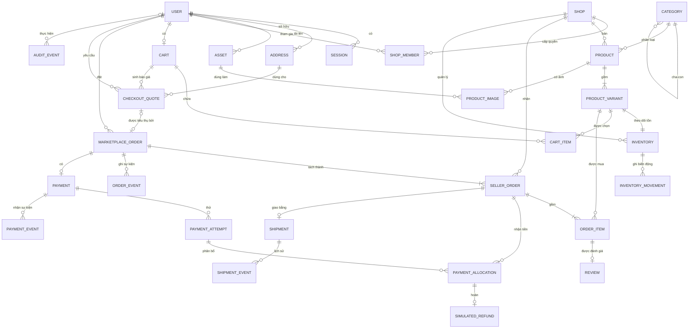
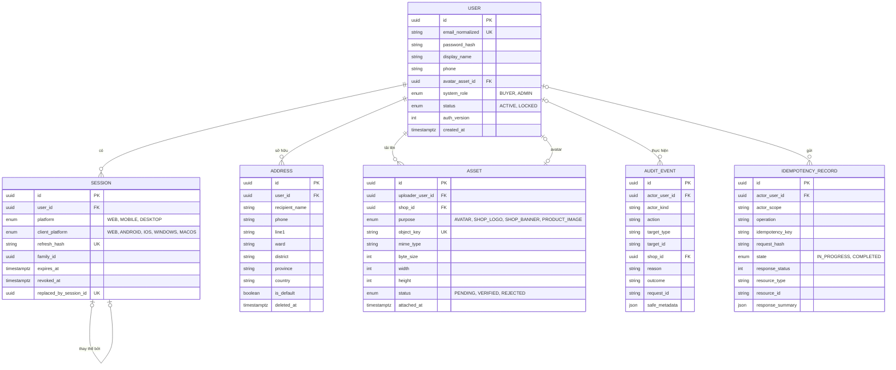
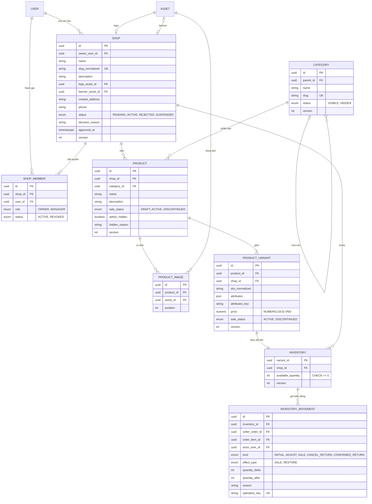
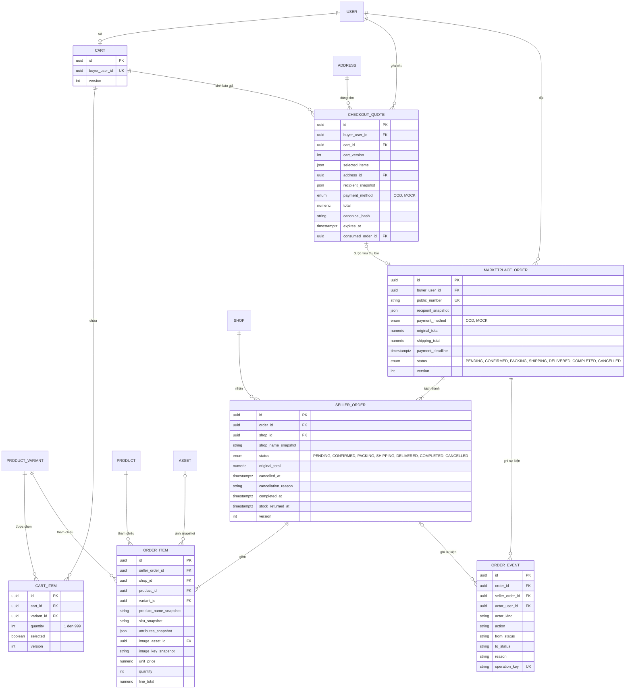
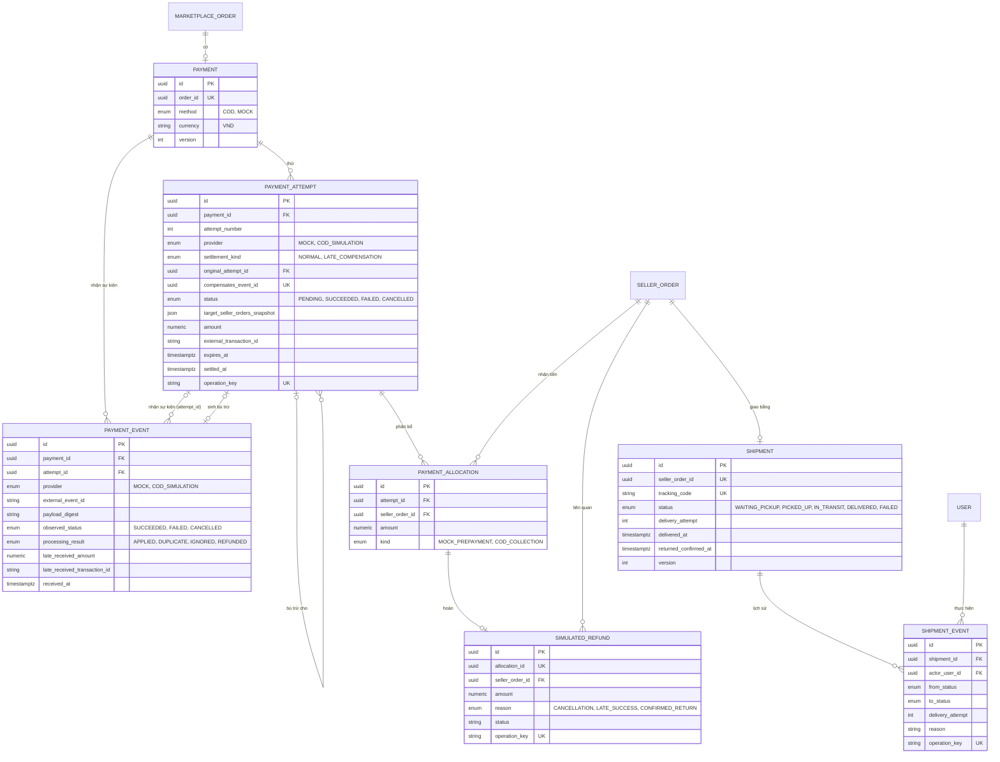
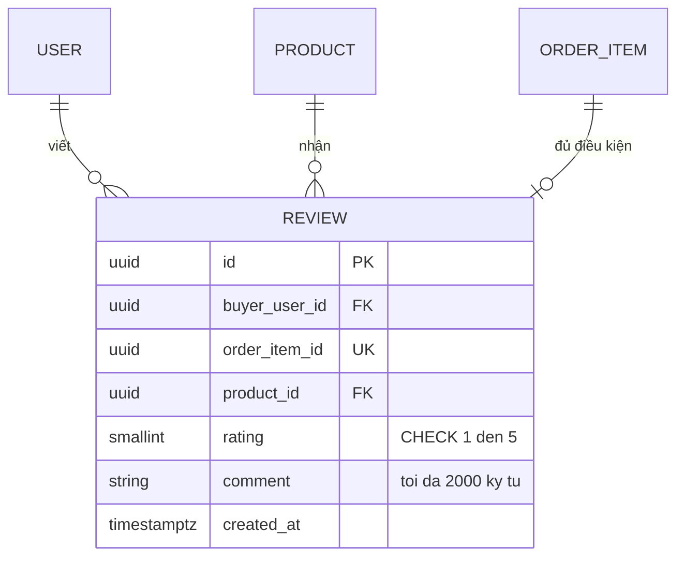

# ERD — Sơ đồ thực thể quan hệ

**Dự án:** Multi-vendor Marketplace MVP
**Nguồn chính:** `apps/api/prisma/schema.prisma` (28 model, trích từ zip repo ngày 2026-10-24), đối chiếu `specs/001-marketplace-mvp/data-model.md` và `docs/database/data-design.md`.
**Cơ sở dữ liệu:** PostgreSQL 17 · khóa chính UUID · tiền `NUMERIC(18,0)` (VND) · thời gian `timestamptz` (UTC).

> **Lưu ý về `Review`.** Bảng `reviews` có trong `data-model.md` (Sprint 6) nhưng **chưa có trong `schema.prisma` hiện tại** và chưa có migration. ERD bên dưới vẫn vẽ để phủ FR-40–42; thực thể này được đánh dấu *(thiết kế, chưa migrate)*.

## 1. Quy ước

| Ký hiệu | Ý nghĩa |
| --- | --- |
| `PK` | Khóa chính |
| `FK` | Khóa ngoại |
| `UK` | Có ràng buộc UNIQUE (đơn lẻ hoặc là một phần của unique tổ hợp, ghi chú ở bảng) |
| `\|\|--o{` | 1 – nhiều (0..n) |
| `\|\|--o\|` | 1 – 0..1 |
| `\|\|--\|{` | 1 – nhiều (1..n) |

Tên cột dùng `snake_case` như trong DB. Chỉ liệt kê các cột quan trọng (khóa, trạng thái, tiền, version, snapshot); danh sách đầy đủ xem `schema.prisma`.

---

## 2. ERD tổng quan (chỉ khóa và quan hệ)

---

## 3. ERD chi tiết theo miền

### 3.1. Định danh, phiên, địa chỉ, tài nguyên ảnh, audit, idempotency

**Ràng buộc đáng chú ý:** `email_normalized` unique; `refresh_hash` unique; `UNIQUE(actor_scope, operation, idempotency_key)` trên `idempotency_records`; chỉ **một** địa chỉ mặc định/user (kiểm tra bằng unique một phần/service); xóa địa chỉ là xóa mềm.

### 3.2. Cửa hàng, danh mục, sản phẩm, biến thể, tồn kho

**Ràng buộc đáng chú ý**

| Bảng | Ràng buộc |
| --- | --- |
| `shops` | `slug_normalized` unique; `logo_asset_id` unique; `banner_asset_id` unique |
| `shop_members` | `UNIQUE(shop_id, user_id)` |
| `products` | `UNIQUE(id, shop_id)` — nền tảng cho FK tổ hợp, chống gắn chéo shop |
| `product_variants` | `UNIQUE(shop_id, sku_normalized)`; `UNIQUE(product_id, attributes_key)`; `UNIQUE(id, shop_id)` |
| `product_images` | `UNIQUE(product_id, position)`; `UNIQUE(product_id, asset_id)` |
| `inventory` | PK là `variant_id` (quan hệ 1–1 với biến thể); `UNIQUE(variant_id, shop_id)`; giảm tồn bằng `UPDATE ... WHERE available_quantity >= qty` |
| `inventory_movements` | `UNIQUE(order_item_id, effect_type)` — mỗi dòng hàng chỉ **một** lần SALE và **một** lần RESTORE (chống hoàn tồn hai lần); `operation_key` unique |
| `categories` | Cây cha-con, không chu trình (kiểm tra trong service) |

### 3.3. Giỏ hàng, báo giá, đơn hàng

**Ràng buộc đáng chú ý**

| Bảng | Ràng buộc |
| --- | --- |
| `carts` | `buyer_user_id` unique — mỗi Buyer một giỏ |
| `cart_items` | `UNIQUE(cart_id, variant_id)` — một biến thể là một dòng |
| `checkout_quotes` | `consumed_order_id` unique — một quote chỉ tạo một đơn; hết hạn sau 5 phút |
| `marketplace_orders` | `public_number` unique; index `(payment_method, payment_deadline, id)` phục vụ job hết hạn |
| `seller_orders` | `UNIQUE(order_id, shop_id)` — mỗi shop đúng một phần trong một Order; `UNIQUE(id, shop_id)` |
| `order_items` | `UNIQUE(seller_order_id, variant_id)`; mọi cột `*_snapshot`, `unit_price`, `line_total` **bất biến** |
| `order_events` | Chỉ thêm (append-only); `operation_key` unique |

**Bất biến tiền:** `line_total = unit_price × quantity`; `seller_orders.original_total = Σ line_total`; `marketplace_orders.original_total = Σ seller_orders.original_total` (kể cả phần đã hủy, để bảo toàn giá trị gốc).

### 3.4. Thanh toán, hoàn tiền mô phỏng, vận chuyển

**Ràng buộc đáng chú ý**

| Bảng | Ràng buộc |
| --- | --- |
| `payments` | `order_id` unique — mỗi Order một Payment |
| `payment_attempts` | `UNIQUE(payment_id, attempt_number)`; `compensates_event_id` unique → mỗi sự kiện đến muộn chỉ sinh **một** bản bù trừ; `operation_key` unique |
| `payment_allocations` | `UNIQUE(attempt_id, seller_order_id)` |
| `simulated_refunds` | `allocation_id` unique → mỗi allocation hoàn tối đa một lần trong MVP |
| `payment_events` | `UNIQUE(provider, external_event_id)` → sự kiện lặp bị phát hiện (`DUPLICATE`) |
| `shipments` | `seller_order_id` unique (mỗi SellerOrder một shipment); `tracking_code` unique |
| `shipment_events` | Chỉ thêm; `operation_key` unique |

**Tính trạng thái tiền (không lưu cột):** gọi C = tổng allocation thành công, R = tổng refund, N = C − R, L = tổng `original_total` các SellerOrder chưa hủy.
C = 0 → `UNPAID`; R = C > 0 → `REFUNDED`; 0 < R < C → `PARTIALLY_REFUNDED`; N < L → `PARTIALLY_PAID`; còn lại `PAID`.

### 3.5. Đánh giá *(thiết kế, chưa migrate)*

Ràng buộc: `UNIQUE(order_item_id)`; `CHECK rating BETWEEN 1 AND 5`; index `(product_id, created_at, id)`. Việc kiểm tra "Buyer sở hữu dòng hàng" và "SellerOrder đã COMPLETED" thực hiện trong service transaction (CHECK không kiểm liên bảng). Không sửa/xóa/phản hồi trong MVP.

---

## 4. Danh mục bảng và module sở hữu

| # | Bảng | Module sở hữu | Migration | Ghi chú |
| --- | --- | --- | --- | --- |
| 1 | `audit_events` | common | 0001_shared | append-only |
| 2 | `idempotency_records` | common | 0001_shared | |
| 3 | `users` | identity | 0002_identity_assets | |
| 4 | `sessions` | identity | 0002_identity_assets | rotation + family |
| 5 | `addresses` | identity | 0002_identity_assets | xóa mềm |
| 6 | `assets` | catalog/media | 0002_identity_assets | |
| 7 | `shops` | shop | 0003_shops | |
| 8 | `shop_members` | shop | 0003_shops | |
| 9 | `categories` | catalog | 0004_catalog_inventory | |
| 10 | `products` | catalog | 0004_catalog_inventory | |
| 11 | `product_images` | catalog | 0004_catalog_inventory | |
| 12 | `product_variants` | catalog | 0004_catalog_inventory | |
| 13 | `inventory` | inventory | 0004_catalog_inventory | |
| 14 | `inventory_movements` | inventory | 0004_catalog_inventory | append-only |
| 15 | `carts` | cart | 0005_cart_orders | |
| 16 | `cart_items` | cart | 0005_cart_orders | |
| 17 | `checkout_quotes` | order | 0005_cart_orders | |
| 18 | `marketplace_orders` | order | 0005_cart_orders | |
| 19 | `seller_orders` | order | 0005_cart_orders | |
| 20 | `order_items` | order | 0005_cart_orders | snapshot bất biến |
| 21 | `order_events` | order | 0005_cart_orders | append-only |
| 22 | `payments` | payment | 0006_payments | |
| 23 | `payment_attempts` | payment | 0006_payments | |
| 24 | `payment_allocations` | payment | 0006_payments | |
| 25 | `simulated_refunds` | payment | 0006_payments | |
| 26 | `payment_events` | payment | 0006_payments | |
| 27 | `shipments` | shipping | 0007_shipments | |
| 28 | `shipment_events` | shipping | 0007_shipments | append-only |
| 29 | `reviews` | review | *(chưa có)* | Sprint 6 |

## 5. Quy tắc toàn vẹn dữ liệu chính

1. **FK lịch sử dùng RESTRICT**, không hard-delete giao dịch; snapshot người nhận, shop, sản phẩm, biến thể, giá nằm trong đơn.
2. **FK tổ hợp chống chéo shop:** `(product_id, shop_id)`, `(variant_id, shop_id)`, `(seller_order_id, shop_id)` đảm bảo một dòng không thể gắn sản phẩm/biến thể của shop khác.
3. **Tồn kho không âm:** giảm tồn bằng cập nhật có điều kiện; mọi thay đổi có movement; `UNIQUE(order_item_id, effect_type)` ngăn hoàn kho hai lần.
4. **Idempotency:** checkout, payment, cancel, shipment, COD, inventory đều dựa trên `idempotency_records` và/hoặc `operation_key`/`external_event_id` unique.
5. **Version (optimistic lock)** ở `shops`, `products`, `product_variants`, `inventory`, `carts`, `cart_items`, `marketplace_orders`, `seller_orders`, `payments`, `shipments`.
6. **Quy tắc liên bảng** (ví dụ: chỉ shop ACTIVE được bán, SellerOrder COMPLETED mới được đánh giá) kiểm tra trong transaction của service; CHECK trong DB chỉ dùng cho bất biến một bảng.
7. **Thứ tự khóa:** Idempotency → User/Cart → Quote → Order → Payment → SellerOrders (theo ID) → Shop → Category → Product → Variant → Inventory (theo ID) → Shipment.

## 6. Đối chiếu và điểm lệch cần lưu ý

| Hạng mục | Tình trạng |
| --- | --- |
| `reviews` | Có trong `data-model.md`, **chưa có** trong `schema.prisma`/migration |
| Tên trạng thái bán | DB dùng `sale_status`; API công khai dùng `selling` (ADR-0002) |
| `data-design.md` vẽ `Payment` 1–1 với `MarketplaceOrder` | Khớp schema (`order_id` unique); tài liệu gọi là "Payment" còn code là `payments` |
| Tên thực thể trong `data-design.md` | `MarketplaceOrder` (khớp). Spec dùng tên ngắn "Order"; trong tài liệu này dùng `MARKETPLACE_ORDER` |
