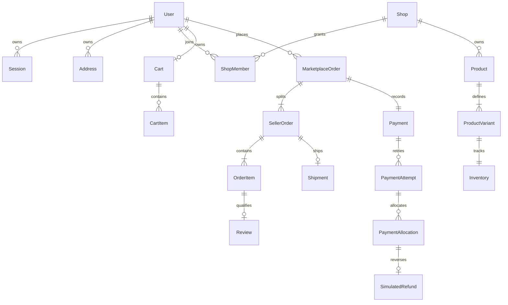

# Thiết kế dữ liệu Marketplace MVP

**Trạng thái:** Baseline thiết kế, chưa có migration được chạy.  
**Nguồn chi tiết:** [`specs/001-marketplace-mvp/data-model.md`](../../specs/001-marketplace-mvp/data-model.md). Tài liệu này ghi quyết định ERD, integrity, transaction và migration review cho W003; model nguồn là field dictionary đầy đủ.

## Mô hình dữ liệu và quyền sở hữu

ERD chi tiết có Asset, Category, InventoryMovement, events, audit và idempotency tại data-model. Mỗi bảng có UUID PK và quan hệ có FK thật. Ownership cốt lõi: User sở hữu Session/Address/Cart/MarketplaceOrder; Shop là phạm vi ShopMember/Product/Inventory/SellerOrder; MarketplaceOrder chứa SellerOrder; SellerOrder chứa OrderItem; Payment/Attempt/Allocation ghi hiệu ứng thu-hoàn; Shipment thuộc SellerOrder; Review gắn OrderItem đã hoàn tất.

## Quy tắc schema

- PostgreSQL là nguồn dữ liệu chuẩn; tiền là `NUMERIC(18,0)` VND và serialization ra API là decimal string; quantity là integer; thời gian `timestamptz` lưu UTC.
- FK lịch sử giao dịch dùng RESTRICT; không hard-delete lịch sử. Snapshot người nhận, shop, sản phẩm, variant và giá trong đơn không đổi theo profile/catalog.
- Dùng unique/check/index cho uniqueness và invariant một bảng. Quy tắc liên bảng được kiểm tra trong service transaction; CHECK không thay thế aggregate validation.
- Mutable rows có `version` nơi cần optimistic concurrency. Sự kiện audit, movement, order/payment/shipment event append-only.
- Internal product/variant state là `sale_status`; API expose `selling` theo ADR-0002. Assets dùng UUID, verified content và ownership; object storage không được gọi trong DB transaction.

## Invariants checkout, tiền và tồn

1. Checkout là all-or-nothing. Claim idempotency trước khi thực hiện; khóa Cart/User/Quote theo protocol, sau đó eligibility, Product/Variant/Inventory theo UUID ổn định. Xác nhận lại owner, active shop/category/product, selling variant, giá, số lượng và quote/address.
2. Tồn giảm bằng conditional update `available_quantity >= requested_quantity`; affected row phải bằng một. Với race 20 checkout trên 5 đơn vị, chỉ 5 commit và tổng movement SALE đúng -5.
3. Tạo MarketplaceOrder, SellerOrders, OrderItems snapshots, Payment, movements/events, xóa đúng cart lines và hoàn tất idempotency cùng commit. Bất kỳ lỗi nào rollback mọi hiệu ứng DB.
4. SellerOrder cancellation/expiry chỉ hoàn tồn đúng một lần; unique movement/effect per OrderItem cùng state/version guard chống lặp. Cancellation và callback/payment xử lý cùng lock order; late success tạo compensation, không mở lại fulfillment.
5. PaymentAttempt ghi lịch sử bất biến. PaymentAllocation chỉ có hiệu lực theo attempt SUCCEEDED; refund liên kết allocation, unique theo allocation trong MVP. Tiền trạng thái được derive từ paid/refunded totals; không ghi đè Order status để biểu diễn tiền.
6. Order state do domain coordinator derive từ SellerOrders theo BR-08. Shipment transition và review eligibility kiểm tra quyền/trạng thái trong cùng transaction.

## Lock order và transaction boundaries

Thứ tự toàn hệ thống theo data-model: Idempotency → User/Cart → CheckoutQuote → Order → Payment → SellerOrders theo ID → Shop → Category → Product → Variant → Inventory theo ID → Shipment. Luồng chưa có Order bắt đầu với catalog eligibility/inventory trước khi tạo Order; không transaction khác thấy Order chưa commit. Callback/hủy/action order khóa Order trước Payment. Không khóa theo thứ tự ngược.

Checkout, cancel/return stock, settlement/refund, shipment/order transitions và review write đều dùng PostgreSQL transaction. READ COMMITTED cùng row locks và conditional writes; không giả định isolation tự bảo đảm toàn bộ invariant. Network/object storage work chạy ngoài transaction với pending/verified state, retry và cleanup an toàn.

## Migration sequence

Migration tạo shared audit/idempotency trước, rồi Identity/Session/Address, Asset/Shop/Catalog, Inventory/Cart, Order/Payment/Shipment/Review theo FK ownership. Nếu FK đích chưa tồn tại, thêm theo migration sở hữu bảng đích như ghi trong tasks; không dùng orphan rows/fake parent. Mỗi migration có fresh-install và upgrade validation; migration đã áp dụng lên môi trường dùng chung không sửa lại mà tạo migration mới. Sequence và fields đầy đủ nằm trong [data model](../../specs/001-marketplace-mvp/data-model.md).

## Bằng chứng review

Tabletop concurrency phải chứng minh 20 buyers/stock 5 cho 5 commit/15 conflict, tổng stock không âm và movement đúng. Replay cùng idempotency key không tạo order/payment/refund thứ hai; key khác payload bị conflict. Duplicate default address, callback/cancel race, retry refund và cross-shop composite FK phải có kiểm thử integration trước khi implementation task tương ứng được nghiệm thu. Đây là acceptance criteria, chưa phải kết quả chạy test hoặc migration.
