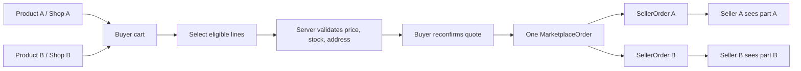
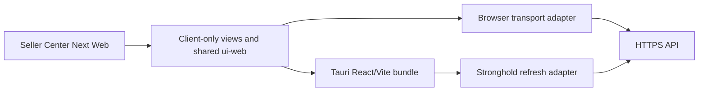

# Luồng màn hình và wireframe MVP

**Cơ sở:** [Spec](../../specs/001-marketplace-mvp/spec.md), [UI plan](../../specs/001-marketplace-mvp/ui-plan.md), ADR-0001 và ADR-0002. Đây là wireframe cấu trúc để review luồng và trạng thái trước khi dựng UI; chưa phải visual design hoặc code.

## Nguyên tắc và state pack

Mọi màn hình thể hiện đúng năm trạng thái:

- **L — Loading:** skeleton/progress theo vùng, giữ kích thước layout, khóa duplicate submit.
- **E — Empty:** thông báo có hướng hành động; list empty và form chưa nhập là hai nội dung riêng.
- **X — Error:** lỗi dễ hiểu; field errors cạnh trường; conflict 409 có reload/reconfirm; không giả báo lưu thành công.
- **S — Success:** dữ liệu server đã lưu, trạng thái/feedback mới; mutation chỉ báo thành công sau commit response.
- **Unauthorized:** chưa login chuyển login kèm return path; thiếu quyền hiển thị 403/404 phù hợp và không lộ resource/private fields.

Web hỗ trợ bàn phím, focus lỗi, nhãn và màn hình 360/1280 px. Native hỗ trợ safe area, back, touch target, accessibility labels và resume/refetch. Tiền là server decimal-string VND; client không tính tổng giao dịch cuối. Logout/user switch xóa sensitive query cache; đổi shop re-key/invalidate dữ liệu theo shop.

## Buyer Web: 13 màn hình

| ID | Wireframe cấu trúc: từ trên xuống | Tác dụng và state/guard riêng |
| --- | --- | --- |
| B01 Home | Header/brand → search → category nav → product grid → footer | Guest xem hàng public; L grid skeleton, E browse categories, X retry, S grid; click mở detail. |
| B02 Register/Login | Auth tabs → email/password/fullName → submit → validation/status | Register/login/logout/refresh; duplicate email/invalid login/CSRF/rate-limit; authenticated redirect. |
| B03 Product list | Breadcrumb/filter summary → sort/page controls → cards → pagination | Chỉ eligible listing; empty filter có reset; stale page/filter không trộn. |
| B04 Search/filter | Query → category/price controls → sort → result count/grid | URL-persisted query/filter; invalid min>max inline; empty query results reset. |
| B05 Product detail | Gallery → title/shop → variant/price/stock → quantity/add → review list | Variant đổi giá/tồn; stopped/out-of-stock không mua; review S6; public projection. |
| B06 Public shop | Shop hero/logo/name → public description → product grid/page | Chỉ shop ACTIVE; hidden shop 404; không hiển thị contact/admin fields riêng. |
| B07 Cart | Cart title → per-shop groups → quantity/select/delete → selected subtotal | Dòng được chọn riêng; empty cart browse CTA; stock issues từng dòng; không sửa dòng ngoài selection. |
| B08 Checkout | Owned address → selected items grouped by shop → server quote/totals → COD/MOCK → confirm | Address ownership, quote 5 phút, idempotency; changed price/totals yêu cầu quote mới; all-or-none. |
| B09 Order list | Filter/status/date → aggregate cards → pagination | Chỉ đơn buyer sở hữu; partial cancellation/payment state tách bạch. |
| B10 Order detail/payment | Order summary → SellerOrder panels → snapshots → payment timeline → allowed actions | Cancel/receive/mock action theo state/version/key; timeout phải tra cứu order trước retry. |
| B11 Profile | Profile fields → avatar picker/preview → password dialog → save | Own account; password verify; file type/size/ownership error; revoke sessions theo policy. |
| B12 Addresses | Address cards/default badge → add/edit form → delete/default actions | Tối đa một default; confirm delete; đơn đã tạo giữ snapshot. |
| B13 Review | Completed item context → 1–5 rating → comment → submit/existing review | Chỉ own completed item; duplicate 409; chưa đủ điều kiện 422; saved review read-only. |

## Seller Center Web: 11 màn hình

| ID | Wireframe cấu trúc: từ trên xuống | Tác dụng và state/guard riêng |
| --- | --- | --- |
| S01 Shop registration | Shop info → logo upload → contact → submit/status | Asset verified và owner; submit tạo PENDING, không tự ACTIVE. |
| S02 Approval status | Shop selector → status banner/reason → resubmit/edit panel | PENDING không bán; REJECTED hiển thị reason và quyền resubmit. |
| S03 Dashboard | Shop switcher → stats cards → pending orders → reviews preview | Mọi query key theo shop; label rõ số tiền mô phỏng. |
| S04 Product management | Shop context → filters/status → table → sell toggle/actions | Own hidden/stopped xem được quản trị; version conflict reload; lịch sử giữ nguyên. |
| S05 Create/edit product | Name/category/description → image gallery → variants table → save | >=1 variant; valid category/assets/positive price; lỗi SKU cạnh dòng; write atomic. |
| S06 Variants/inventory | Variant/SKU list → stock value → delta/reason dialog → result | expectedVersion; concurrent update 409; không ghi đè stock từ stale screen. |
| S07 Order list | Shop selector → status/date filters → scoped orders table | Chỉ SellerOrder thuộc membership; empty per filter. |
| S08 Fulfillment | Order snapshots → allowed transition controls → shipment timeline → COD collection | State/version/reason; COD sau DELIVERED; fail/retry không hoàn kho trước return confirmation. |
| S09 Revenue | Shop/date range → day/month table → totals/definition | Asia/Saigon; completed-only policy, refunds/cancel separately, no parent-child double count. |
| S10 Shop settings | Shop profile → logo/banner → public preview → save | Asset ownership, slug policy, optimistic version. |
| S11 Reviews | Shop/product/rating filters → read-only review rows | Review chỉ của shop; Seller không sửa/xóa/phản hồi Buyer. |

## Admin: 7 màn hình

| ID | Wireframe cấu trúc: từ trên xuống | Tác dụng và state/guard riêng |
| --- | --- | --- |
| A01 Dashboard | Date range → system counts → GMV/status definitions | Admin only; units/status definitions; no double-count aggregate and parts. |
| A02 Users | Search/filter → account table → lock/unlock reason dialog | Admin only; reason/version; lock revokes sessions; response không lộ hash/token. |
| A03 Shop approval | Pending queue → selected shop detail → approve/reject reason | Pending/version guard, audit actor/time/reason. |
| A04 Shop management | Search/status → shop detail → suspend/resume action | Suspend chặn mua mới; đơn cũ vẫn theo policy; reason/version. |
| A05 Categories | Tree → edit/create form → hide dialog | Cycle/parent validation; hidden ancestor chặn hàng mới. |
| A06 Product moderation | Search → product preview → hide/reason action | Snapshot đơn giữ nguyên; Seller không tự bỏ moderation; audit. |
| A07 Order inquiry | Search → order/parts/payment/shipment timeline → audit | Lịch sử xem; recovery action guarded reason/key; không PATCH final state. |

## Hai shop trong checkout

Checkout quote/confirm là một ý định có cùng idempotency key; bất kỳ lỗi eligibility/stock nào rollback toàn bộ. Buyer nhìn một aggregate với phần theo shop; mỗi seller chỉ nhìn phần được cấp quyền. Partial cancel áp dụng lên một SellerOrder, nêu rõ phần tiền/kho liên quan và giữ nguyên phần kia.

## Seller client-only reuse cho Tauri

S01–S11 dùng chung client views, validation, tokens, API client và nghiệp vụ hiển thị. Tauri package không import Next server components, Server Actions hay remote web page; chỉ thay adapter auth/navigation/file selection theo platform. Seller authorization luôn ở API. Access token ở memory; desktop refresh vault mở bằng mật khẩu người dùng; không có plaintext fallback. Desktop screen matrix/endpoint chi tiết ở [UI plan](../../specs/001-marketplace-mvp/ui-plan.md).
