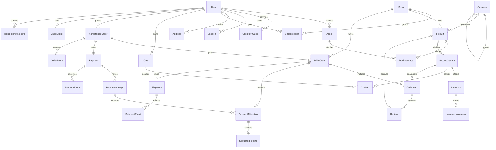

# Data Model — Marketplace MVP

Thiết kế phục vụ FR-01–50 và BR-01–10 trong `spec.md`; chưa tạo schema/migration.
PostgreSQL là nguồn sự thật, Prisma là adapter; module sở hữu bảng và công khai service nghiệp vụ.
Cross-module transaction được điều phối trong monolith bằng cùng transaction context.

## Quy ước chung

- Mọi bảng có `id UUID` primary key; mọi quan hệ có foreign key thật. Tên trường dưới đây là
  tên lưu trữ, triển khai Prisma có thể ánh xạ sang camelCase. Không dùng tên `order` trần.
- Tiền là `NUMERIC(18,0)` VND, truyền ra hợp đồng dạng chuỗi thập phân; không tính bằng float.
  Giá > 0; tổng, thu và hoàn >= 0. Số lượng là integer, dương trên dòng hàng, không âm tại kho.
- Thời gian là `timestamptz`, lưu UTC, thống kê theo Asia/Saigon. Bảng mutable có
  `created_at`, `updated_at`; bảng sự kiện bất biến có `created_at` và `occurred_at` nếu cần.
- FK lịch sử giao dịch dùng RESTRICT, không cascade xóa. User/shop/product/variant dùng trạng
  thái hoặc `deleted_at` thích hợp; địa chỉ được xóa mềm. Snapshot đơn không cập nhật theo hồ sơ.
- Trường JSONB chỉ dùng snapshot/thuộc tính có giới hạn, không thay thế quan hệ hoặc tiền có kiểu.
- Mỗi cập nhật nhạy cảm kiểm tra trạng thái hiện tại và `version INT` để chống ghi đè ngoài ý muốn.
- Các tổng liên bảng kiểm tra trong transaction và integration test, không giả định CHECK có thể
  bảo đảm tổng các hàng ở bảng khác. Job đối soát chỉ phát hiện sai lệch, không tự sửa lịch sử.

## Danh mục thực thể và ownership

### Identity — FR-01–06, BR-01

| Bảng | Trường nghiệp vụ | Constraint/index và lifecycle |
| --- | --- | --- |
| User | email_normalized varchar(254), password_hash text, display_name varchar(120), phone varchar(20) nullable, avatar_asset_id UUID nullable FK Asset, system_role BUYER/ADMIN, status ACTIVE/LOCKED, auth_version int | UNIQUE email_normalized sau trim/lower; không public self-register ADMIN; index(status,created_at,id). Seller được suy từ membership, Buyer không mất quyền khi mở shop |
| Session | user_id, platform WEB/MOBILE/DESKTOP, refresh_hash text, family_id UUID, expires_at (tối đa 7 ngày từ tạo family), revoked_at nullable, replaced_by_session_id nullable, last_seen_at | UNIQUE refresh_hash; FK self RESTRICT; index(user_id,revoked_at), expires_at; chỉ lưu token hash; rotate một lần, token cũ reuse thu hồi cả family. JWT 10 phút mang session id và kiểm tra phiên cho logout tức thời; Session có created_at/updated_at, rotation không kéo dài hạn family |
| Address | user_id, recipient_name, phone, line1, ward, district, province, postal_code nullable, is_default bool, deleted_at nullable | Partial unique(user_id) WHERE is_default AND deleted_at IS NULL; index(user_id,deleted_at); thay default khóa User trong transaction. Xóa default không tự chọn địa chỉ khác |

Đổi mật khẩu khóa User, xác thực mật khẩu hiện tại, tăng auth_version/thu hồi các phiên khác.
Khóa tài khoản thu hồi mọi Session; mở khóa không khôi phục Session. Không ghi hash/token vào audit.

### Shop và Catalog — FR-07–20, BR-02–03

| Bảng | Trường nghiệp vụ | Constraint/index và lifecycle |
| --- | --- | --- |
| Shop | owner_user_id, name varchar(150), slug_normalized, description, logo_asset_id UUID FK Asset, banner_asset_id UUID nullable FK Asset, contact_address varchar(500), phone, status PENDING/ACTIVE/REJECTED/SUSPENDED, decision_reason nullable, approved_at nullable, version | UNIQUE slug_normalized; index(status,created_at,id); owner cũng có ShopMember; slug bất biến sau lần duyệt đầu, kể cả suspended |
| ShopMember | shop_id, user_id, role OWNER/MANAGER, status ACTIVE/REVOKED | UNIQUE(shop_id,user_id); index(user_id,status,shop_id); tạo shop + membership owner cùng transaction; đúng một owner tương ứng owner_user_id, không có chuyển chủ trong MVP |
| Category | parent_id nullable, name, slug, status VISIBLE/HIDDEN, version | UNIQUE slug nội bộ sinh từ name + suffix ổn định (DTO không nhận slug); FK self; CHECK parent_id != id; index(parent_id,status,id); kiểm tra chu kỳ nhiều cấp trong transaction; ẩn tổ tiên cũng làm hàng hậu duệ không mua mới |
| Product | shop_id, category_id, name, description, sale_status DRAFT/ACTIVE/DISCONTINUED, admin_hidden bool, hidden_reason nullable, version | UNIQUE(id,shop_id); index(shop_id,sale_status,created_at,id), (category_id,sale_status,created_at,id); danh sách công khai còn kiểm tra shop/category/admin flag; không hard-delete khi đã tham chiếu |
| ProductImage | product_id, asset_id UUID FK Asset, position | UNIQUE(product_id,position), UNIQUE(product_id,asset_id); chỉ Asset VERIFIED đúng owner/shop được attach; object key/content metadata thuộc Asset |
| ProductVariant | product_id, shop_id, sku_normalized, attributes JSONB, attributes_key, price, sale_status ACTIVE/DISCONTINUED, version | UNIQUE(shop_id,sku_normalized), UNIQUE(product_id,attributes_key), UNIQUE(id,shop_id); composite FK(product_id,shop_id)→Product; giá nguyên dương; index(product_id,sale_status,price,id) |

Sản phẩm không tùy chọn vẫn có một variant với attributes rỗng. Product ACTIVE phải có ảnh đã
kiểm tra và ít nhất một variant ACTIVE; service bảo đảm điều kiện này trong transaction.
Không thêm bảng option/value động trong MVP: attributes là map chuỗi giới hạn khóa/độ dài,
canonical attributes_key được chuẩn hóa và kiểm tra trùng. SKU chuẩn hóa thống nhất cho shop.
Giá đại diện lấy MIN(price) của biến thể ACTIVE; không cần bảng tổng hợp sớm. Tìm kiếm ban đầu
lọc trên dữ liệu công khai và tên; chỉ thêm index tìm kiếm chuyên dụng sau EXPLAIN/đo SC-006.

### Inventory và Cart — FR-21–28, BR-03–04

| Bảng | Trường nghiệp vụ | Constraint/index và lifecycle |
| --- | --- | --- |
| Inventory | variant_id, shop_id, available_quantity int, version | UNIQUE variant_id; composite FK(variant_id,shop_id)→ProductVariant; CHECK available_quantity >= 0; index(shop_id,variant_id) |
| InventoryMovement | inventory_id, seller_order_id nullable, order_item_id nullable, actor_user_id nullable, kind INITIAL/ADJUST/SALE/CANCEL_RETURN/CONFIRMED_RETURN, effect_type SALE/RESTORE nullable (NULL cho điều chỉnh), quantity_delta int, quantity_after int, reason, operation_key | UNIQUE operation_key; CHECK quantity_delta != 0, quantity_after >= 0; index(inventory_id,created_at,id); append-only, cùng transaction cập nhật Inventory; UNIQUE(order_item_id,effect_type) khi có order_item; effect_type SALE/RESTORE tách kind, chặn cả CANCEL_RETURN và CONFIRMED_RETURN cùng hoàn một item |
| Cart | buyer_user_id, version | UNIQUE buyer_user_id; tạo lazy hoặc cùng User |
| CartItem | cart_id, variant_id, quantity int, selected bool, version | UNIQUE(cart_id,variant_id); quantity > 0; index(cart_id,selected,id); không snapshot giá làm nguồn thanh toán; chưa giữ hàng |

Seller điều chỉnh bằng delta hoặc giá trị đích kèm expected_version; khóa Inventory rồi tính
phần chênh lệch từ tồn mới nhất. Không ghi đè tồn dựa trên màn hình cũ. Mỗi adjustment có lý do.

### Order — FR-25–32, BR-04–08

| Bảng | Trường nghiệp vụ | Constraint/index và lifecycle |
| --- | --- | --- |
| MarketplaceOrder | buyer_user_id, public_number, recipient_snapshot JSONB, payment_method COD/MOCK, original_total, shipping_total (=0), created_at, payment_deadline nullable, version | UNIQUE public_number; index(buyer_user_id,created_at,id); payment_deadline = created_at + 15 phút cho MOCK, NULL cho COD; tổng gốc bất biến |
| SellerOrder | order_id, shop_id, shop_name_snapshot varchar(150), status PENDING/CONFIRMED/PACKING/SHIPPING/DELIVERED/COMPLETED/CANCELLED, original_total, cancelled_at nullable, cancellation_reason nullable, completed_at nullable, stock_returned_at nullable, version | UNIQUE(order_id,shop_id), UNIQUE(id,shop_id); index(shop_id,status,created_at,id), (shop_id,completed_at,id); original_total bất biến; stock_returned_at là dấu chống hoàn kho lặp, không phải quyền bỏ kiểm tra movement |
| OrderItem | seller_order_id, shop_id, product_id, variant_id, product_name_snapshot, sku_snapshot, attributes_snapshot JSONB, image_asset_id UUID nullable FK Asset, image_key_snapshot nullable, unit_price, quantity, line_total | composite FK(seller_order_id,shop_id)→SellerOrder và (variant_id,shop_id)→ProductVariant; CHECK quantity > 0, unit_price > 0, line_total = unit_price * quantity; UNIQUE(seller_order_id,variant_id); index(product_id,id) |
| OrderEvent | order_id, seller_order_id nullable, actor_user_id nullable, actor_kind USER/SYSTEM, action, from_status nullable, to_status nullable, reason nullable, operation_key | UNIQUE operation_key; index(order_id,created_at,id), (seller_order_id,created_at,id); immutable; FK actor nullable dành cho scheduler, không xóa user giao dịch |

Snapshot người nhận gồm đầy đủ tên, điện thoại và địa chỉ từng thành phần; validate cấu trúc trước
lưu. FK địa chỉ hiện tại là tùy chọn, không dùng để render đơn. Các snapshot và tiền không sửa
qua API chung hoặc Admin. Một SellerOrder hủy nguyên phần; hủy lẻ OrderItem ngoài MVP.

Order aggregate được tính từ SellerOrders trong service chung, không có endpoint PATCH status:
1. Tất cả CANCELLED → CANCELLED.
2. Các phần không CANCELLED đều COMPLETED → COMPLETED, partialCancellation = có phần hủy.
3. Ngược lại bỏ CANCELLED/COMPLETED, lấy min theo PENDING, CONFIRMED, PACKING, SHIPPING, DELIVERED.

Các số tổng được derive: cancelledTotal là tổng original_total phần hủy; paidGross từ khoản thu
thành công; refundedTotal từ hoàn thành công; netPaid = paidGross-refundedTotal;
amountDue = max(0, originalTotal-cancelledTotal-netPaid). Không giảm original_total khi hủy. Không duy trì counter dashboard riêng; tính từ cùng snapshot truy vấn. Nếu trả nhiều số liệu trong một response, dùng read-only REPEATABLE READ để tránh mỗi số lấy một thời điểm khác nhau.

### Payment — FR-33–36, BR-05–08

| Bảng | Trường nghiệp vụ | Constraint/index và lifecycle |
| --- | --- | --- |
| Payment | order_id, method COD/MOCK, currency VND, version | UNIQUE order_id; lịch sử attempt quyết định tiền, không đồng nhất với Order status |
| PaymentAttempt | payment_id, attempt_number, provider MOCK/COD_SIMULATION, settlement_kind NORMAL/LATE_COMPENSATION, compensates_event_id nullable, status PENDING/SUCCEEDED/FAILED/CANCELLED, amount, external_transaction_id nullable, expires_at nullable, settled_at nullable, operation_key | UNIQUE(payment_id,attempt_number), UNIQUE(provider,external_transaction_id) khi có; UNIQUE operation_key; amount > 0; index(payment_id,status,created_at); chỉ một PENDING MOCK bằng partial unique; kiểm tra một thành công MOCK dưới khóa Payment |
| PaymentAllocation | attempt_id, seller_order_id, amount, kind MOCK_PREPAYMENT/COD_COLLECTION | UNIQUE(attempt_id,seller_order_id); amount > 0; index(seller_order_id,id); chỉ tạo khoản tiền có hiệu lực với attempt SUCCEEDED; mỗi phần có tối đa một lần thu có hiệu lực bằng ràng buộc service dưới khóa Order/Payment |
| SimulatedRefund | allocation_id, seller_order_id, amount, reason CANCELLATION/LATE_SUCCESS/CONFIRMED_RETURN, status SUCCEEDED, operation_key | UNIQUE operation_key; UNIQUE allocation_id trong MVP vì hoàn nguyên phần; amount = allocation.amount; index(seller_order_id,created_at,id); append-only |
| PaymentEvent | payment_id, attempt_id nullable, provider, external_event_id, payload_digest, observed_status, processing_result APPLIED/DUPLICATE/IGNORED/REFUNDED, received_at | UNIQUE(provider,external_event_id); index(payment_id,received_at,id); lưu dữ liệu đã allowlist, không raw token/payload nhạy cảm |

PaymentAttempt của MOCK khóa số tiền và tập SellerOrders khi bắt đầu. Hủy một phần làm attempt
PENDING cũ CANCELLED trước khi tạo retry cho phần còn hiệu lực. Callback thành công của attempt
đã hủy/hết hạn được ghi nhận như khoản thu muộn với các allocation snapshot ban đầu và hoàn
nguyên khoản thu muộn; không thanh toán thay cho attempt mới và không mở lại đơn. Nếu payment
đã có thành công hợp lệ, callback mâu thuẫn chỉ thêm PaymentEvent, không đổi kết quả đã xác nhận.
Kết quả sự kiện và kết quả kinh tế tách biệt: callback muộn cần truy vết nhưng không đổi FAILED/
CANCELLED thành một thành công có quyền fulfillment. Lưu `late_received_amount` và
`late_received_transaction_id` trên PaymentEvent rồi liên kết đúng một attempt bù trừ riêng bằng unique compensates_event_id với
`settlement_kind LATE_COMPENSATION`; attempt này SUCCEEDED, có allocation/refund cùng transaction,
và bị loại khỏi quy tắc “một thành công MOCK hợp lệ”. Trường settlement_kind bắt buộc
NORMAL/LATE_COMPENSATION, mặc định NORMAL. Không ghi đè lịch sử attempt cũ.

Trạng thái tiền tổng: nếu có hoàn, REFUNDED khi refundedTotal = paidGross > 0, ngược lại
PARTIALLY_REFUNDED; nếu chưa hoàn thì UNPAID khi paidGross=0, PAID khi netPaid >= tổng phần
còn hiệu lực > 0, ngược lại PARTIALLY_PAID. Đơn hủy chưa thu vẫn UNPAID với amountDue=0.
Expose số tiền riêng để tránh hiểu REFUNDED/PAID là trạng thái xử lý đơn.

### Shipping, Review, Admin — FR-37–50, BR-07–10

| Bảng | Trường nghiệp vụ | Constraint/index và lifecycle |
| --- | --- | --- |
| Shipment | seller_order_id, tracking_code, status WAITING_PICKUP/PICKED_UP/IN_TRANSIT/DELIVERED/FAILED, delivery_attempt int, delivered_at nullable, returned_confirmed_at nullable, version | UNIQUE seller_order_id, tracking_code; tạo/kích hoạt ở PACKING; delivery_attempt >= 1; index(status,updated_at,id); không tạo shipment mới khi giao lại |
| ShipmentEvent | shipment_id, actor_user_id, from_status nullable, to_status, delivery_attempt, reason nullable, operation_key | UNIQUE operation_key; index(shipment_id,created_at,id); append-only, ghi kể cả retry/return confirmation |
| Review | buyer_user_id, order_item_id, product_id, rating smallint, comment varchar(2000) | UNIQUE order_item_id; CHECK rating BETWEEN 1 AND 5; index(product_id,created_at,id); service kiểm tra buyer và SellerOrder COMPLETED; không sửa/xóa/phản hồi |
| AuditEvent | actor_user_id nullable, actor_kind, action, target_type, target_id UUID, shop_id nullable, reason nullable, outcome, request_id, safe_metadata JSONB | index(target_type,target_id,created_at,id), (actor_user_id,created_at,id), request_id; append-only; polymorphic target được xác thực service, không giả FK đến nhiều bảng; không lưu secret/PII dư thừa |
| IdempotencyRecord | actor_user_id nullable, actor_scope text, operation text, idempotency_key varchar(128), request_hash, state IN_PROGRESS/COMPLETED, response_status, resource_type nullable, resource_id UUID nullable, response_summary JSONB, expires_at nullable | UNIQUE(actor_scope,operation,idempotency_key); actor_scope luôn non-null, hệ thống dùng scope tên job; hash trên payload canonical; replay khác hash → conflict; lưu mapping checkout/payment/cancel lâu dài cùng giao dịch, không TTL xóa mất khả năng chống trùng |

Shipment bàn giao PICKED_UP đưa SellerOrder PACKING→SHIPPING; IN_TRANSIT giữ SHIPPING;
DELIVERED đưa SHIPPING→DELIVERED. FAILED giữ SHIPPING. Retry FAILED→WAITING_PICKUP không
chuyển ngược SellerOrder; pickup/in-transit lần sau vẫn SHIPPING. Admin xác nhận hàng hoàn về
khi FAILED bằng action riêng, đặt returned_confirmed_at, hủy SellerOrder và hoàn kho/tiền.
Chỉ Buyer sở hữu xác nhận DELIVERED→COMPLETED khi allocation thu đủ số tiền phần đó; Seller/Admin
không tự xác nhận thay Buyer trong happy path. COD collected là action mô phỏng có quyền, chỉ
cho khi shipment DELIVERED, thu theo SellerOrder đúng một lần.

## ERD khái quát

## Transaction boundaries và đồng thời

1. **Checkout toàn bộ hoặc không có gì:** claim IdempotencyRecord trong transaction, khóa User,
   Cart và các CartItems được chọn; kiểm tra địa chỉ sở hữu. Khóa eligibility rows và variant/
   Inventory theo thứ tự UUID ổn định; đọc giá hiện tại, đối chiếu xác nhận quote hiện hành.
   Kiểm tra tất cả lỗi trước ghi đơn. Mỗi giảm tồn dùng điều kiện `available_quantity >= quantity`
   và kiểm tra affected rows = 1. Tạo Order/SellerOrders/Items/Payment, SALE movements, event,
   xóa đúng CartItems đã chọn và hoàn tất idempotency cùng commit. Bất kỳ lỗi rollback hết.
   Không gọi object storage/network trong transaction. Tồn trừ ngay, không reservation từ Cart.
2. **Thứ tự khóa toàn hệ thống:** Idempotency → User/Cart nếu cần → CheckoutQuote nếu cần → Order → Payment →
   SellerOrders theo id → Shop → Category theo id → Product → Variant → Inventory theo id →
   Shipment. Checkout chưa có Order nên bắt đầu catalog eligibility trước khi insert Order mới;
   không giao dịch khác được thấy Order chưa commit. Callback/hủy/order actions luôn Order trước
   Payment; dashboard chỉ đọc. Admin eligibility mutation chỉ khóa các hàng nó sửa, không đi ngược
   sang Order. Cart cập nhật khóa Cart trước variant khi cần, không khóa Order.
3. **Last stock:** inventory atomic conditional decrement chạy trong transaction trên PostgreSQL
   thật. 20 checkout cho tồn 5: đúng 5 commit, 15 out-of-stock, tổng movements SALE=-5, tồn=0.
   Retry deadlock/serialization có giới hạn dùng cùng idempotency key; không tự retry lỗi nghiệp vụ.
4. **Hủy toàn/riêng:** khóa Order, Payment, mọi phần liên quan; kiểm tra quyền và state. Hủy toàn
   nếu bất kỳ phần chưa hủy không PENDING thì rollback toàn bộ. Seller có quyền hủy CONFIRMED
   trước PACKING; Buyer chỉ PENDING. CAS trạng thái, CANCEL_RETURN movement unique theo item,
   stock_returned_at, hoàn allocation đã thu, OrderEvent, audit và idempotency cùng commit.
5. **Payment success/expiry race:** khóa Order/Payment cùng thứ tự, dùng thời gian DB và deadline
   cố định. Thành công NORMAL chỉ khi xử lý trong hạn, chưa thành công hợp lệ và phần còn hoạt
   động đúng snapshot; expiry ở hoặc sau deadline hủy PENDING và hoàn kho. Callback đến muộn
   đi compensation kể cả timestamp bên gửi báo trước hạn. Scheduler quét bounded batches, claim
   Order bằng khóa, kiểm tra lại sau khóa; restart không bỏ sót vì deadline nằm trong DB.
6. **Cancellation/callback race:** nếu success commit trước thì hủy hoàn tiền; nếu hủy commit
   trước thì success muộn được bù trừ. Cả hai kết thúc cùng tồn/tiền kinh tế, không mở lại phần hủy.
7. **Giao/thu COD/complete:** mỗi action khóa Order→Payment→SellerOrder→Shipment, kiểm tra owner/
   shop permission, current state; update và event cùng transaction. COD collection unique theo
   phần, repeated action replay. Không tự hoàn tồn khi FAILED chưa có returned confirmation.
8. **Admin khóa user/shop:** khóa cập nhật eligibility; checkout kiểm tra lại dưới khóa trước
   commit. Shop suspended vẫn có quyền xử lý đơn cũ nếu account active; account locked bị chặn
   và Admin chỉ dùng action được quy định, không PATCH tùy ý lịch sử. Tạo audit cùng transaction.
9. **Review:** kiểm tra Order ownership + COMPLETED dưới transaction, insert unique OrderItem;
   concurrent double-review một thành công, một conflict.

Mọi transaction dùng READ COMMITTED cùng row locks/conditional writes rõ ràng; không hứa chỉ
đổi isolation tự giải quyết toàn bộ invariants. Test có hai kết nối đồng thời và barrier thực.

## Migration, seed và bằng chứng theo Sprint

| Sprint | Migration dự kiến, chưa thực thi | Seed và validation |
| --- | --- | --- |
| S1 | ERD, field dictionary, enum/state decisions; review migration order | Fixture mô tả 2 shop/2 buyer và bảng tính expected totals; chưa có DB triển khai |
| S2 | Identity User, Session, Address; indexes/partial default constraint, initial audit/idempotency | Admin bootstrap từ env riêng, buyer active/locked; duplicate email, default-address race, session revoke tests |
| S3 | Asset, Shop, ShopMember, Category, Product, ProductImage, Variant, Inventory/Movement (W021); FK/shop composite keys và stock checks | Shop pending/rejected/active/suspended; category cha/con/hidden; 2 variants + inventory opening movements; cross-shop/sku/category cycle tests |
| S4 | Cart/Item; bổ sung index inventory theo query | Tồn 0/1/5, cart multi-shop, discontinued variant; stale adjustment, duplicate add, quantity invalid tests |
| S5 | CheckoutQuote, Order/SellerOrder/Item/Event, Payment/Attempt/Allocation/Refund/Event; Shipment/Event (W037); constraints và deadline index | COD, MOCK success/fail/retry/expiry/partial cancel/late success; concurrency SC-003/004, rollback fault injection |
| S6 | Review (W043), dashboard indexes đã đo; không đổi lịch sử Order | Review đủ/sai điều kiện, dashboard known totals; tích hợp shipment waiting/delivered/failed/retry/returned + COD partial collection |
| S7 | Hardening constraints/index sau EXPLAIN trên fixture; không thêm nghiệp vụ schema mới | Completed/cancelled/unfinished across Asia/Saigon midnight, one review/item; chính xác doanh thu SC-008 |
| S8 | Không feature schema mới trừ bug blocker; rehearsal migration từ empty và version trước | Seed demo deterministic 10 shop/1.000 product; backup/restore + smoke; verify historical snapshots/totals |

Seed development phải idempotent theo stable natural keys, có dữ liệu âm để test; không xóa giao dịch
ở demo đang dùng. Seed destructive reset chỉ ở database test disposable có guard tên môi trường.
Không lưu mật khẩu/secret thật trong fixtures. Dùng password demo chỉ trong local/demo có nhãn.

Áp dụng migration qua CI/deploy có bước backup và review SQL. Không sửa migration đã áp dụng;
thay đổi bổ sung tạo migration mới. Thay đổi bất tương thích dùng expand→backfill→switch→contract,
không drop cột giao dịch trong sprint demo. Rollback app dùng schema tương thích; lỗi data migration
khôi phục backup theo runbook và ghi rõ mất dữ liệu sau thời điểm backup. Mỗi migration phải kiểm
tra FK/unique/check/index, migration từ DB sạch và fixture version trước, cùng expected record counts.

## Ma trận kiểm chứng tối thiểu

- **FR-01–15:** unique email/slug/SKU; default address; ownership composite FK và quyền service;
  category cycle; locked/suspended eligibility; snapshot sống qua đổi tên/giá/địa chỉ.
- **FR-21–32:** giá client giả bị bỏ qua; changed quote yêu cầu xác nhận; checkout thiếu một dòng
  rollback hết; selected-cart preservation; cross-shop item bị FK chặn; stock return đúng một lần.
- **FR-33–39:** replay 10 lần; cùng key khác payload conflict; retry/expiry; success mâu thuẫn;
  callback muộn + partial cancellation; COD partial collection; failed/retry/returned stock sequence.
- **FR-40–50:** một review đúng buyer/item complete; dashboard không cộng kép Order và phần;
  boundary ngày/tháng Asia/Saigon; audit actor/reason; không sửa snapshot/hoàn tất qua Admin.
- **Recovery:** crash trước/sau commit giữ idempotency mapping; scheduler tiếp tục sau restart;
  restore backup giữ FK/tổng tiền và không replay callback tạo thêm hiệu lực.

## Quyết định và giới hạn

Không cần Redis/reservation table/BullMQ/event sourcing cho nguồn dữ liệu MVP. Scheduler DB-backed
làm expiry theo batch, cùng deployment API nhưng được claim qua row lock để nhiều instance an toàn.
Payment allocations/refunds là sổ nghiệp vụ mô phỏng có nguồn giao dịch, không phải ví/ledger tiền thật.
JSON snapshot/schema, trường tiền và error contracts phải thống nhất với `contracts/` trước code.
Các quy tắc BR là baseline được lập kế hoạch, chưa phải bằng chứng implementation hoặc test pass.

## Nguồn kỹ thuật đã đối chiếu

- [PostgreSQL 17 — Row locks và deadlocks](https://www.postgresql.org/docs/17/explicit-locking.html):
  cơ sở cho khóa hàng đến cuối transaction và thứ tự khóa nhất quán.
- [PostgreSQL 17 — Constraints](https://www.postgresql.org/docs/17/ddl-constraints.html):
  cơ sở cho FK/unique/check và việc không dùng CHECK để thay invariant liên bảng.

Các lựa chọn domain/payment ở trên là quyết định thiết kế từ BR, không phải yêu cầu của PostgreSQL.

## Contract persistence alignment

### Asset — Upload ownership, Sprint 3

Asset thuộc module Catalog/media public service, dùng chung Identity/Shop qua service này.
Trường: `id UUID`, `uploader_user_id FK User`, `shop_id FK Shop nullable`,
`purpose AVATAR/SHOP_LOGO/SHOP_BANNER/PRODUCT_IMAGE`, `object_key text UNIQUE`,
`mime_type`, `byte_size int`, `status PENDING/VERIFIED/REJECTED`, `attached_at nullable`,
`created_at`, `updated_at`. CHECK byte_size trong 1..5242880; allowlist JPEG/PNG/WebP
và kiểm tra nội dung thực trước VERIFIED. Index `(uploader_user_id,status,created_at,id)`
và `(shop_id,purpose,status,id)`. API upload trả Asset UUID; không tin object key từ client.

Logo trước tạo shop có shop_id NULL, purpose SHOP_LOGO và uploader chính là người tạo shop.
CreateShop khóa Asset, kiểm tra VERIFIED/unbound/đúng uploader, bind shop_id trong cùng
transaction tạo Shop/membership. Shop đổi ảnh dùng asset đúng membership; Avatar chỉ đúng user.
Không cho rebind asset của shop khác hoặc public file chưa verified. ProductImage.asset_id,
User.avatar_asset_id và Shop.logo_asset_id/banner_asset_id đều có FK Asset RESTRICT.
Snapshot OrderItem giữ image_asset_id và key snapshot; dọn orphan không xóa Asset còn được
tham chiếu. Job orphan dùng grace period và kiểm tra mọi FK/attached state trước xóa object;
không coi DB rollback có thể hoàn tác việc đã gọi S3.

### CheckoutQuote — Confirmation snapshot, Sprint 5

CheckoutQuote thuộc Order: `id UUID`, `buyer_user_id FK User`, `cart_id FK Cart`,
`cart_version int`, `selected_items_snapshot JSONB` (cartItemId, variantId, shopId, quantity,
unitPrice VND string, lineTotal), `address_id FK Address`, `recipient_snapshot JSONB`,
`payment_method COD/MOCK`, `total NUMERIC(18,0)`, `canonical_hash text`, `expires_at`,
`consumed_order_id FK MarketplaceOrder nullable UNIQUE`, `created_at`, `updated_at`.
Index `(buyer_user_id,expires_at,id)` và expires_at phục vụ cleanup; CHECK total>0,
expires_at = created_at + 5 phút được service đặt bằng database clock.

Quote không giữ tồn, không tạo Order, không làm khóa giá. quoteId là UUID lưu bền để process
restart vẫn kiểm tra được. Checkout khóa Cart rồi quote của chính Buyer, kiểm tra expiry, cart version,
tập dòng/số lượng/phương thức/địa chỉ theo canonical snapshot, rồi kiểm tra eligibility và giá
hiện tại dưới khóa. Giá hoặc nội dung thay đổi trả conflict yêu cầu quote mới; không âm thầm
checkout giá khác. Thành công gắn consumed_order_id cùng transaction. Replay cùng idempotency
key trả Order trước kiểm quote expiry; một quote không tạo hai Order với hai key khác nhau.
Quote đã dùng giữ mapping cùng giao dịch; quote hết hạn chưa dùng có thể cleanup sau 24 giờ.
Quote không chứa secret và endpoint không cho đọc quote của Buyer khác.

### Tên và trạng thái contract

- `fullName` API ánh xạ User.display_name varchar(120), cùng validation 1–120 ký tự.
- `contactAddress` API ánh xạ Shop.contact_address varchar(500), không parse ngầm thành JSON.
- `shopNameSnapshot` trả từ SellerOrder.shop_name_snapshot, snapshot khi checkout; đổi tên shop
  không đổi đơn cũ.
- Session.platform map WEB từ clientPlatform WEB, MOBILE từ ANDROID/IOS,
  DESKTOP từ WINDOWS/MACOS; lưu thêm
  `client_platform` đúng enum transport để quản lý thiết bị. Không nhận platform làm nguồn quyền.
- Product DRAFT là trạng thái nội bộ trước publish; boolean công khai `selling=true` ánh xạ ACTIVE,
  false ánh xạ DISCONTINUED với sản phẩm đã publish. DRAFT chỉ có trong create/edit workflow;
  contract không nhận sale_status tùy ý. admin_hidden là cờ riêng, Seller không được bật lại nó.
- Shipment chỉ tạo khi SellerOrder vào PACKING; trước đó response shipment là null.
  Không có row shipment WAITING_PICKUP trong checkout và không có trạng thái inactive bổ sung.

