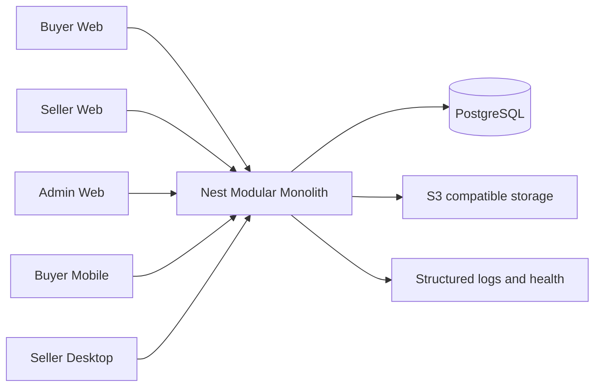
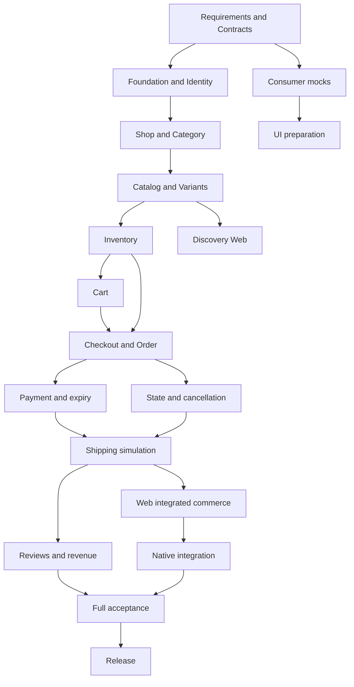
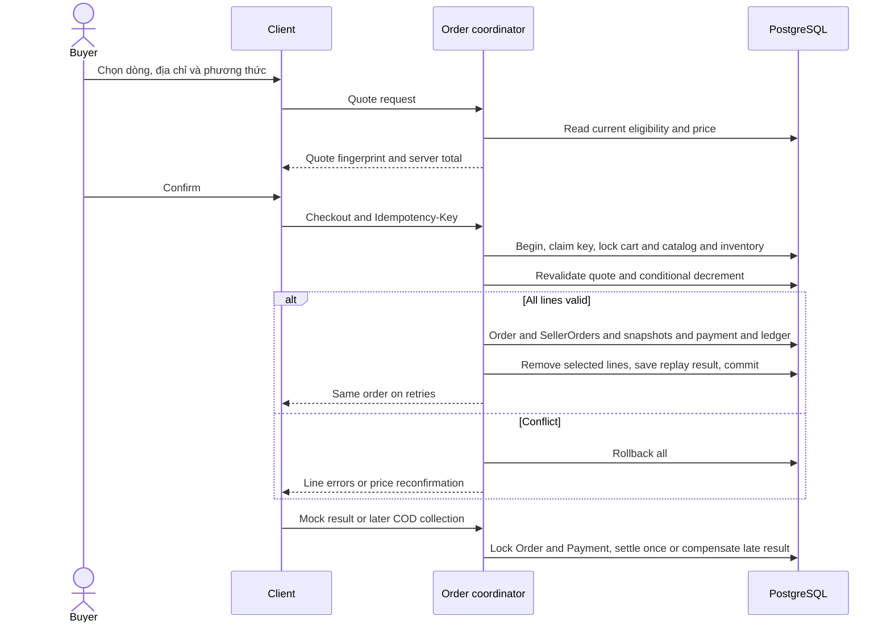

# Implementation Plan: Multi-Vendor Marketplace MVP

**Branch**: `main` | **Date**: 2026-10-20 | **Spec**: [spec.md](spec.md)

**Input**: spec.md và master prompt Implementation Planning của chủ dự án.
**Feature directory**: `specs/001-marketplace-mvp`.
Setup resolver trả logical context `001-marketplace-mvp`; Git thực tế vẫn là `main`.
Không tạo/chuyển branch; toàn bộ công việc trong bước này chỉ là tài liệu thiết kế.

## Summary

16 tuần/8 Sprint, 5 thành viên, Modular Monolith, 50 FR trên Web/Mobile/Desktop.
64 work packages, tổng 157 person-day (PD) trong ngân sách 180 PD net feature delivery;
đây là estimate có điều kiện, không cam kết chắc chắn hoàn thành.
Đọc cùng [research](research.md), [WBS](wbs.md), [task allocation](task-allocation.md), [data model](data-model.md),
[API contract](contracts/api.md), [UI plan](ui-plan.md), [quickstart](quickstart.md).
Chưa có source ứng dụng hoặc kết quả kiểm thử implementation.

## Technical Context

**Language/Version**: TypeScript strict theo compiler/peer range từng workspace;
Node24 LTS >=24.15, backend TypeScript6 theo baseline nghiên cứu, Rust stable cho Tauri.
**Primary Dependencies**: pnpm12/Turbo2; Next16/React19.2; Expo57/RN0.86/React19.2.3;
Tauri2/React static shell; Nest12/Prisma7; Tailwind/shadcn web, TanStack Query, RHF/Zod.
Zustand chỉ khi cần. Exact patch/image digest khóa W008/W017 sau compatibility smoke;
không ép compiler backend lên Expo. Lý do, alternatives và nguồn: research R01–08.
**Storage**: PostgreSQL17, UUID/FK/NUMERIC(18,0); managed S3-compatible dev/demo buckets.
Không Redis/BullMQ/search engine trước khi có nhu cầu đo được. Không MinIO archived làm mặc định.
**Testing**: Jest/Supertest, PostgreSQL integration thật, Playwright Web, native component/device
acceptance, contract diff, concurrency barriers, test clock, backup/restore drill.
**Target Platform**: Linux Docker server; Web responsive; Android/iOS Buyer; Windows/macOS Seller.
W008 ghi exact min OS theo toolchain đã chọn, máy Mac/Xcode/simulator/device và runner khả dụng.
Không hứa hỗ trợ OS đã hết hỗ trợ hoặc app store publishing.
**Project Type**: pnpm monorepo 6 apps, một Nest REST API và một PostgreSQL.
**Performance Goals**: SC006 >=95/100 search/list <=2 giây,20 users,1000 products/10 shops;
SC003 20 checkout/5 stock; SC004 replay10 không sai hiệu lực tiền/tồn.
**Constraints**: 16 tuần,5 người giả định,157 PD baseline,50 PD bug buffer trừ riêng;
không tiền/giao vận thật hoặc hệ thống phân tán. Planning không cài dependency/chạy migration.
**Scale/Scope**: 50 FR,10 journeys, toàn bộ màn hình/nền tảng trong spec, quy mô đồ án/demo.

## Constitution Check

| Gate | Before Phase0 | After Phase1 | Bằng chứng thiết kế |
| --- | --- | --- | --- |
| Modular Monolith/domain/SOLID/KISS | PASS | PASS | Public interfaces, transaction context, không abstraction rỗng |
| Stack/monorepo | PASS | PASS | Technical Context; source layout và compiler theo workspace |
| UUID/FK/NUMERIC/migrations/history | PASS | PASS | data-model constraints, migration order, immutable snapshots |
| Multi-shop/variant/stock/idempotency | PASS | PASS | BR04–09, locks/conditional decrement/ledger/allocation/refund |
| Auth/ownership/secrets/native tokens | PASS | PASS | research R04, contracts auth/CSRF/resource policies |
| API v1/validation/OpenAPI | PASS | PASS | Markdown contract hiện có; W004 OpenAPI, W011 runtime drift check |
| Tests/DoD/từng milestone/docs | PASS | PASS | Test matrix/quickstart; chưa có tuyên bố tests đã chạy |
| Scope/no destructive operations | PASS | PASS | Chỉ tài liệu, giữ50 FR và nền tảng; không reset/deploy |

PASS là phù hợp thiết kế, không chứng nhận build/security implementation.
Phase0 research đã chốt lựa chọn; Phase1 được đối chiếu lại research/data/contracts/guide.
BR trong spec là baseline để lập kế hoạch; W001 review trước code, thay đổi phải cập nhật
spec/impact trước triển khai. Không có vi phạm hiến chương cần ngoại lệ.

## Project Structure

### Documentation (this feature)

```text
specs/001-marketplace-mvp/
  spec.md
  checklists/requirements.md
  plan.md
  research.md
  wbs.md
  tasks.md
  task-allocation.md
  data-model.md
  contracts/api.md
  ui-plan.md
  quickstart.md
```

`tasks.md` đã được tạo: 158 task chưa thực hiện, nhóm theo 10 user stories. `task-allocation.md` ghi owner/reviewer, Sprint và phân bổ đúng 157 PD từ WBS; không cộng effort hai lần. Phase là nhóm capability; lịch chọn task sẵn sàng theo Sprint và dependency, không chờ hoàn tất Admin để thử Mobile.

### Source Code (repository root)

Cây workspace được khởi tạo ở T008; source của từng app/package sẽ được thêm bởi các task triển khai tương ứng:

```text
apps/
  storefront/                  # Next Buyer
  seller-center/               # Next Seller, share client views
  admin-panel/                 # Next Admin
  mobile/                      # Expo Buyer native UI
  desktop/                     # Tauri + React/Vite static Seller shell
  api/src/
    modules/{identity,shop,catalog,inventory,cart,order,payment,shipping,review,admin}/
    common/                    # DTO/error/guards/requestId
  api/test/{integration,e2e}/
packages/
  api-client/                  # generated transport/platform auth adapters
  contracts/                   # reviewed OpenAPI/types
  validation/
  ui-web/                      # shared DOM + Seller client views
  design-tokens/
  config/
infra/
docs/{adr,architecture,testing,deployment}/
tests/{e2e,concurrency,contracts}/
docker-compose.yml
pnpm-workspace.yaml
turbo.json
```

**Structure Decision**: Đủ6 apps/6 packages. Seller feature views chia sẻ cho Desktop;
Mobile chỉ share contract/validation/tokens, không import DOM/shadcn. Domain sở hữu repository;
Order coordinator gọi public services với cùng Prisma transaction context, không import repository
nội bộ. Không nhúng Next server vào Tauri.

## Complexity Tracking

Không có violation cần justification. Payment allocation/refund và inventory movement là tối thiểu
để chứng minh dữ liệu đúng, không là ví tiền/event sourcing. Một API deployment, Postgres search,
scheduler DB-backed expiry, không Redis/queue chuyên dụng trước khi có nhu cầu.

## 01. Executive Summary

Repository mới chỉ có README, Spec Kit, constitution/spec; chưa có chức năng ứng dụng.
Chiến lược contract-first, Web vertical slices trước native integration; test từ S2.
S3 demo shop→duyệt→đăng hàng; S5 demo commerce đa shop gồm trả/giao mô phỏng.

Capacity mỗi người mỗi Sprint:10 PD gross (10 ngày×8h), trừ2.5 học tập/không sẵn sàng,
1 Scrum/điều phối,0.75 review/integration và1.25 bug buffer →4.5 PD feature.
Toàn nhóm400 gross −100 học −40 họp −30 review/integration −50 bug buffer =180 PD net.
WBS157 PD còn23 PD slack ngoài buffer50; không cộng buffer thành feature đã hứa.
Test của từng task đã trong estimate; W050–57 là kiểm chứng tổng hợp, review trừ riêng.
157 PD tương đối lạc quan: giả định quen stack và reuse client/UI hiệu quả, không đào tạo từ đầu.
Mỗi Sprint dùng actual để reforecast, không khẳng định 16 tuần chắc chắn đạt toàn phạm vi.

## 02. Project Scope

| Loại | Nội dung |
| --- | --- |
| In Scope | FR01–50, Guest/Buyer/Seller/Admin, multi-shop, variant/tồn/cart/checkout/COD/mock/shipping/review/stats, toàn platform matrix |
| Optional | Visual polish, animation nhẹ, chart presentation sau khi số liệu đúng; chỉ lấy slack |
| Out of Scope | Tiền/vận chuyển thật, wallet/đối soát, chat/live/ads/AI/flash sale tải lớn/voucher, đổi trả sau hoàn tất, UI nhân viên, sửa giao dịch final |
| Future | Chỉ thêm sau spec/effort/security riêng; không dự phòng hạ tầng dư |

MVP giữ đầy đủ50 FR nhưng UI tối giản, VND/phí giao0, một shipment/SellerOrder,
không app store publishing. P1/P2 story không có nghĩa được bỏ khỏi phạm vi.
PROJECT_RULES.md, FUNCTIONAL_REQUIREMENTS.md, DATABASE_DESIGN.md, API_SPECIFICATION.md chưa có.
Hiện dùng constitution/spec/data-model/contracts tương ứng; W001/003/004/058 hoàn thiện tài liệu
SRS/use-case/ERD/API/report, không tạo nhiều bản sao không được duy trì. README còn1 dòng,
W016/058–64 phải bổ sung hướng dẫn thật. Những việc này là TODO triển khai có ID, không unknown thiết kế.

## 03. Work Breakdown Structure

[64 work packages](wbs.md), mỗi ticket có Task ID, mô tả, Owner/Reviewer, Priority,
Difficulty, PD, Dependency, Deliverable, Acceptance Criteria và Test Cases.
Bao phủ22 nhóm yêu cầu; có thể chuyển GitHub Projects không phân tích lại nghiệp vụ.
P0=foundation/integrity/release blocker; P1=feature MVP bắt buộc xếp sau; P2=optional chưa estimate.
Dependencies là gate tích hợp/nghiệm thu; có thể chuẩn bị UI bằng mocks và tests bằng fixtures trước,
không nghiệm thu feature thật khi backend predecessor chưa đạt. UI3–4PD có thể tách theo màn hình
mà giữ tổng effort, không lấy PD này làm estimate lại cho task con.

## 04. Architecture & Module Dependencies





Đây là delivery dependencies, không sơ đồ import Nest. Module public ports giữ dependency một chiều;
Order coordinator quyết định state, gọi Payment/Inventory/Shipping cùng transaction context.
Payment không callback ngược Order tạo vòng imports; Admin gọi domain actions hợp lệ.

Critical path: W001→003/004→017/011/009/010→018/019→020/021→026/027/029
→035→034/036→037→038/039 integration→040/041→048/054/055→056/057→063/064.
Không cộng mọi PD thành elapsed time vì nhiều owner song song. W035/036 thuộc M2,
W034/037 thuộc M1; clients dựng mocks từ contract S1/S4, M5 dựng fixtures trước API hoàn thành.
Chậm contract/checkout1 Sprint có thể chậm native/release1 Sprint nếu hết slack.



## 05. 16-Week Implementation Roadmap

Tuần tương đối W1–16; chưa đặt ngày bắt đầu. Mỗi Sprint10 ngày làm việc,22.5 PD net team.
ID/effort thống nhất WBS, không estimate hai lần.

| Sprint/tuần | Goal/US | Tasks | PD | Dependency | Deliverable/AC/demo | Tests | Risk → mitigation |
| --- | --- | --- | --- | --- | --- | --- | --- |
| S1 W1–2 | Requirements/architecture; US1–10 design | W001–008 | 19 | Spec/constitution | Use-case/SRS, ERD, contracts, wireframes; walkthrough checkout/quyền actor | Tabletop BR/schema/mock review | Scope/toolchain sai → chốt BR/ADR/Mac access |
| S2 W3–4 | Foundation/auth US1 | W009–017 | 20.5 | Contract/ERD S1 | Workspace/Compose/CI, register→login→profile/address→logout thật; Seller/Admin shells | Auth/session/migration/E2E US1 | ESM/peer mismatch → compatibility smoke trước feature |
| S3 W5–6 | Shop/catalog/stock US2–4 | W018–025 | 20.5 | Identity | Shop→approve→publish variant→Buyer xem; khóa/ẩn đúng | Cross-shop/slug/SKU/MIME/stock adjustment | Upload mismatch → adapter fixture + real bucket test |
| S4 W7–8 | Discovery/cart US4–5.1 | W026–033 | 20.5 | Catalog/stock | Search/filter/cart, stock UI, checkout policies; thin native spike | Last-stock proof/schema drift/load baseline | Transaction chưa đúng → giữ gate trước order |
| S5 W9–10 | Commerce US5–7 | W034–041 | 21 | Cart/policies/stock proof | Hai shop split/COD/mock/hủy/fulfill/deliver E2E Web thật | SC003/004, payment/expiry/cancel races | Critical path dày → mock UI sớm, ưu tiên integrity, dùng buffer |
| S6 W11–12 | Reviews/stats/admin/native US8–10 | W042–049 | 20 | Order/payment/shipping | Stats/reviews/Admin + native core, Desktop secure login shell | Known totals/timezone/review unique/native auth | M4/M5 quá tải → M3 hỗ trợ Mobile, reuse Seller |
| S7 W13–14 | Full acceptance/stability US1–10 | W050–057 | 20 | S6 feature integrated | Native full screens + OS artifacts, security/perf/recovery evidence | SC001–009,5-user usability, IDOR/CSRF/restore | Native lỗi → freeze optional, buffer/pair review |
| S8 W15–16 | Release/docs/demo | W058–064 | 15.5 | Accepted RC | HTTPS demo, seed/report/slides/runbook/native handover | SC010/restore/rollback/full rehearsal | Deploy trễ → lab/video fallback có nhãn, không coi là online pass |

Điều chỉnh roadmap nguồn: inventory nền tảng S3 để hàng có tồn hợp lệ; shipping S5 để
commerce E2E sớm; review/stats S6 để S7 tập trung ổn định. Mobile chỉ spike2PD S4 (T130) sau foundation/auth/discovery, không phụ thuộc Admin,
integration S6. Desktop được thiết kế sharing trước, tích hợp sau Web Seller, không làm cả3 UI đầy đủ cùng lúc.

S5 sequencing có điều kiện: D1–3 M2 checkout, M1 chuẩn bị policy/tests; D3–5 M2 payment,
M1 hoàn cancel; D6–7 shipping. M3/M4 dùng3PD mock-first trước D8,1PD tích hợp thật D8;
M5 dựng fixtures sớm, D8–9 race/E2E, D9–10 staging/demo. Nếu prerequisite chưa ổn ngày3,
reforecast ngay, không dồn test vào cuối ngày10 để đạt lịch giả.

## 06. Team Responsibility Matrix

| Member | Chính | Reviewer/backup | Deliverable mỗi Sprint S1→S8 |
| --- | --- | --- | --- |
| M1 | Identity/Shop + state/cancel/shipping/reviews | M2 integrity; M4 UI policy | Rules/ports → auth → shop/category → cart/state → cancel/shipping → admin/reviews → security/docs → report |
| M2 | Data/Catalog/Inventory + checkout/payment/stats | M1 transaction; M5 tests | ERD/contracts → workspace/API/DB → catalog/stock → query/concurrency → checkout/payment → stats → integrity/perf → schema/release |
| M3 | Buyer Web + Mobile completion support | M4 UX; M5 native | Wireframes → accounts → discovery → cart → checkout → reviews/mobile support → native/usability → demo/slides |
| M4 | Seller/Admin Web + Desktop | M3 UX; M5 native | Wireframes → shells → publish/approval → stock → fulfillment → dashboards/Tauri → Desktop full → artifacts/manual |
| M5 | Mobile/Test harness/DevOps | M2 DB/infra; M3 Mobile | Test/infra audit → CI/test → upload/security → native spike/drift → race/staging → native core → acceptance/native CI → deployment/clean setup |

M2 không gánh mọi bài khó: state/cancel/shipping M1; native integration M4; concurrency/release M5;
Mobile completion M3 hỗ trợ. M5 không viết mọi test: mỗi owner viết tests của ticket,
M5 điều phối harness/evidence. Reviewer độc lập theo WBS, không self-approve.

| Tổng planned PD | M1 | M2 | M3 | M4 | M5 | Team |
| --- | --- | --- | --- | --- | --- | --- |
| Baseline | 32.5 | 33 | 30.5 | 30 | 31 | 157 |

Không ai vượt4.5PD/Sprint. Chi tiết sprint/person trong Capacity totals WBS.
Nếu4 người:144 net PD <157, thiếu ít nhất13PD;3 người:108PD, thiếu49PD.
Giảm polish/phụ hoặc kéo dài lịch, không cắt integrity/auth/checkout.
Giảm FR/platform phải sửa spec được chủ dự án chấp thuận, không tự coi phần bỏ là DONE.

## 07. Database Implementation Plan

[data-model.md](data-model.md) là dictionary đầy đủ fields/types/relationships/constraints/index/state.
Migration: S2 User/Session/Address/audit/idempotency; S3 Shop/Member/Category/Product/Image/Variant/
Inventory/Movement; S4 Cart/Item; S5 Order/SellerOrder/Item/Event, Payment/Attempt/Allocation/Refund/Event,
Shipment/Event; S6 Review/stats indexes; S7 hardening; S8 release rehearsal, không feature schema mới.

NUMERIC(18,0) VND serialize decimal string; UUID/FK/composite shop keys, unique email/slug/SKU,
review/item, order/shop và operation key. Index owner+created, shop+status, catalog+category và
payment deadline; đo EXPLAIN trước thêm index. Không dùng CHECK liên bảng thay transaction.
Checkout eligibility/price/tồn được khóa và giảm có điều kiện; snapshot, Order split, ledger và cart
cùng transaction. Cancel/expiry/payment/return dùng parent Order lock theo cùng thứ tự;
không network/S3 call trong transaction. Late payment event tạo compensation attempt/allocation/refund,
không mở lại đơn. COD collection một lần/SellerOrder đã giao.

Seed module từng Sprint với stable keys/negative cases. Demo cuối10 shops/1000 products,2 buyers,
admin và shop pending/locked/hidden; cancelled/refunded/completed fixtures có expected totals.
Không reset shared DB, không password thật trong fixture. Fresh/upgrade migration, FK/check,
race/snapshot và restore tests; migration đã áp dụng chỉ sửa bằng migration mới.

## 08. API Implementation Plan

[contracts/api.md](contracts/api.md) có method/path, request/response DTO, auth/ownership,
validation/error/test/Sprint cho auth/users/shops/categories/products/cart/checkout/orders/payments/
shipments/reviews/admin. Đây là contract Markdown thiết kế, chưa có endpoint hoặc OpenAPI chạy được.
W004 S1 chuyển OpenAPI3.0.3 + reviewed examples/mocks; W011 S2 tạo runtime Swagger và diff kiểm chứng.
Generated client từ cùng snapshot, PR thay contract phải có schema diff/client generation.
Additive v1 trước; breaking change cần version và kế hoạch consumer được chấp thuận.
Money string/UUID/UTC/errors requestId/pageSize<=100, idempotency mutation nhạy cảm,
expectedVersion/CAS cho stock/state. Web JWT memory + refresh cookie/CSRF;
native SecureStore/Stronghold adapter. Chi tiết token thời hạn research R04/contracts.

## 09. Frontend/Mobile/Desktop Plan

[ui-plan.md](ui-plan.md) có từng màn hình, mục tiêu/components, endpoint, state/validation,
loading/empty/error/success, acceptance và Sprint. TanStack Query server state;
React/RHF/Zod UI/forms, không copy server state vào Zustand.
Seller views client-only share ui-web cho Tauri React/Vite shell; Mobile dùng native UI/tokens,
không remote website wrapper hoặc nhúng Next server. Tauri capabilities/CSP/HTTPS allowlist tối thiểu,
Stronghold password-unlock cho refresh, memory access token. Clear user/shop query caches khi logout.

## 10. Testing Strategy

| Level/priority | Sprint | Cases | Pass/evidence |
| --- | --- | --- | --- |
| Unit P0 | S2–7 | Auth/policies, exact money, availability, state table/aggregate | Valid/invalid branches tiền/quyền/state đúng; CI logs |
| Integration P0 | S2–7 | Session revoke, approval, product+variant+stock, split/snapshot/refund | PostgreSQL thật, fresh+upgrade, fault injection không partial/âm tồn |
| Contract P0 | S1–7 | Schema/examples/runtime DTO/client mocks | Không breaking drift không review; examples match runtime |
| E2E P0 | S2 auth/S3 publish/S5 commerce/S6–7 full | Register→shop→approve→publish→cart→multi-shop→pay→fulfill→review | SC001/002 đủ50FR, real API không DB edit |
| Concurrency P0 | S4 proof/S5/S7 | Barrier20 requests/5stock, replay10; expiry/cancel/pay/adjust races | SC003/004:5 commit/15 out of stock, effect/totals exact |
| Security P0 | S2–7 | Buyer IDOR/Seller cross-shop, locked session, price/state spoof, upload, CSRF/reuse/CORS/rate limit | SC007: không lộ/đổi dữ liệu, secrets redacted |
| Usability P1 | S3–7 | 360/1280/keyboard/form states;5 người mua5 dòng/2shop | SC005:>=4/5 trong3 phút, record từng lần |
| Performance P1 | S4 baseline/S7 | 1000 products/10 shops/20users/100 observations | SC006:>=95/100 <=2s, record host/network/fixture |
| Reports P0 | S6–7 | Completed/cancel/refund/partial COD/midnight | SC008 exact totals không double-count |
| Native P0 | S4 smoke/S6–7 | Android/iOS Buyer, Win/macOS Seller | SC009 bằng chứng từng OS/flow; build alone không là pass |
| Recovery P0 | S7–8 | Restart expiry/fresh clone/seed twice/restore/rollback | SC010<=30phút sau prerequisites; lịch sử/totals giữ nguyên |

Không dùng coverage% thay acceptance. Mock cho isolation UI/unit, không thay DB integrity/E2E.
Sai quyền/tiền/tồn là release blocker. Hiện chưa chạy các test này; owner sẽ gắn commands,
exit results, môi trường và evidence vào ticket/acceptance matrix, không tự tuyên bố pass.

## 11. Deployment & CI/CD Plan

| Environment | Mô hình | Isolation/mục đích |
| --- | --- | --- |
| Local | Compose PG/API/3 Next apps + S3 dev bucket | env gitignored, volume riêng, fixture có guard |
| CI | Ephemeral PostgreSQL/test namespace; storage mock unit, real bucket contract smoke | Không đụng demo DB, cleanup chỉ resource test định danh |
| Staging | Nếu ít budget dùng chung host demo nhưng DB/project/credential riêng | Private smoke trước promote |
| Demo | Linux VPS/VM Compose, reverse proxy HTTPS, PG volume, API/3web, managed S3 | Không public DB, off-host backup |

VPS2vCPU/4GB là điểm xuất phát benchmark, không sizing/SLA hoặc giá/free-tier cam kết.
Build images trong CI, không compile mọi app trên demo host; re-size sau đo S4/S5.
Lab LAN là fallback demo nếu hosting lỗi, không đánh đồng với nghiệm thu online.

Env inventory: NODE_ENV, DATABASE_URL, API_PORT, JWT signing/verification và rotation secrets,
ACCESS_TOKEN_TTL=10m, REFRESH_SESSION_TTL=7d, CORS_ORIGINS, PUBLIC_API_URL,
S3_ENDPOINT/REGION/BUCKET/ACCESS_KEY_ID/SECRET_ACCESS_KEY/PUBLIC_READ_BASE,
MOCK_PAYMENT_TTL=15m, LOG_LEVEL, bootstrap admin cho seed có chủ đích.
Chỉ URL public vào NEXT_PUBLIC_/EXPO_PUBLIC_; không secret client bundle.
HTTPS/Secure cookies ở môi trường chia sẻ; ngoại lệ local HTTP chỉ development.

PR CI: frozen install/allowlist package build scripts → lint → typecheck → unit → build →
PostgreSQL integration/contract diff/Web smoke. Native matrix Win/Mac theo thay đổi/RC,
không cấp secrets cho fork PR. Pin Action commit/container digest khi release.
Protected main có reviewer/status checks; Conventional Commits, feature/fix/refactor/docs/test branches.

Release: tag image → backup → reviewed additive migration → deploy app tương thích →
health/live + health/ready → login/list/checkout smoke bằng fixture demo → promote có evidence.
Liveness=process, readiness=DB/config thiết yếu; storage probe riêng có timeout.
Structured log requestId/actorId/action/result/duration, redact credential/PII;
health/5xx/expiry/duplicate anomalies có cảnh báo cơ bản.

Backup ít nhất daily và trước migration, mã hóa/off-host, retention7 ngày cho demo;
RPO mục tiêu24h/RTO2h cần đo qua drill, chưa bảo đảm. Policy object backup/version tương ứng.
Rollback app về image trước khi schema tương thích, không down migration phá dữ liệu.
Nếu corrupt: dừng ghi, giữ snapshot/log hiện tại, nêu ảnh hưởng dữ liệu và xin quyết định restore
trước thao tác phá hủy. W053/057/063 chạy rehearsal; không tự thực hiện deployment trong planning.

## 12. Risk Register

| ID | Risk | Probability | Impact | Priority | Dấu hiệu | Phòng ngừa | Contingency | Owner |
| --- | --- | --- | --- | --- | --- | --- | --- | --- |
| R01 | Scope creep | High | High | P0 | Ticket ngoài FR/BR | Scope/change log | Freeze optional, reforecast/spec/date | M1 |
| R02 | DB/migration sai | Medium | High | P0 | FK thiếu/snapshot đổi | ERD/constraints/upgrade tests | Corrective migration/restore drill | M2 |
| R03 | Checkout/payment bất nhất | High | High | P0 | Âm tồn/trùng thu | Proof S4/shared locks/dedupe | Stop release, buffer/review transaction | M2+M1 |
| R04 | API/client lệch | Medium | High | P0 | Mock pass/integration fail | Contract/gen-client drift CI | Sửa provider/consumer trong cùng PR | M3+M2 |
| R05 | Mobile chậm | High | High | P0 | S4 smoke/S6 checkout thiếu | Device access S1/spike S4 | M3 hỗ trợ, bỏ polish, reforecast | M5 |
| R06 | Tauri integration | Medium | High | P0 | Next-only import/Mac fail | Static shared views/secure adapter | M4/M5 pair, tối thiểu IPC | M4 |
| R07 | Auth/ownership bug | Medium | High | P0 | Cross-shop/reuse succeeds | Negative policy tests | Revoke/fix/full security rerun | M1 |
| R08 | Merge conflicts | High | Medium | P1 | PR>2ngày, cùng DTO | Owner module/small PR/contract-first | Pair resolve/rerun, không overwrite | M4 |
| R09 | Deploy/budget failure | Medium | High | P0 | OOM/health/bucket fail | Budget/benchmark/staging | Image rollback/lab-video fallback có nhãn | M5 |
| R10 | Thiếu thời gian test | High | High | P0 | Test dồn S7/defects tăng | Owner tests từng Sprint/buffer | Freeze features, P0 regression trước release | M5 |
| R11 | Thiếu Mac/iOS access | Medium | High | P0 | W008 không có runner/device | Confirm lab/account budget S1 | Mượn lab/runner, đổi gate hoặc scope được duyệt | M4+M5 |
| R12 | Runtime compatibility | Medium | High | P0 | ESM/peer/build lỗi S2 | Exact pin/smoke trước feature | ADR chọn supported compatible version | M2 |
| R13 | Ít người hơn giả định | Medium | High | P0 | Actual<4.5PD/Sprint | Actual/forecast weekly | Rebalance/reduce optional/extend date | M1 |
| R14 | Mất dữ liệu/demo | Low | High | P0 | Restore fail/seed reset | Off-host backup/guarded seed | Stop writes/preserve logs/recovery decision | M5 |

Buffer gates: S3 publish, S4 concurrency/native access, S5 commerce, S6 native integration,
S7 RC freeze. Chậm>1tuần critical path hoặc forecast>180PD thì replan ngay.
Giảm trước polish/animation/chart presentation và external integration không bắt buộc;
giữ số liệu/quyền/state/validation/tests/screens core. Nếu vẫn thiếu, đề xuất giảm noncore
FR/platform hoặc kéo dài lịch bằng sửa spec được chấp thuận, không tự thay baseline.

## 13. Milestones & Deliverables

| Gate | Bàn giao/người review | Exit criteria |
| --- | --- | --- |
| G1 S1 | Use cases/ERD/contracts/wireframes; team review | 50FR trace, BR rõ, capacity và native access được ghi |
| G2 S2 | M1/M2 auth, M3/M4 shells, M5 CI | Real auth/address, CI4checks, persistence |
| G3 S3 | Shop/catalog/stock/screens/security | Shop→duyệt→variant→public E2E, cross-shop denied |
| G4 S4 | Cart/query/stock proof/native spike | Last-stock proof, selected cart, order contract frozen |
| G5 S5 | Team commerce/staging | Hai shop split/paid/cancel/fulfill/deliver, races data đúng |
| G6 S6 | Reviews/stats/Admin/native core | Known totals, native purchase/security evidence |
| G7 S7 | RC/tests/native artifacts | Zero P0, SC001–009 evidence, backup drill |
| G8 S8 | Source/schema/API/tests/report/slides/runbook | SC010/full demo/limitations/handover |

GitHub Projects đề xuất BACKLOG→READY→IN PROGRESS→IN REVIEW→TESTING→DONE.
Ticket title `[W035][S5] Atomic multi-shop checkout`; description nghiệp vụ, priority, estimate PD,
assignee/reviewer, dependency IDs, deliverable, AC và testing checklist lấy từ WBS.
READY có contract/input/AC đủ cho phần việc; WIP1 primary/member. IN REVIEW có PR linked FR/task,
migration/security impact và commands/results. TESTING có evidence real environment.
DONE chỉ khi DoD hiến chương đạt, không chỉ code commit/merge. Author không tự review chính.
Planning đầu Sprint chọn theo capacity; daily async blockers; mid-Sprint forecast;
review/demo/retrospective cuối Sprint, cập nhật actual/remaining. Không tạo Project/issues hoặc gửi
thông báo nhóm trong bước này.

## 14. MVP Demo Scenario

1. Chuẩn bị fixture disposable trước demo, không reset DB chia sẻ đang dùng; check health.
2. Guest xem/tìm hàng, đăng ký Buyer; SellerA/B đăng shop, Admin duyệt, đăng variants/tồn.
3. Buyer chọn5 dòng/2shop, sửa quantity/selected, xác nhận quote/địa chỉ/Mock Payment.
4. Một Order/2SellerOrders, trả thành công; Seller sửa giá không đổi snapshot đơn cũ.
5. SellerA chỉ thấy phầnA, confirm→pack→ship→deliver; Buyer nhận→review đúng một lần.
6. Hủy phầnB còn PENDING, refund/restore một lần, phầnA không đổi.
7. Đơn khác COD→giao→thu mô phỏng→nhận; stats chỉ tính COMPLETED, không double-count.
8. Trình diễn failure/retry/expiry bằng test-clock fixture/report có nhãn;
   không giả vờ chờ15phút đã chạy nếu dùng test clock.
9. Buyer Android/iOS và Seller Win/Mac mở cùng dữ liệu; logout/cross-shop denied.
10. Trình bày SC003/004/007 reports, native evidence, restore và clean-room runbook.

Chi tiết lệnh/expected outcomes ở [quickstart.md](quickstart.md).

## 15. First Sprint Action Plan

| Thứ tự/ngày | Tasks | Owner/reviewer | Hành động/output |
| --- | --- | --- | --- |
| D1–2 | W001 | M1/M3 | Review50FR/BR, chốt hủy/expiry/phí0/VND, SRS/use-case/change log |
| D1–2 | W005/006 draft | M3/M4 | Wireframe dựa input, đợi W001 để nghiệm thu |
| D2–4 | W002 | M1/M2 | Public ports/auth boundaries/monolith/Desktop ADR |
| D2–5 | W003 | M2/M1 | ERD/constraints/state/locks, tabletop pay-vs-cancel |
| D2–5 | W007/008 | M5/M2+M4 | Fixtures/test matrix/runtime/Mac-iOS/bucket budget evidence |
| D5–7 | W004 | M2/M4 | OpenAPI/examples theo contract, schema validation/mocks |
| D5–8 | W005/006 finalize | M3/M4 | Walkthrough2shop, UI states và sharing boundaries |
| D8–9 | G1 review | Team | Trace every FR, ready S2 backlog, review estimates |
| D10 | Review/retro | M1 điều phối | Demo thiết kế, blockers/capacity, action kế tiếp |

Không code feature ở S1; W004 chỉ contract/mock artifacts. Các prerequisite evidence là việc
cần thực hiện, chưa phải đã kiểm chứng trên máy nhóm. Bộ plan/tasks đã có; sau lần chỉnh tài liệu này chạy `$speckit-analyze`, rồi chọn nhóm task được ủy quyền để triển khai, không tự thực hiện toàn bộ backlog.

## Planning Validation Record

Rà soát 2026-10-20: 64 IDs duy nhất, dependencies đều tồn tại và graph không có chu kỳ;
effort tổng157PD, mỗi owner<=4.5PD/Sprint, reviewer khác owner. Roadmap totals khớp WBS.
Đã kiểm15 phần yêu cầu, headings bắt buộc của plan-template, internal Markdown links tồn tại,
code fences cân bằng và không còn template placeholders.
Đã đồng bộ auth10min/refresh7days, InventoryS3/ShippingS5/ReviewS6, Asset/Quote persistence,
Shipment tạo PACKING, payment late-compensation và aggregate tiền giữa tài liệu.
Không có extensions.yml ở pre/post checks nên không hook nào cần thực thi.
Đây là kiểm tra tài liệu; không chạy test/build ứng dụng vì chưa có source, không cài dependencies,
không tạo migration, không deploy và không tạo tasks.md.

## Approved Documentation Corrections — 2026-10-20

- T001: yêu cầu/use cases, Owner M1/Reviewer M3, W001/S1/2 PD.
- T002: kiến trúc/public interfaces, Owner M1/Reviewer M2, W002/S1/2 PD.
- T003: thiết kế dữ liệu/transaction invariants, Owner M2/Reviewer M1, W003/S1/2.5 PD.
- T130 là nhánh thử Mobile S4, chỉ cần T004 toolchain, T019 client, T022 foundation, T039 identity và T070 discovery. W032 chỉ cấp 2 PD cho nhánh này.
- S6 mở rộng app/session đã tạo ở S4, không scaffold hoặc chi ngân sách W032 lần nữa. Các task acceptance toàn nền tảng vẫn phải có evidence đúng OS.
- Dùng packages/contracts, DTO selling, trạng thái nội bộ sale_status. Owner/reviewer/Sprint và allocation ở từng task; bảng kiểm toán tại [task-allocation.md](task-allocation.md).
- 158 task vẫn unchecked, tổng effort giữ 157 PD; lần chỉnh này chỉ sửa tài liệu.
