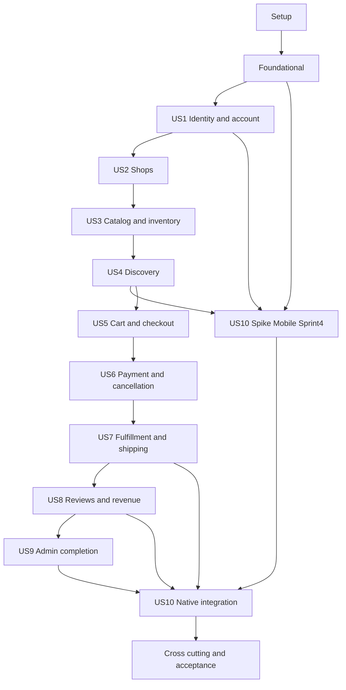

# Tasks: Multi-Vendor Marketplace MVP

**Input**: Design documents from `specs/001-marketplace-mvp/`.
**Created**: 2026-10-20 | **Git branch**: `codex/monorepo-t008` | **Status**: Setup/foundation và US1–US5 đã có mã; US6 có schema, dịch vụ, route và UI thanh toán/hủy nhưng kiểm thử PostgreSQL, concurrency và nghiệm thu chưa có kết quả chạy local được ghi nhận. US7 hiện mới có schema và policy; US8–US10 chưa hoàn tất. Checkbox bên dưới là nguồn theo dõi từng task; W008 vẫn mở.
**Prerequisites**: [plan.md](plan.md), [spec.md](spec.md), [research.md](research.md), [data-model.md](data-model.md), [contracts/api.md](contracts/api.md), [ui-plan.md](ui-plan.md), [quickstart.md](quickstart.md), [wbs.md](wbs.md) và [constitution](../../.specify/memory/constitution.md).

**Tests**: Được yêu cầu rõ trong spec NFR-04, acceptance/SC và hiến chương. Có contract/unit/integration/E2E/security/concurrency phù hợp. Viết tests trước implementation tương ứng; lần chạy trước implementation phải thất bại vì hành vi chưa có sau khi harness compile, không xem lỗi dependency hoặc test giả là bằng chứng nghiệp vụ. Các test placeholder không được dùng để báo pass.

**Organization**: 13 phase; 158 task nhỏ là phân rã 64 WBS packages, không phải 158 estimate bổ sung lên 157 PD. Mỗi task ghi WBS và dependency IDs. Mỗi task có Owner chính, Reviewer, Sprint và Allocation rõ. Chi tiết phân bổ trong task-allocation.md; không cộng lại estimate WBS và task.

## Format: `[ID] [P?] [Story] Description`

- Mọi task có checkbox chưa đánh dấu, ID liên tục, file paths cụ thể; [US1]–[US10] chỉ xuất hiện trong phase story.
- [P] là lane song song sau khi mọi dependency ghi trên task đã hoàn tất; không có nghĩa bắt đầu ngay từ đầu dự án. Chỉ parallel các task cùng wave và khác file; shared Prisma schema/migration/OpenAPI luôn tuần tự.
- Owner là người chịu trách nhiệm chính; allocation phụ có effort ghi contributor/Sprint theo WBS; reference=0.00PD chỉ là liên kết ngữ cảnh/phụ thuộc, không chi ngân sách ở task đó. Sprint liệt kê nhiều giai đoạn chỉ khi task có phần việc ở nhiều Sprint, mỗi phần được ghi riêng; không hiểu mọi phần phải xong cùng ngày.
- Task tests chỉ tick khi đã viết và có red evidence đúng lý do; story chỉ đạt checkpoint khi full suite liên quan green thực tế. Task verify phải ghi observed evidence, không chỉ mô tả expected.
- Phạm vi là tạo tasks.md, không triển khai source hoặc đánh dấu task hoàn tất ở lần sinh này.

## Path Conventions

Paths là repository-relative từ `C:/Users/admin/Desktop/cnpm`; dùng exact path trong task, không tìm trong folder specs để tạo source. `apps/api/prisma/schema.prisma` là file model dùng chung; migrations có tên semantic ổn định nhưng prefix thứ tự theo dependency. Với FK trỏ model chưa ra đời, chỉ thêm cột nullable/constraint ở migration story sở hữu đích như chỉ rõ, không insert dữ liệu tham chiếu mồ côi hoặc fake parent.

Ràng buộc fields/nullable/enums/unique/index trong task model được trích nguyên văn từ data-model. DTO max/min/required/money/enums bổ sung dùng đúng contract; mọi thay đổi sau này phải đồng bộ cả hai nguồn, không tự phát minh nghiệp vụ. `selling` là tên transport chính thức; `packages/contracts` là package chính thức theo plan, không tạo package contract thứ hai.

Phase là thứ tự capability, không tương đương Sprint. Gán lịch theo WBS: identity core S2, assets/avatar S3; stock S3, cart S4, order/payment/shipping S5, reviews/stats/Admin S6, native core S6–7 và release S8. US1 avatar có thể được hoàn thiện trong S3; không coi auth core đã có là toàn US1 đã DONE. Mock preparation không thay gate nền tảng/backend thật.

## Phase 1: Setup (Shared Infrastructure)

**Goal**: Chốt design và khởi tạo workspace.

**Independent Test / Checkpoint**: Review input/contracts/toolchain, smoke workspace không thay test nghiệp vụ.

- [x] T001 Chốt yêu cầu FR01–50 và BR01–10, actor/use case/acceptance, giữ phạm vi MVP và các mặc định hiện hành; ghi SRS và quyết định trong docs/requirements/srs.md. Quy ước packages/contracts, field API selling và sale_status nội bộ đã thống nhất trong bộ thiết kế. [Owner: M1; Reviewer: M3; Sprint: S1; WBS: W001; Allocation: W001=2.00PD(M1/S1); Depends: none]
- [x] T002 [P] Chốt Modular Monolith, public interfaces, auth trust boundaries và chia sẻ Seller client-only; ghi docs/adr/0001-modular-monolith.md và docs/adr/0002-contract-naming.md theo packages/contracts, field selling; không đổi stack hoặc nghiệp vụ. [Owner: M1; Reviewer: M2; Sprint: S1; WBS: W002; Allocation: W002=2.00PD(M1/S1); Depends: T001]
- [x] T003 [P] Review ERD, UUID/FK/NUMERIC, snapshots và bất biến checkout/payment/stock, lock ordering và migration theo module; ghi docs/database/data-design.md và docs/adr/0003-data-integrity.md, đối chiếu specs/001-marketplace-mvp/data-model.md. [Owner: M2; Reviewer: M1; Sprint: S1; WBS: W003; Allocation: W003=2.50PD(M2/S1); Depends: T001]
- [x] T004 [P] Ghi pins/peer compatibility Node24>=24.15,pnpm12,Next16,Nest12,Prisma7,Expo57,Tauri2; kiểm Mac/Xcode/iOS/Windows access,minOS,bucket/budget theo research ở docs/development/toolchain.md và docs/development/platform-access.md. Host hiện tại đã được kiểm; quyền Mac/iOS, Android SDK, Windows native toolchain và bucket/budget chưa có bằng chứng/cấp phát nên vẫn là readiness gate W008. [Owner: M5; Reviewer: M4; Sprint: S1; WBS: W008; Allocation: W008=1.50PD(M5/S1); Depends: T002]
- [x] T005 [P] Wireframes B01–B13/S01–S11/A01–A07, state L/E/X/S/unauthorized, checkout2shop và Seller client-only reuse trong docs/design/screen-flows.md. [Owner: M3; Reviewer: M4; Sprint: S1; WBS: W005,W006; Allocation: W005=3.50PD(M3/S1), W006=3.50PD(M4/S1); Depends: T001, T002]
- [x] T006 [P] Map50FR/10SC, negative fixtures/expected totals,20requests/stock5 và OS evidence matrix ở docs/testing/test-plan.md,docs/testing/fixture-design.md. [Owner: M5; Reviewer: M2; Sprint: S1; WBS: W007; Allocation: W007=2.00PD(M5/S1); Depends: T001, T003]
- [x] T007 Chuyển toàn endpoint/DTO/auth/error trong contracts/api.md thành reviewed OpenAPI3.0.3; UUID,money string,enums,required/nullability,examples,Idempotency-Key trong packages/contracts/openapi.yaml và packages/contracts/examples/commerce.json. Đã đối chiếu đủ 79 operations với endpoint inventory và kiểm schema references. [Owner: M2; Reviewer: M4; Sprint: S1; WBS: W004; Allocation: W004=1.00PD(M2/S1); Depends: T004, T005, T006, T002, T003]
- [x] T008 Khởi tạo6apps/6packages theo plan, exact pins/lockfile, compiler strict riêng workspace, Turbo scripts trong package.json,pnpm-workspace.yaml,turbo.json,pnpm-lock.yaml,packages/config/tsconfig.base.json. Đã khóa 13 workspace projects; frozen lockfile + strict peer resolution đạt, Turbo nhận diện đủ12 app/package; source build và native readiness vẫn là gate các task sau. [Owner: M2; Reviewer: M3; Sprint: S2; WBS: W017; Allocation: W017=0.25PD(M2/S2); Depends: T007]
- [x] T009 [P] Đã cấu hình ESLint flat config dùng chung, chặn explicit `any`, Prettier và script lint/typecheck theo workspace; xác nhận rule `any`, typecheck với fixture TS và các workspace hiện chưa có nguồn. [Owner: M2; Reviewer: M3; Sprint: S2; WBS: W017; Allocation: W017=0.25PD(M2/S2); Depends: T008]
- [x] T010 [P] Đã thêm `.env.example` theo inventory plan mục11, gồm JWT10m/refresh7d/mock15m, URL public không credentials, secret/bootstrap fields để trống và mapping DATABASE_URL host/container; `.gitignore` chặn env/local secrets nhưng cho phép commit các example. [Owner: M5; Reviewer: M2; Sprint: S2; WBS: W016; Allocation: W016=0.40PD(M5/S2); Depends: T008]
- [x] T011 [P] Đã bổ sung README/local guide, đồng bộ quickstart với trạng thái workspace; ghi prerequisites/ports3000–3002/API4000, script hiện có và contract còn thiếu, ngăn reset shared DB, cùng giới hạn native theo OS. [Owner: M5; Reviewer: M2; Sprint: S2; WBS: W016,W058; Allocation: W016=0.40PD(M5/S2), W058=0.00PD(reference); Depends: T008]

**Checkpoint**: Không chuyển gate nếu còn dependency hoặc bằng chứng bắt buộc chưa đạt.

---

## Phase 2: Foundational (Blocking Prerequisites)

**Goal**: Infrastructure/API/contracts/test harness chung; chưa tạo domain trước story.

**Independent Test / Checkpoint**: Real PostgreSQL/API health/client mocks/CI smoke; chặn story implementation đến checkpoint này.

- [x] T012 Đã bootstrap NestJS ESM với `/api/v1`, Swagger/OpenAPI3.0.3 tại `/api/docs`, health live và readiness kiểm tra config + PostgreSQL bằng `SELECT 1`; thêm build/start scripts. Smoke test live=200, docs=200, ready=503 khi chưa có DB/config; Prisma service/migration framework được hoàn tất ở T013. [Owner: M2; Reviewer: M1; Sprint: S2; WBS: W011; Allocation: W011=0.67PD(M2/S2); Depends: T009, T010, T011]
- [x] T013 Đã cấu hình Prisma 7/PostgreSQL adapter, generated client, `DatabaseService` dùng chung pool, `TransactionContext` public và lệnh migrate dev/deploy/status có guard `DATABASE_URL`; schema/config/migration lock sẵn sàng cho các migration domain sau. Validate/generate, API build/typecheck và smoke live=200/ready=503 khi thiếu DB/config đạt. Transaction/migration với PostgreSQL thật đạt trên DB test `cnpm_test` (T017) và PostgreSQL 17.11 Compose (T022). [Owner: M2; Reviewer: M1; Sprint: S2; WBS: W011,W012; Allocation: W011=0.67PD(M2/S2), W012=0.00PD(reference); Depends: T012]
- [x] T014 Đã thêm global ValidationPipe chặn unknown fields, error envelope có requestId, money dạng chuỗi VND, pagination mặc định1/20 tối đa100 và UTC date-range validation; structured logger lọc credential/email, request logging chỉ ghi metadata allowlist. CORS dùng origin allowlist; middleware CSRF yêu cầu Origin + header trên browser/cookie mutation, việc đối chiếu token đã phát hành hoàn tất ở T032. Unit smoke validation/error/logger đạt; HTTP smoke CORS allow/deny, requestId và CSRF thiếu header=403 đạt. [Owner: M2; Reviewer: M1; Sprint: S2; WBS: W011; Allocation: W011=0.66PD(M2/S2); Depends: T013]
- [x] T015 Đã định nghĩa AccessContext/system role và provider token, ResourcePolicy cho ownership/shop membership, generic TransactionContext port không phụ thuộc Prisma; DatabaseModule bind port vào PrismaTransactionContext, không tạo fake auth hoặc vòng import common→database. Typecheck/build/lint API và format đạt; authentication/session và enforcement runtime tiếp tục ở T031–T032. [Owner: M1; Reviewer: M5; Sprint: S2; WBS: W010,W002; Allocation: W010=1.00PD(M1/S2), W002=0.00PD(reference); Depends: T014]
- [x] T016 Đã thêm AuditEvent và IdempotencyRecord trong Prisma schema/migration 0001_shared; AuditEvent có đủ index và trigger chặn UPDATE/DELETE/TRUNCATE, metadata chỉ nhận object để service áp dụng allowlist, target polymorphic không có FK giả. Idempotency có unique scope/operation/key, SHA-256 hash, state/status checks và expires_at nullable; actor_user_id nullable, FK sẽ thêm sau khi User tồn tại. Prisma validate/migrate-diff/generate cùng API typecheck/build/lint đạt; áp migration lên PostgreSQL thật được kiểm ở T017 với disposable DB. [Owner: M2; Reviewer: M5; Sprint: S2; WBS: W012,W019; Allocation: W012=0.67PD(M2/S2), W019=0.00PD(reference); Depends: T015]
- [x] T017 Jest/Supertest harness có URL guard chỉ nhận TEST_DATABASE_URL cho DB hậu tố _test/_disposable và xác nhận đúng tên; tạo database `cnpm_test` riêng sau khi xác nhận database chưa tồn tại, fresh reset→deploy→redeploy migration integration suite đạt 2/2 tests. Prisma 7.10 không hỗ trợ `--skip-seed`, harness đã bỏ cờ này. Unit/HTTP tests (9) đạt; reset chỉ chạy trên database test đã xác nhận sau khi user consent. [Owner: M5; Reviewer: M1; Sprint: S2; WBS: W015,W007; Allocation: W015=0.40PD(M5/S2), W007=0.00PD(reference); Depends: T016]
- [x] T018 [P] Đã thêm Next root layouts/providers cho ba web app, per-app QueryClient không retry mutation, metadata/lang VI; Tailwind CSS v4/PostCSS dùng trong app shell và shared UI primitives theo shadcn `data-slot` pattern; UI web exports Button/TextField/FormSection accessibility states cùng design tokens/CSS variables. Tạo trang shell để xác nhận production build. Typecheck, lint và build cả ba app đạt; xác nhận Tailwind utilities có trong generated CSS; file export UI là index.tsx để hỗ trợ JSX. [Owner: M3; Reviewer: M1; Sprint: S2; WBS: W013,W014; Allocation: W013=1.34PD(M3/S2), W014=0.00PD(reference); Depends: T017]
- [x] T019 [P] Đã sinh OpenAPI types từ packages/contracts/openapi.yaml bằng openapi-typescript 7.13.0, có lệnh generate:types/export package. ApiTransport gửi credential HttpOnly cookie hoặc refresh body theo adapter, access/refresh tokens dùng TokenStore interface và MemoryTokenStore, refresh đồng thời chỉ một lần; chỉ GET/HEAD/OPTIONS được gửi lại sau refresh, mutation không auto-retry. Unit tests 3/3, typecheck và lint api-client đạt. [Owner: M2; Reviewer: M4; Sprint: S1; WBS: W004,W013; Allocation: W004=1.00PD(M2/S1), W013=0.00PD(reference); Depends: T017]
- [x] T020 [P] Đã thêm Docker Compose PostgreSQL/API/3 Next apps với healthchecks, volume dev/test riêng, port loopback, profile test và S3 dev env tùy chọn; thêm API/web Dockerfiles, `.dockerignore`, `.env.compose.example`, quickstart. `docker compose config --quiet`, image build và container smoke trên Docker Desktop đạt ở T022. [Owner: M5; Reviewer: M2; Sprint: S2; WBS: W016; Allocation: W016=0.40PD(M5/S2); Depends: T017]
- [x] T021 Đã thêm `.github/workflows/ci.yml` quyền `contents: read`, không dùng secrets/`pull_request_target`, checkout/setup-node pin commit SHA; PostgreSQL ephemeral chạy reset integration, generated OpenAPI drift và schema parity gates. `allowBuilds` trong pnpm-workspace chỉ cho Prisma/SWC/resolver cần thiết; telemetry/watcher bị chặn. Đã thêm `@marketplace/contracts`, script `prisma:schema:check` dùng URL test riêng và cập nhật các lệnh thật trong quickstart. Local frozen install, workspace lint/typecheck/unit/build pass; integration 2/2; OpenAPI diff sạch; schema diff không khác biệt. GitHub workflow chưa được kích hoạt vì chưa push commit mới. [Owner: M5; Reviewer: M2; Sprint: S2; WBS: W016,W033; Allocation: W016=0.40PD(M5/S2), W033=0.00PD(reference); Depends: T018, T019, T020]
- [x] T022 Đã ghi versions/commands/exits và smoke evidence trong `docs/testing/foundation-evidence.md`: frozen install, lint, typecheck, unit, build, PostgreSQL integration/schema diff và local API live/ready/docs đạt. Docker Compose PostgreSQL 17.11, API và ba Next apps build/start khỏe; migration deploy thành công, mọi readiness healthcheck đều healthy, các HTTP smoke trả 200. GitHub CI chưa chạy vì thay đổi chưa push. [Owner: M5; Reviewer: M2; Sprint: S2; WBS: W016,W017; Allocation: W016=0.40PD(M5/S2), W017=0.00PD(reference); Depends: T021]

**Checkpoint**: Không chuyển gate nếu còn dependency hoặc bằng chứng bắt buộc chưa đạt.

---

## Phase 3: User Story 1 — Tài khoản và địa chỉ cá nhân (Priority: P1)

**Goal**: FR01–06: đăng ký/login/logout,hồ sơ/avatar/password và địa chỉ sở hữu riêng.

**Independent Test / Checkpoint**: Tài khoản mới đi hết US1; email trùng/input sai bị chặn,default address tối đa1,logout/reuse/đổi password revoke đúng.

### Tests

- [x] T023 [P] [US1] Viết contract tests tất cả auth/csrf/register/login/refresh/logout,users/me/password/addresses/assets,redacted DTOs trong tests/contracts/identity.contract.spec.ts; auth và upload fixtures đúng OpenAPI. [Owner: M5; Reviewer: M1; Sprint: S2; WBS: W015,W024; Allocation: W015=0.40PD(M5/S2), W024=0.00PD(reference); Depends: T022]
- [x] T024 [P] [US1] Viết integration tests session rotation/reuse/logout/locked account/password/CSRF,unique email/default-address concurrency,cross-user upload trong apps/api/test/integration/identity.integration.spec.ts. [Owner: M5; Reviewer: M1; Sprint: S2; WBS: W015,W025; Allocation: W015=0.40PD(M5/S2), W025=0.00PD(reference); Depends: T022]
- [x] T025 [P] [US1] Viết E2E register→login→profile/address/password→avatar→logout,mọi L/E/X/S và unauthorized trong tests/e2e/buyer-account.spec.ts. [Owner: M5; Reviewer: M1; Sprint: S2; WBS: W015; Allocation: W015=0.40PD(M5/S2); Depends: T022]

### Implementation

- [x] T026 [US1] Thêm User theo fields/constraints nguyên văn vào apps/api/prisma/schema.prisma; hệ thống chỉ BUYER/ADMIN,Seller suy từ membership; không tự đăng ký ADMIN. Ràng buộc User nguyên văn data-model: «email_normalized varchar(254), password_hash text, display_name varchar(120), phone varchar(20) nullable, avatar_asset_id UUID nullable FK Asset, system_role BUYER/ADMIN, status ACTIVE/LOCKED, auth_version int»; «UNIQUE email_normalized sau trim/lower; không public self-register ADMIN; index(status,created_at,id). Seller được suy từ membership, Buyer không mất quyền khi mở shop». [Owner: M1; Reviewer: M2; Sprint: S2; WBS: W009; Allocation: W009=0.50PD(M1/S2); Depends: T023, T024, T025] Prisma validate/generate, API lint và workspace typecheck đạt sau khi sửa kiểu response của T024. Chuẩn hóa email và FK Asset được đặt ở migration T030/T029 theo thứ tự phụ thuộc.
- [x] T027 [US1] Thêm Session trong apps/api/prisma/schema.prisma,client_platform theo WEB/ANDROID/IOS/WINDOWS/MACOS map WEB/MOBILE/DESKTOP; family absolute7days,JWT10min. Ràng buộc Session nguyên văn data-model: «user_id, platform WEB/MOBILE/DESKTOP, refresh_hash text, family_id UUID, expires_at (tối đa 7 ngày từ tạo family), revoked_at nullable, replaced_by_session_id nullable, last_seen_at»; «UNIQUE refresh_hash; FK self RESTRICT; index(user_id,revoked_at), expires_at; chỉ lưu token hash; rotate một lần, token cũ reuse thu hồi cả family. JWT 10 phút mang session id và kiểm tra phiên cho logout tức thời; Session có created_at/updated_at, rotation không kéo dài hạn family». [Owner: M1; Reviewer: M2; Sprint: S2; WBS: W009,W010; Allocation: W009=0.50PD(M1/S2), W010=0.00PD(reference); Depends: T026] Prisma validate/generate và API lint đạt; migration được nhóm ở T030, hành vi rotate/revoke family sẽ triển khai ở T031.
- [x] T028 [US1] Thêm Address và nullable/required fields nguyên văn trong apps/api/prisma/schema.prisma; soft-delete và default partial unique. Ràng buộc Address nguyên văn data-model: «user_id, recipient_name, phone, line1, ward, district, province, postal_code nullable, is_default bool, deleted_at nullable»; «Partial unique(user_id) WHERE is_default AND deleted_at IS NULL; index(user_id,deleted_at); thay default khóa User trong transaction. Xóa default không tự chọn địa chỉ khác». [Owner: M2; Reviewer: M5; Sprint: S2; WBS: W012; Allocation: W012=0.67PD(M2/S2); Depends: T027] Prisma validate/generate và API lint đạt; country VN theo contract API. Partial unique thuộc migration T030, hành vi khóa User khi đổi/xóa địa chỉ thuộc T033.
- [x] T029 [US1] Thêm Asset base và User.avatar_asset_id FK trong apps/api/prisma/schema.prisma; uploader ownership,nullable shop_id chỉ được bind/FK ởUS2; trước đó từ chối shop-bound upload,cho avatar/unbound logo. Asset nguyên văn: «Asset thuộc module Catalog/media public service, dùng chung Identity/Shop qua service này. Trường: `id UUID`, `uploader_user_id FK User`, `shop_id FK Shop nullable`, `purpose AVATAR/SHOP_LOGO/SHOP_BANNER/PRODUCT_IMAGE`, `object_key text UNIQUE`, `mime_type`, `byte_size int`, `status PENDING/VERIFIED/REJECTED`, `attached_at nullable`, `created_at`, `updated_at`. CHECK byte_size trong 1..5242880; allowlist JPEG/PNG/WebP và kiểm tra nội dung thực trước VERIFIED. Index `(uploader_user_id,status,created_at,id)` và `(shop_id,purpose,status,id)`. API upload trả Asset UUID; không tin object key từ client. Logo trước tạo shop có shop_id NULL, purpose SHOP_LOGO và uploader chính là người tạo shop. CreateShop khóa Asset, kiểm tra VERIFIED/unbound/đúng uploader, bind shop_id trong cùng transaction tạo Shop/membership. Shop đổi ảnh dùng asset đúng membership; Avatar chỉ đúng user. Không cho rebind asset của shop khác hoặc public file chưa verified. ProductImage.asset_id, User.avatar_asset_id và Shop.logo_asset_id/banner_asset_id đều có FK Asset RESTRICT. Snapshot OrderItem giữ image_asset_id và key snapshot; dọn orphan không xóa Asset còn được tham chiếu. Job orphan dùng grace period và kiểm tra mọi FK/attached state trước xóa object; không coi DB rollback có thể hoàn tác việc đã gọi S3.». [Owner: M5; Reviewer: M2; Sprint: S3; WBS: W024; Allocation: W024=1.00PD(M5/S3); Depends: T028] Prisma validate/generate, API typecheck và lint đạt; ảnh width/height được lưu theo contract API. CHECK byte size/MIME/dimensions và migration thuộc T030; shop_id FK/binding thuộc US2, upload ownership policy được thực hiện ở T034.
- [x] T030 [US1] Tạo reviewed migration identity/media/default-address và actor FKs shared audit/idempotency trong apps/api/prisma/migrations/0002_identity_assets/migration.sql; fresh/upgrade tests,không sửa shared migration đã áp dụng. [Owner: M1; Reviewer: M2; Sprint: S2; WBS: W009,W012; Allocation: W009=0.50PD(M1/S2), W012=0.00PD(reference); Depends: T029] Tạo từ Prisma schema diff, giữ nguyên 0001_shared; thêm CHECK/partial unique và migration integration assertions. Prisma validate/generate, typecheck, API lint và unit tests đạt; migration assertions đã viết, chạy integration đang chờ xác nhận reset test database ở T039.
- [x] T031 [US1] Argon2id/register/login,JWT10m/sessionlookup,refresh hash/rotation,reuse family revoke,logout,password current-check/revoke others ở apps/api/src/modules/identity/identity.service.ts; read/write qua Prisma và auth context. [Owner: M1; Reviewer: M2; Sprint: S2; WBS: W009,W010; Allocation: W009=0.50PD(M1/S2), W010=0.00PD(reference); Depends: T030] Argon2id, email canonicalization, JWT10m, absolute 7-day family, serialized rotate/reuse revoke, logout/session/password status enforcement đã triển khai; unit/auth contract pass. T039 sẽ chạy integration against PostgreSQL.
- [x] T032 [US1] Wire Bearer guard active User/session every request,RBAC và ownership,pre-session CSRF+Origin/login/refresh/logout,rate-limit/CORS allowlist trong apps/api/src/modules/identity/access.guard.ts và apps/api/src/common/http/csrf-request.middleware.ts; không platform tự cấp quyền. [Owner: M1; Reviewer: M5; Sprint: S2; WBS: W010; Allocation: W010=1.00PD(M1/S2); Depends: T031] Active user/session/authVersion, signed double-submit CSRF, Origin allowlist và register/login/refresh throttle đã nối vào API.
- [x] T033 [P] [US1] Profile/password/address CRUD,default switch khóa User,DTO fullName1–120/phone8–20/AddressWrite contract,no snapshot rewrite ở identity service/controller. [Owner: M2; Reviewer: M5; Sprint: S2; WBS: W012,W013; Allocation: W012=0.66PD(M2/S2), W013=0.00PD(reference); Depends: T032] Có profile/password/address CRUD, lock User row trước khi switch default và soft-delete; contract tests pass.
- [x] T034 [P] [US1] S3 adapter upload singlefile,signature/decode JPEG/PNG/WebP,1..5242880bytes,randomkeys/verified state/owned avatar/unboundlogo,controlled orphan safety trong apps/api/src/modules/catalog/media/asset.service.ts; không S3 trong DB tx. [Owner: M5; Reviewer: M2; Sprint: S3; WBS: W024; Allocation: W024=1.00PD(M5/S3); Depends: T032] Signature/MIME match, Sharp decode, pixel limit, random object key, verified asset metadata, S3 upload/delete compensation, ownership and purpose restrictions implemented; actual S3 integration awaits configured credentials.
- [x] T035 [US1] Implement auth/users/addresses/assets controllers/DTO projections trong apps/api/src/modules/identity/identity.controller.ts; explicit HTTP statuses/unknown-field validation,không secrets response. [Owner: M1; Reviewer: M2; Sprint: S2; WBS: W009,W010,W012,W024; Allocation: W009=0.50PD(M1/S2), W010=0.00PD(reference), W012=0.00PD(reference), W024=0.00PD(reference); Depends: T033, T034] Swagger runtime exposes all 13 identity endpoints; contract tests verify request fixtures, response statuses and runtime routes.
- [x] T036 [US1] Web memory access/HttpOnlySecureSameSiteLax refresh cookie,single-flight refresh,logout cache clear,form error normalization trong packages/api-client/src/auth/web-session.ts và packages/ui-web/src/auth/session-provider.tsx; no localStorage token. [Owner: M3; Reviewer: M1; Sprint: S2; WBS: W013,W014; Allocation: W013=1.33PD(M3/S2), W014=0.00PD(reference); Depends: T035] Access token stays in MemoryTokenStore; refresh cookie is HttpOnly/Secure/SameSite=Lax; refresh is single-flight; logout clears tokens and React Query cache.
- [x] T037 [P] [US1] B02/B11/B12 auth/profile/avatar/password/address/default forms với L/E/X/S trong apps/storefront/src/app/login/page.tsx,register/page.tsx,account/page.tsx,account/addresses/page.tsx; native thuộcUS10. [Owner: M3; Reviewer: M1; Sprint: S2; WBS: W013; Allocation: W013=1.33PD(M3/S2); Depends: T036] Register/login, profile and password updates, address empty/create/default, avatar upload and logout flows implemented; Playwright L/E/X/S suite passes.
- [x] T038 [P] [US1] Seller/Admin auth routes/provider và role-gated navigation trong apps/seller-center/src/app/login/page.tsx,apps/admin-panel/src/app/login/page.tsx,packages/ui-web/src/auth/role-gate.tsx; không fake shop data. [Owner: M4; Reviewer: M1; Sprint: S2; WBS: W014; Allocation: W014=3.50PD(M4/S2); Depends: T036] Seller/Admin login and role-gated portal entry implemented without sample shop data. Seller membership provisioning remains part of US2 shop flows.
- [x] T039 [US1] Chạy identity contract/unit/integration/E2E và seed idempotent Admin/Buyer credentials từ local env ở apps/api/prisma/seed/identity.seed.ts; ghi observed results trong docs/testing/us1-evidence.md trước tick story. [Owner: M5; Reviewer: M1; Sprint: S2; WBS: W015,W016; Allocation: W015=0.40PD(M5/S2), W016=0.00PD(reference); Depends: T037, T038] Seed và evidence đã thêm; unit 11/11, contract 34/34, PostgreSQL integration 8/8 (2 suites), browser E2E 5/5, typecheck/lint/build pass. Integration reset đúng database disposable `cnpm_test` sau khi chủ DB xác nhận; runner chỉ nối TEST_DATABASE_URL vào API trong integration mode.

**Checkpoint**: Chạy và review nghiệm thu của US1 theo spec; mọi ảnh hưởng story trước còn green, không có lỗi tiền/tồn/quyền.

---

## Phase 4: User Story 2 — Đăng ký, duyệt và quản lý shop (Priority: P1)

**Goal**: FR07–10: multi-shop,membership,registration/approval/rejection/resubmit/suspend/settings.

**Independent Test / Checkpoint**: Seed user/Admin tạo PENDING→reject/resubmit→ACTIVE,đổi thông tin/ảnh,khóa/mở;wrong-shop denied,new sale blocked,existing history preserved.

### Tests

- [x] T040 [P] [US2] Contract tests shops create/public/management/PATCH/resubmit/users-me-shops và admin queue/approve/reject/suspend/resume trong tests/contracts/shops.contract.spec.ts. [Owner: M1; Reviewer: M4; Sprint: S3; WBS: W018,W025; Allocation: W018=0.42PD(M1/S3), W025=0.00PD(reference); Depends: T039]
- [x] T041 [P] [US2] Shop ownership/slug uniqueness/logo binding/approval race/audit/locked eligibility E2E trong apps/api/test/integration/shops.integration.spec.ts và tests/e2e/shop-onboarding.spec.ts. [Owner: M1; Reviewer: M4; Sprint: S3; WBS: W018,W025; Allocation: W018=0.42PD(M1/S3), W025=0.00PD(reference); Depends: T039]

### Implementation

- [x] T042 [US2] Shop fields/enums/constraints nguyên văn và logo/banner FKs trong apps/api/prisma/schema.prisma; approved slug immutable cả suspended. Ràng buộc Shop nguyên văn data-model: «owner_user_id, name varchar(150), slug_normalized, description, logo_asset_id UUID FK Asset, banner_asset_id UUID nullable FK Asset, contact_address varchar(500), phone, status PENDING/ACTIVE/REJECTED/SUSPENDED, decision_reason nullable, approved_at nullable, version»; «UNIQUE slug_normalized; index(status,created_at,id); owner cũng có ShopMember; slug bất biến sau lần duyệt đầu, kể cả suspended». [Owner: M1; Reviewer: M4; Sprint: S3; WBS: W018; Allocation: W018=0.42PD(M1/S3); Depends: T040, T041]
- [x] T043 [US2] ShopMember schema và Asset.shop_id FK,owner exactly1 theo Shop.owner_user_id,binding logo owned/unbound/VERIFIED; migration ở apps/api/prisma/schema.prisma,apps/api/prisma/migrations/0003_shops/migration.sql. Ràng buộc ShopMember nguyên văn data-model: «shop_id, user_id, role OWNER/MANAGER, status ACTIVE/REVOKED»; «UNIQUE(shop_id,user_id); index(user_id,status,shop_id); tạo shop + membership owner cùng transaction; đúng một owner tương ứng owner_user_id, không có chuyển chủ trong MVP». [Owner: M1; Reviewer: M4; Sprint: S3; WBS: W018; Allocation: W018=0.42PD(M1/S3); Depends: T042]
- [x] T044 [US2] Public ShopService/repository/membership scopes,ShopCreate+owner+asset binding tx,profile/logo/banner/version,resubmit/approve/reject/suspend/resume/audit trong apps/api/src/modules/shop/shop.service.ts. [Owner: M1; Reviewer: M4; Sprint: S3; WBS: W018; Allocation: W018=0.41PD(M1/S3); Depends: T043]
- [x] T045 [US2] Expose shops public vs management projections và Admin queue/actions DTOs trong apps/api/src/modules/shop/shop.controller.ts; pending/locked privacy và role guards. [Owner: M1; Reviewer: M4; Sprint: S3; WBS: W018; Allocation: W018=0.41PD(M1/S3); Depends: T044]
- [x] T046 [P] [US2] S01/S02/S10+shop switcher,owned logo/banner,approval reason/resubmit,readonly approved slug trong apps/seller-center/src/app/shops/page.tsx. [Owner: M4; Reviewer: M1; Sprint: S3; WBS: W023; Allocation: W023=0.80PD(M4/S3); Depends: T045]
- [x] T047 [P] [US2] A03/A04 pending queue/approve/reject/reason/suspend/resume và status conflict reload trong apps/admin-panel/src/app/shops/page.tsx. [Owner: M4; Reviewer: M1; Sprint: S3; WBS: W023; Allocation: W023=0.80PD(M4/S3); Depends: T045]
- [x] T048 [US2] Seed pending/rejected/active/suspended và multi-memberships ở apps/api/prisma/seed/shops.seed.ts; chạyUS2 tests chứng minh Shopper quyền không mất,ghi docs/testing/us2-evidence.md. [Owner: M5; Reviewer: M1; Sprint: S3; WBS: W025; Allocation: W025=1.00PD(M5/S3); Depends: T046, T047]

**Checkpoint**: Chạy và review nghiệm thu của US2 theo spec; mọi ảnh hưởng story trước còn green, không có lỗi tiền/tồn/quyền.

---

## Phase 5: User Story 3 — Danh mục, sản phẩm và biến thể (Priority: P1)

**Goal**: FR11–15/28: category tree,Product vs Variant,stock adjustment,owned uploads,non-destructive stop.

**Independent Test / Checkpoint**: Shop đã duyệt tạo2variants với ảnh/giá/tồn khác nhau,edit/stop/adjust đúng,cycle/duplicateSKU/stale stock/cross-shop đều bị chặn.

### Tests

- [x] T049 [P] [US3] Contract tests admin/categories,shop management/products,variant CRUD,inventory GET/adjust/assets theo từng endpoint success/bad DTO/role/owner/errors trong tests/contracts/catalog-inventory.contract.spec.ts. [Owner: M2; Reviewer: M1; Sprint: S3; WBS: W020,W021,W025; Allocation: W020=0.50PD(M2/S3), W021=0.00PD(reference), W025=0.00PD(reference); Depends: T048]
- [x] T050 [P] [US3] Category cycle/hidden ancestor,SKU uniqueness,variant attr dedupe,product atomicity,asset ownership/stock lost-update ở apps/api/test/integration/catalog.integration.spec.ts,apps/api/test/integration/inventory.integration.spec.ts. [Owner: M2; Reviewer: M1; Sprint: S3; WBS: W020,W021,W025; Allocation: W020=0.50PD(M2/S3), W021=0.00PD(reference), W025=0.00PD(reference); Depends: T048]
- [x] T051 [P] [US3] E2E Admin category→Seller publish2variants→edit/stop/adjust,invalid upload/error states trong tests/e2e/product-publishing.spec.ts. [Owner: M4; Reviewer: M1; Sprint: S3; WBS: W023,W025; Allocation: W023=0.80PD(M4/S3), W025=0.00PD(reference); Depends: T048]

### Implementation

- [x] T052 [US3] Category schema nguyên văn,internal slug generated/cycle transaction check ở apps/api/prisma/schema.prisma. Ràng buộc Category nguyên văn data-model: «parent_id nullable, name, slug, status VISIBLE/HIDDEN, version»; «UNIQUE slug nội bộ sinh từ name + suffix ổn định (DTO không nhận slug); FK self; CHECK parent_id != id; index(parent_id,status,id); kiểm tra chu kỳ nhiều cấp trong transaction; ẩn tổ tiên cũng làm hàng hậu duệ không mua mới». [Owner: M1; Reviewer: M2; Sprint: S3; WBS: W019; Allocation: W019=0.38PD(M1/S3); Depends: T049, T050, T051]
- [x] T053 [US3] Product/ProductImage schema nguyên văn,VERIFIED assetFks,DTO selling mapping và admin_hidden riêng ở apps/api/prisma/schema.prisma. Ràng buộc Product nguyên văn data-model: «shop_id, category_id, name, description, sale_status DRAFT/ACTIVE/DISCONTINUED, admin_hidden bool, hidden_reason nullable, version»; «UNIQUE(id,shop_id); index(shop_id,sale_status,created_at,id), (category_id,sale_status,created_at,id); danh sách công khai còn kiểm tra shop/category/admin flag; không hard-delete khi đã tham chiếu». Ràng buộc ProductImage nguyên văn data-model: «product_id, asset_id UUID FK Asset, position»; «UNIQUE(product_id,position), UNIQUE(product_id,asset_id); chỉ Asset VERIFIED đúng owner/shop được attach; object key/content metadata thuộc Asset». [Owner: M2; Reviewer: M1; Sprint: S3; WBS: W020; Allocation: W020=0.50PD(M2/S3); Depends: T052]
- [x] T054 [US3] ProductVariant schema nguyên văn,canonical attributes/SKU shop scope,no floatmoney ở apps/api/prisma/schema.prisma. Ràng buộc ProductVariant nguyên văn data-model: «product_id, shop_id, sku_normalized, attributes JSONB, attributes_key, price, sale_status ACTIVE/DISCONTINUED, version»; «UNIQUE(shop_id,sku_normalized), UNIQUE(product_id,attributes_key), UNIQUE(id,shop_id); composite FK(product_id,shop_id)→Product; giá nguyên dương; index(product_id,sale_status,price,id)». [Owner: M2; Reviewer: M1; Sprint: S3; WBS: W020; Allocation: W020=0.50PD(M2/S3); Depends: T053]
- [x] T055 [US3] Inventory/InventoryMovement theo constraints nguyên văn trong apps/api/prisma/schema.prisma; S3 chỉ INITIAL/ADJUST,Order references nullable chưa được expose/ghi trướcUS5; thêm future Order FK trongUS5 migration,không tạo fake Order. Ràng buộc Inventory nguyên văn data-model: «variant_id, shop_id, available_quantity int, version»; «UNIQUE variant_id; composite FK(variant_id,shop_id)→ProductVariant; CHECK available_quantity >= 0; index(shop_id,variant_id)». Ràng buộc InventoryMovement nguyên văn data-model: «inventory_id, seller_order_id nullable, order_item_id nullable, actor_user_id nullable, kind INITIAL/ADJUST/SALE/CANCEL_RETURN/CONFIRMED_RETURN, effect_type SALE/RESTORE nullable (NULL cho điều chỉnh), quantity_delta int, quantity_after int, reason, operation_key»; «UNIQUE operation_key; CHECK quantity_delta != 0, quantity_after >= 0; index(inventory_id,created_at,id); append-only, cùng transaction cập nhật Inventory; UNIQUE(order_item_id,effect_type) khi có order_item; effect_type SALE/RESTORE tách kind, chặn cả CANCEL_RETURN và CONFIRMED_RETURN cùng hoàn một item». [Owner: M2; Reviewer: M5; Sprint: S3; WBS: W021; Allocation: W021=1.00PD(M2/S3); Depends: T054]
- [x] T056 [US3] Reviewed category/catalog/inventory checks/composite keys/indexes và0stock no zero-delta INITIAL movement trong apps/api/prisma/migrations/0004_catalog_inventory/migration.sql; schema fresh/upgrade tests. [Owner: M1; Reviewer: M2; Sprint: S3; WBS: W019,W020,W021; Allocation: W019=0.38PD(M1/S3), W020=0.00PD(reference), W021=0.00PD(reference); Depends: T055]
- [x] T057 [P] [US3] Category hierarchy/public port,parent cycle/hidden ancestor checks dưới locks,Admin writes/audit trong apps/api/src/modules/catalog/services/category.service.ts và apps/api/src/modules/catalog/repositories/category.repository.ts. [Owner: M1; Reviewer: M2; Sprint: S3; WBS: W019; Allocation: W019=0.37PD(M1/S3); Depends: T056]
- [x] T058 [P] [US3] Inventory delta nonzero+expectedVersion,atomic nonnegative/version ledger,public tx methods trong apps/api/src/modules/inventory/services/inventory.service.ts và inventory.repository.ts; no absolute stale overwrite. [Owner: M2; Reviewer: M5; Sprint: S3; WBS: W021; Allocation: W021=1.00PD(M2/S3); Depends: T056]
- [x] T059 [US3] Catalog create/update/variant stop/membership-owned asset attach và inventory opening tx,public eligibility service trong apps/api/src/modules/catalog/services/product.service.ts,variant.service.ts; không sửa history. [Owner: M2; Reviewer: M1; Sprint: S3; WBS: W020; Allocation: W020=0.50PD(M2/S3); Depends: T057, T058]
- [x] T060 [US3] Admin category và shop scoped catalog/variant/inventory controllers+DTOs với cross-shop404 và401/403/409/422 theo contract trong apps/api/src/modules/catalog/controllers/categories.controller.ts,products-management.controller.ts,apps/api/src/modules/inventory/controllers/inventory.controller.ts. [Owner: M1; Reviewer: M2; Sprint: S3; WBS: W019,W020,W021; Allocation: W019=0.37PD(M1/S3), W020=0.00PD(reference), W021=0.00PD(reference); Depends: T057, T059, T058]
- [x] T061 [P] [US3] S04/S05/S06 product table/editor/gallery/variant/stock delta dialog,409reload,L/E/X/S trong packages/ui-web/src/seller/catalog/product-editor.tsx,inventory-editor.tsx,apps/seller-center/src/app/shops/[shopId]/products/page.tsx. [Owner: M4; Reviewer: M1; Sprint: S3,S4; WBS: W023,W031; Allocation: W023=0.80PD(M4/S3), W031=4.00PD(M4/S4); Depends: T060]
- [x] T062 [P] [US3] A05 category tree/create/edit/hide,parent guards/errors trong apps/admin-panel/src/app/categories/page.tsx và apps/admin-panel/src/features/categories/category-editor.tsx. [Owner: M4; Reviewer: M1; Sprint: S3; WBS: W023; Allocation: W023=0.80PD(M4/S3); Depends: T060]
- [x] T063 [US3] Seed variants0/1/5stock/hidden category/stopped product trong apps/api/prisma/seed/catalog.seed.ts; chạy real bucket upload/integration/E2E và ghi docs/testing/us3-evidence.md. [Owner: M5; Reviewer: M1; Sprint: S3; WBS: W025; Allocation: W025=1.00PD(M5/S3); Depends: T061, T062] Seed catalog fixtures hoàn tất trên `cnpm_test` (categories demo-catalog-visible/demo-catalog-hidden, stopped product d563d428-a8b8-457f-a136-52f2034b4780, variant stocks 0, 1, 5). Unit tests (30/30), contract tests catalog-inventory, PostgreSQL integration suites (catalog và inventory) cùng Playwright E2E product-publishing (2/2) đều pass; evidence ghi nhận tại docs/testing/us3-evidence.md.

**Checkpoint**: Chạy và review nghiệm thu của US3 theo spec; mọi ảnh hưởng story trước còn green, không có lỗi tiền/tồn/quyền.

---

## Phase 6: User Story 4 — Khám phá hàng hóa (Priority: P1)

**Goal**: FR16–20 Guest/Buyer home/list/search/filter/sort/detail/public shop.

**Independent Test / Checkpoint**: Fixture active/hidden/stopped/out-of-stock/suspended; tìm/lọc/sort/paginate chỉ thấy đúng public data và variant price; Guest phải login trước mua.

### Tests

- [x] T064 [P] [US4] Contract tests GET categories/products/product detail/public shop/products,filters/sort/page/secret-free projections trong tests/contracts/discovery.contract.spec.ts; review listing tích hợpUS8 sau. [Owner: M2; Reviewer: M3; Sprint: S4; WBS: W028,W033; Allocation: W028=0.67PD(M2/S4), W033=0.00PD(reference); Depends: T063]
- [x] T065 [P] [US4] Integration public eligibility/ancestor hide,MIN active variant price,stable ties,page and badrange,product out-of-stock visible trong apps/api/test/integration/discovery.integration.spec.ts. [Owner: M2; Reviewer: M3; Sprint: S4; WBS: W028; Allocation: W028=0.67PD(M2/S4); Depends: T063]

### Implementation

- [x] T066 [US4] Query/repository product search/filter/price range/category/NEWEST/PRICE_ASC/PRICE_DESC,minactiveprice và id tie-break,index EXPLAIN trong apps/api/src/modules/catalog/services/discovery.service.ts,apps/api/src/modules/catalog/repositories/discovery.repository.ts. [Owner: M2; Reviewer: M3; Sprint: S4; WBS: W028; Allocation: W028=0.66PD(M2/S4); Depends: T064, T065]
- [x] T067 [US4] Expose public categories/products/detail/shop/products và Guest projection,hidden404,money string,pagination whitelist trong apps/api/src/modules/catalog/controllers/discovery.controller.ts; no private contact/admin fields. [Owner: M3; Reviewer: M2; Sprint: S3; WBS: W022,W028; Allocation: W022=1.34PD(M3/S3), W028=0.00PD(reference); Depends: T066]
- [x] T068 [P] [US4] B01/B03/B04 home/grid/search/filter/sort/pagination URLstate,360/1280,L/E/X/S ở apps/storefront/src/app/page.tsx,products/page.tsx,apps/storefront/src/features/discovery/product-grid.tsx. [Owner: M3; Reviewer: M2; Sprint: S3; WBS: W022,W030; Allocation: W022=1.33PD(M3/S3), W030=0.00PD(reference); Depends: T067]
- [x] T069 [P] [US4] B05 variant gallery/current price/available quantity và B06public shop trong apps/storefront/src/app/products/[productId]/page.tsx,shops/[shopId]/page.tsx; cart action login-gated, nốiUS5 sau; review widget nốiUS8. [Owner: M3; Reviewer: M2; Sprint: S3; WBS: W022; Allocation: W022=1.33PD(M3/S3); Depends: T067]
- [x] T070 [US4] Chạy Guest/Buyer discovery/filter/detail/public shop E2E,keyboard/responsive/empty/error và 1000product query baseline,ghi tests/e2e/discovery.spec.ts và docs/testing/us4-evidence.md; SC006 full load cuối. [Owner: M3; Reviewer: M2; Sprint: S4; WBS: W030,W033; Allocation: W030=2.00PD(M3/S4), W033=2.00PD(M5/S4); Depends: T068, T069] Discovery contract tests pass; PostgreSQL integration discovery suite pass; baseline 1000 sản phẩm / 10 shop với 100 observations ở 20 concurrent requests ghi nhận p95 = 153.8ms (đạt yêu cầu SC006 < 2s); Playwright discovery E2E suite pass 3/3 tests (search/page/out-of-stock, desktop/filters, empty/error); evidence ghi nhận tại docs/testing/us4-evidence.md.

**Checkpoint**: Chạy và review nghiệm thu của US4 theo spec; mọi ảnh hưởng story trước còn green, không có lỗi tiền/tồn/quyền.

---

## Phase 7: User Story 5 — Giỏ hàng và checkout đa shop (Priority: P1)

**Goal**: FR21–28: account cart,selected items,server quote,atomic order split/snapshots/stock/idempotency.

**Independent Test / Checkpoint**: Buyer/2shops đủ variants: chọn subset→quote→tạo1Order/2SellerOrders; price/stock changed không partial;20buyers/stock5 đúng5success,replay10 cùng Order.

### Tests

- [X] T071 [P] [US5] Contract all cart CRUD,checkout/quotes,checkout và Order/SellerOrder read DTO shapes,money/address snapshot,Idempotency-Key trong tests/contracts/checkout.contract.spec.ts. [Owner: M1; Reviewer: M3; Sprint: S4; WBS: W026,W027,W033; Allocation: W026=0.50PD(M1/S4), W027=2.00PD(M1/S4), W033=0.00PD(reference); Depends: T070]
- [X] T072 [P] [US5] Integration cartmerge/select,buyer isolation,quote5min/stale cart/price reconfirm,transaction rollback/snapshot/no network tx trong apps/api/test/integration/checkout.integration.spec.ts. [Owner: M2; Reviewer: M1; Sprint: S4; WBS: W029,W035; Allocation: W029=1.00PD(M2/S4), W035=0.00PD(reference); Depends: T070]
- [X] T073 [P] [US5] Barrier20checkout/stock5,replay10samekey,differentbody409,two keys onequote,stock adjust collision,crash/restart mapping trong apps/api/test/integration/checkout.integration.spec.ts. [Owner: M2; Reviewer: M1; Sprint: S4; WBS: W029,W040; Allocation: W029=1.00PD(M2/S4), W040=0.00PD(reference); Depends: T070]

### Implementation

- [X] T074 [US5] Cart/CartItem schema nguyên văn trong apps/api/prisma/schema.prisma; cart quantity/selected contract1–999,no reservation,one variant/cart. Ràng buộc Cart nguyên văn data-model: «buyer_user_id, version»; «UNIQUE buyer_user_id; tạo lazy hoặc cùng User». Ràng buộc CartItem nguyên văn data-model: «cart_id, variant_id, quantity int, selected bool, version»; «UNIQUE(cart_id,variant_id); quantity > 0; index(cart_id,selected,id); không snapshot giá làm nguồn thanh toán; chưa giữ hàng». [Owner: M1; Reviewer: M3; Sprint: S4; WBS: W026; Allocation: W026=0.50PD(M1/S4); Depends: T071, T072, T073]
- [X] T075 [US5] MarketplaceOrder/SellerOrder/OrderItem/OrderEvent fields/constraints nguyên văn trong apps/api/prisma/schema.prisma; immutable address/product/price/shop snapshot và aggregate derived. Ràng buộc MarketplaceOrder nguyên văn data-model: «buyer_user_id, public_number, recipient_snapshot JSONB, payment_method COD/MOCK, original_total, shipping_total (=0), created_at, payment_deadline nullable, version»; «UNIQUE public_number; index(buyer_user_id,created_at,id); payment_deadline = created_at + 15 phút cho MOCK, NULL cho COD; tổng gốc bất biến». Ràng buộc SellerOrder nguyên văn data-model: «order_id, shop_id, shop_name_snapshot varchar(150), status PENDING/CONFIRMED/PACKING/SHIPPING/DELIVERED/COMPLETED/CANCELLED, original_total, cancelled_at nullable, cancellation_reason nullable, completed_at nullable, stock_returned_at nullable, version»; «UNIQUE(order_id,shop_id), UNIQUE(id,shop_id); index(shop_id,status,created_at,id), (shop_id,completed_at,id); original_total bất biến; stock_returned_at là dấu chống hoàn kho lặp, không phải quyền bỏ kiểm tra movement». Ràng buộc OrderItem nguyên văn data-model: «seller_order_id, shop_id, product_id, variant_id, product_name_snapshot, sku_snapshot, attributes_snapshot JSONB, image_asset_id UUID nullable FK Asset, image_key_snapshot nullable, unit_price, quantity, line_total»; «composite FK(seller_order_id,shop_id)→SellerOrder và (variant_id,shop_id)→ProductVariant; CHECK quantity > 0, unit_price > 0, line_total = unit_price * quantity; UNIQUE(seller_order_id,variant_id); index(product_id,id)». Ràng buộc OrderEvent nguyên văn data-model: «order_id, seller_order_id nullable, actor_user_id nullable, actor_kind USER/SYSTEM, action, from_status nullable, to_status nullable, reason nullable, operation_key»; «UNIQUE operation_key; index(order_id,created_at,id), (seller_order_id,created_at,id); immutable; FK actor nullable dành cho scheduler, không xóa user giao dịch». [Owner: M2; Reviewer: M1; Sprint: S5; WBS: W035; Allocation: W035=0.42PD(M2/S5); Depends: T074]
- [X] T076 [US5] CheckoutQuote schema nguyên văn snapshot/canonical hash/DBclock5min/consumed order unique ở apps/api/prisma/schema.prisma; không giữ giá/tồn qua quote. CheckoutQuote nguyên văn: «CheckoutQuote thuộc Order: `id UUID`, `buyer_user_id FK User`, `cart_id FK Cart`, `cart_version int`, `selected_items_snapshot JSONB` (cartItemId, variantId, shopId, quantity, unitPrice VND string, lineTotal), `address_id FK Address`, `recipient_snapshot JSONB`, `payment_method COD/MOCK`, `total NUMERIC(18,0)`, `canonical_hash text`, `expires_at`, `consumed_order_id FK MarketplaceOrder nullable UNIQUE`, `created_at`, `updated_at`. Index `(buyer_user_id,expires_at,id)` và expires_at phục vụ cleanup; CHECK total>0, expires_at = created_at + 5 phút được service đặt bằng database clock. Quote không giữ tồn, không tạo Order, không làm khóa giá. quoteId là UUID lưu bền để process restart vẫn kiểm tra được. Checkout khóa Cart rồi quote của chính Buyer, kiểm tra expiry, cart version, tập dòng/số lượng/phương thức/địa chỉ theo canonical snapshot, rồi kiểm tra eligibility và giá hiện tại dưới khóa. Giá hoặc nội dung thay đổi trả conflict yêu cầu quote mới; không âm thầm checkout giá khác. Thành công gắn consumed_order_id cùng transaction. Replay cùng idempotency key trả Order trước kiểm quote expiry; một quote không tạo hai Order với hai key khác nhau. Quote đã dùng giữ mapping cùng giao dịch; quote hết hạn chưa dùng có thể cleanup sau 24 giờ. Quote không chứa secret và endpoint không cho đọc quote của Buyer khác.». [Owner: M2; Reviewer: M1; Sprint: S5; WBS: W035; Allocation: W035=0.42PD(M2/S5); Depends: T075]
- [X] T077 [US5] Payment header Order1:1 theo constraints nguyên văn ở apps/api/prisma/schema.prisma; attempts/allocations/refund thuộcUS6,unpaid projection derived không giả payment success. Ràng buộc Payment nguyên văn data-model: «order_id, method COD/MOCK, currency VND, version»; «UNIQUE order_id; lịch sử attempt quyết định tiền, không đồng nhất với Order status». [Owner: M2; Reviewer: M1; Sprint: S5; WBS: W035,W036; Allocation: W035=0.42PD(M2/S5), W036=0.00PD(reference); Depends: T076]
- [X] T078 [US5] Migration cart/order/quote/payment-header,composite OrderItem shopFK và thêm InventoryMovement Order/SellerOrder references/uniqueSALE-RESTORE ở apps/api/prisma/migrations/0005_cart_orders/migration.sql; không sửa migration cũ. [Owner: M1; Reviewer: M3; Sprint: S4; WBS: W026,W035; Allocation: W026=0.50PD(M1/S4), W035=0.00PD(reference); Depends: T077]
- [X] T079 [US5] Owner-scoped cart merge/update/delete/group/selected,bump version,positivequantity và live eligibility annotations trong apps/api/src/modules/cart/services/cart.service.ts. [Owner: M1; Reviewer: M3; Sprint: S4; WBS: W026; Allocation: W026=0.50PD(M1/S4); Depends: T078]
- [X] T080 [US5] Create owned canonical quote với all line issues/current serverprice/address/paymentmethod,expires5min,invalidate stale cart/address trong apps/api/src/modules/order/services/quote.service.ts; không clientprice authority. [Owner: M2; Reviewer: M1; Sprint: S5; WBS: W035; Allocation: W035=0.42PD(M2/S5); Depends: T079]
- [X] T081 [US5] Order coordinator claim durable key→User/Cart/Quote locks→eligibility rows/variant/inventory sorted→conditional decrement→snapshots/split/payment header/SALEledger/selectedcart removal/keyresult same commit trong apps/api/src/modules/order/services/checkout.service.ts; bounded serialization retry/no S3calls. [Owner: M2; Reviewer: M1; Sprint: S5; WBS: W035; Allocation: W035=0.41PD(M2/S5); Depends: T080]
- [X] T082 [US5] Buyer Order list/detail projections và BR08 aggregate/status amounts,read-only snapshot từ repository trong apps/api/src/modules/order/services/order-query.service.ts,apps/api/src/modules/order/services/order-aggregate.ts; unauthorized404,US6 adds captured/refund sources. [Owner: M2; Reviewer: M1; Sprint: S5; WBS: W035; Allocation: W035=0.41PD(M2/S5); Depends: T081]
- [X] T083 [US5] Cart/quotes/checkout và GET orders/detail DTO validation/status/idempotency replay trước consumed/expired quote checks trong apps/api/src/modules/cart/controllers/cart.controller.ts,apps/api/src/modules/order/controllers/checkout.controller.ts,orders.controller.ts. [Owner: M1; Reviewer: M3; Sprint: S4; WBS: W026,W035; Allocation: W026=0.50PD(M1/S4), W035=0.00PD(reference); Depends: T082]
- [X] T084 [P] [US5] B05add-to-cart/B07cart groups/selected/quantity/remove,error lines,reloadcurrentprice trong apps/storefront/src/features/cart/cart-view.tsx,apps/storefront/src/app/cart/page.tsx; invalidate scoped queries. [Owner: M3; Reviewer: M2; Sprint: S4; WBS: W030; Allocation: W030=2.00PD(M3/S4); Depends: T083]
- [X] T085 [P] [US5] B08 quote/address/method/confirmation,idempotency key same intent,persist retry reconciliation,no fake success trong apps/storefront/src/app/checkout/page.tsx,apps/storefront/src/features/checkout/checkout-confirm.tsx; payment panel nốiUS6. [Owner: M3; Reviewer: M1; Sprint: S5; WBS: W038; Allocation: W038=1.00PD(M3/S5); Depends: T083]
- [X] T086 [P] [US5] B09/B10 own Order list/detail,multi-shop snapshots/aggregate/payment pending trong apps/storefront/src/app/orders/page.tsx,orders/[orderId]/page.tsx; cancel/receive actions nốiUS6/7. [Owner: M3; Reviewer: M1; Sprint: S5; WBS: W038; Allocation: W038=1.00PD(M3/S5); Depends: T083]
- [x] T087 [US5] Chạy contracts/integration/races/selectedcart E2E và exact money/stock checks,ghi tests/e2e/multi-shop-checkout.spec.ts,docs/testing/us5-evidence.md; không gọiUS5 pass nếu chỉ mocks. [Owner: M5; Reviewer: M2; Sprint: S5; WBS: W040,W041; Allocation: W040=0.63PD(M5/S5), W041=0.00PD(reference); Depends: T084, T085, T086] Checkout contract tests pass (8 runtime routes + validation assertions); PostgreSQL integration checkout suite pass trên `cnpm_test` (bao gồm cart merge, buyer isolation, 20-buyer stock race với 10 concurrent retries, idempotency replay, stock rollback khi unavailable, expired quote); Playwright E2E multi-shop-checkout pass 1/1 test (buyer journey từ login, add to cart, quote check, đặt hàng và xem order snapshot); evidence ghi nhận tại docs/testing/us5-evidence.md.

**Checkpoint**: Chạy và review nghiệm thu của US5 theo spec; mọi ảnh hưởng story trước còn green, không có lỗi tiền/tồn/quyền.

---

## Phase 8: User Story 6 — Thanh toán và hủy hợp lệ (Priority: P1)

**Goal**: FR31/33–36,BR06–08: COD/mock,retries/expiry/partial cancellation/refund và late compensation.

**Independent Test / Checkpoint**: COD unpaid tách order; mock success/fail/cancel/retry,15min expiry/restart,late success/refund và cancel scopes; replay10 only1effect,không resurrect đơn.

### Tests

- [ ] T088 [P] [US6] Contract payments query/mock-attempt/mock-result,cod-collection và Buyer/Seller cancel/reject routes,scoped money/error enums trong tests/contracts/payments-cancellation.contract.spec.ts. [Owner: M2; Reviewer: M1; Sprint: S5; WBS: W036,W040; Allocation: W036=0.29PD(M2/S5), W040=0.00PD(reference); Depends: T087]
- [x] T089 [P] [US6] Unit exact pricing/status aggregates/attempt terminals và cancel state table,không float trong apps/api/src/modules/payment/services/payment-policy.spec.ts,apps/api/src/modules/order/services/cancellation-policy.spec.ts. [Owner: M1; Reviewer: M2; Sprint: S5; WBS: W034,W036; Allocation: W034=0.50PD(M1/S5), W036=0.00PD(reference); Depends: T087]
- [ ] T090 [P] [US6] DB tests success-vs-expiry/cancel,late compensation,repeatedCOD/refund,keyconflict,partialcancel invalidates pendingattempt,DBclock/restart sweep trong apps/api/test/integration/payment.integration.spec.ts,tests/concurrency/payment-cancellation.spec.ts. [Owner: M5; Reviewer: M2; Sprint: S5; WBS: W040; Allocation: W040=0.63PD(M5/S5); Depends: T087]

### Implementation

- [ ] T091 [US6] PaymentAttempt/PaymentAllocation/PaymentEvent schema nguyên văn và immutable source event identity trong apps/api/prisma/schema.prisma; pending attempt phải có target_seller_orders_snapshot JSONB (sellerOrderId, amount là chuỗi VND), original_attempt_id nullable FK PaymentAttempt cho compensation, compensates_event_id nullable FK PaymentEvent UNIQUE; snapshot được ghi trước settlement và bất biến. Ràng buộc PaymentAttempt nguyên văn data-model: «payment_id, attempt_number, provider MOCK/COD_SIMULATION, settlement_kind NORMAL/LATE_COMPENSATION, compensates_event_id nullable, status PENDING/SUCCEEDED/FAILED/CANCELLED, amount, external_transaction_id nullable, expires_at nullable, settled_at nullable, operation_key»; «UNIQUE(payment_id,attempt_number), UNIQUE(provider,external_transaction_id) khi có; UNIQUE operation_key; amount > 0; index(payment_id,status,created_at); chỉ một PENDING MOCK bằng partial unique; kiểm tra một thành công MOCK dưới khóa Payment». Ràng buộc PaymentAllocation nguyên văn data-model: «attempt_id, seller_order_id, amount, kind MOCK_PREPAYMENT/COD_COLLECTION»; «UNIQUE(attempt_id,seller_order_id); amount > 0; index(seller_order_id,id); chỉ tạo khoản tiền có hiệu lực với attempt SUCCEEDED; mỗi phần có tối đa một lần thu có hiệu lực bằng ràng buộc service dưới khóa Order/Payment». Ràng buộc PaymentEvent nguyên văn data-model: «payment_id, attempt_id nullable, provider, external_event_id, payload_digest, observed_status, processing_result APPLIED/DUPLICATE/IGNORED/REFUNDED, received_at»; «UNIQUE(provider,external_event_id); index(payment_id,received_at,id); lưu dữ liệu đã allowlist, không raw token/payload nhạy cảm». [Owner: M2; Reviewer: M1; Sprint: S5; WBS: W036; Allocation: W036=0.29PD(M2/S5); Depends: T088, T089, T090]
- [ ] T092 [US6] SimulatedRefund schema nguyên văn,late compensation event linkage/unique source,attempt snapshots và deadline index ở apps/api/prisma/schema.prisma,apps/api/prisma/migrations/0006_payments/migration.sql; một NORMAL capture dưới Order/Payment lock. Ràng buộc SimulatedRefund nguyên văn data-model: «allocation_id, seller_order_id, amount, reason CANCELLATION/LATE_SUCCESS/CONFIRMED_RETURN, status SUCCEEDED, operation_key»; «UNIQUE operation_key; UNIQUE allocation_id trong MVP vì hoàn nguyên phần; amount = allocation.amount; index(seller_order_id,created_at,id); append-only». [Owner: M2; Reviewer: M1; Sprint: S5; WBS: W036; Allocation: W036=0.29PD(M2/S5); Depends: T091]
- [ ] T093 [US6] Central Order→Payment→SellerOrders→catalog/inventory lock ordering,idempotent inventoryRESTORE/refund + audit cùng commit trong apps/api/src/modules/order/services/order-transaction.ts và apps/api/src/modules/payment/services/settlement.service.ts. [Owner: M1; Reviewer: M2; Sprint: S5; WBS: W034,W036; Allocation: W034=0.50PD(M1/S5), W036=0.00PD(reference); Depends: T092]
- [ ] T094 [US6] Mock attempts immutable snapshot,terminal/retry15min,capture once,sự kiện thanh toán mô phỏng dedupe,late compensation SUCCEEDED+allocation+fullrefund atomic,no oldattempt rewrite trong apps/api/src/modules/payment/services/payment.service.ts,apps/api/src/modules/payment/repositories/payment.repository.ts. [Owner: M2; Reviewer: M1; Sprint: S5; WBS: W036; Allocation: W036=0.29PD(M2/S5); Depends: T093]
- [ ] T095 [US6] Buyer PENDING part/all-or-none total;Seller PENDING/CONFIRMED beforePACKING withreason;invalidate stale pendingattempt,restore/refund once,no changes otherparts trong apps/api/src/modules/order/services/cancellation.service.ts. [Owner: M1; Reviewer: M2; Sprint: S5; WBS: W034; Allocation: W034=0.50PD(M1/S5); Depends: T094]
- [ ] T096 [US6] DBclock15min guard mọi pay/confirm,30s bounded DB-backed sweep,restartcatchup,no memory-onlytimeout/COD expiry trong apps/api/src/modules/payment/jobs/payment-expiry.job.ts; cùng lock/idempotency semantics. [Owner: M2; Reviewer: M1; Sprint: S5; WBS: W036; Allocation: W036=0.28PD(M2/S5); Depends: T095]
- [ ] T097 [US6] Payment history and aggregate net vs live SellerOrders/refund precedence/outstanding exactdecimal trong apps/api/src/modules/payment/services/payment-query.service.ts; define COD collection port eligibility DELIVERED (US7 integration),no client amount. [Owner: M2; Reviewer: M1; Sprint: S5; WBS: W036,W044; Allocation: W036=0.28PD(M2/S5), W044=0.00PD(reference); Depends: T096]
- [ ] T098 [US6] Wire payment/mock/cod và Buyer/Seller cancel/reject endpoints/DTOs/expectedVersion/idempotency/audit trong apps/api/src/modules/payment/controllers/payments.controller.ts,apps/api/src/modules/order/controllers/cancellation.controller.ts. [Owner: M1; Reviewer: M2; Sprint: S5; WBS: W034,W036; Allocation: W034=0.50PD(M1/S5), W036=0.00PD(reference); Depends: T097]
- [ ] T099 [US6] B08/B10mock outcome/retry/countdown,cancel-part/full dialog với blockingparts,refund/outstanding,COD unpaid labels trong apps/storefront/src/features/orders/payment-panel.tsx,cancel-dialog.tsx; timeout cùng key,never frontend authoritative deadline. [Owner: M3; Reviewer: M1; Sprint: S5; WBS: W038; Allocation: W038=1.00PD(M3/S5); Depends: T098]
- [ ] T100 [US6] ChạyV06–08,race/restart/partialcancel/capture fixtures ở apps/api/prisma/seed/payments.seed.ts,docs/testing/us6-evidence.md; COD collection happy path chứng minh sauUS7 không giả shipment. [Owner: M5; Reviewer: M2; Sprint: S5; WBS: W040,W041; Allocation: W040=0.62PD(M5/S5), W041=0.00PD(reference); Depends: T099]

**Đối chiếu 2026-10-26**: T089 được đánh dấu sau khi `corepack pnpm test` chạy xanh (7 suite, 30 test API, gồm hai file unit policy). T088 vẫn mở: `test:contracts` có 156/157 test đạt và thiếu khai báo `Idempotency-Key` ở một route. T090 vẫn mở vì integration cần `TEST_DATABASE_URL` disposable và `tests/concurrency/payment-cancellation.spec.ts` không tồn tại. T091–T093 và T095–T099 có mã/schema/migration/UI tương ứng như [US6 evidence](../../docs/testing/us6-evidence.md) mô tả, nhưng chưa đánh dấu hoàn tất khi contract/integration và nghiệm thu còn lỗi/chưa chạy. T094 còn thiếu `apps/api/src/modules/payment/repositories/payment.repository.ts` (logic hiện nằm trong `payment.service.ts`). T100 vẫn mở vì chưa có kết quả V06–V08, race/restart và COD sau giao hàng được chạy, dù file seed và evidence đã có. Các đường dẫn lệch cần được thống nhất trong task trước khi đóng chúng.

**Checkpoint**: Chạy và review nghiệm thu của US6 theo spec; mọi ảnh hưởng story trước còn green, không có lỗi tiền/tồn/quyền.

---

## Phase 9: User Story 7 — Xử lý đơn và giao hàng mô phỏng (Priority: P1)

**Goal**: FR29–32/37–39: Seller phần đơn riêng,fulfillment state machine,shipping fail/retry/return,COD/Buyer receive.

**Independent Test / Checkpoint**: SeedSellerOrders chạy confirm→pack→pickup→transit→delivered→CODcollect/paid→Buyerreceive;fail/retry/return không hoàn tồn sớm,sai state/quyền đều bị chặn.

### Tests

- [x] T101 [P] [US7] Contract Seller danh sách đơn/detail/confirm/pack,shipment GET/events/retry,Admin return và Buyer receive,DTO/version/auth trong tests/contracts/fulfillment.contract.spec.ts. [Owner: M1; Reviewer: M4; Sprint: S5; WBS: W037,W040; Allocation: W037=0.40PD(M1/S5), W040=0.00PD(reference); Depends: T100]
- [x] T102 [P] [US7] State table/ownership,thu COD sau giao/receive eligibility,failed/retry/confirmedreturn exactlyonce,incompatible concurrentactions trong apps/api/test/integration/fulfillment.integration.spec.ts. [Owner: M1; Reviewer: M4; Sprint: S5; WBS: W037,W040; Allocation: W037=0.40PD(M1/S5), W040=0.00PD(reference); Depends: T100]

### Implementation

- [x] T103 [US7] Shipment/ShipmentEvent schema fields/constraints nguyên văn trong apps/api/prisma/schema.prisma,apps/api/prisma/migrations/0007_shipments/migration.sql; shipment null trướcPACKING,one row/part,no inactive invented state. Ràng buộc Shipment nguyên văn data-model: «seller_order_id, tracking_code, status WAITING_PICKUP/PICKED_UP/IN_TRANSIT/DELIVERED/FAILED, delivery_attempt int, delivered_at nullable, returned_confirmed_at nullable, version»; «UNIQUE seller_order_id, tracking_code; tạo/kích hoạt ở PACKING; delivery_attempt >= 1; index(status,updated_at,id); không tạo shipment mới khi giao lại». Ràng buộc ShipmentEvent nguyên văn data-model: «shipment_id, actor_user_id, from_status nullable, to_status, delivery_attempt, reason nullable, operation_key»; «UNIQUE operation_key; index(shipment_id,created_at,id); append-only, ghi kể cả retry/return confirmation». [Owner: M1; Reviewer: M4; Sprint: S5; WBS: W037; Allocation: W037=0.40PD(M1/S5); Depends: T101, T102]
- [x] T104 [US7] PENDING→CONFIRMED→PACKING→SHIPPING→DELIVERED→COMPLETED guards,Mock mustpaid/COD mayunpaid,audit/version/locks và create shipment atPACKING trong apps/api/src/modules/order/services/fulfillment.service.ts;no arbitraryPATCHstatus. [Owner: M1; Reviewer: M2; Sprint: S5; WBS: W034,W037; Allocation: W034=0.50PD(M1/S5), W037=0.00PD(reference); Depends: T103]
- [x] T105 [US7] WAITING_PICKUP→PICKED_UP→IN_TRANSIT→DELIVERED/FAILED,history,FAILEDretry retainsSHIPPING,Admin return cancels/restores/refunds once trong apps/api/src/modules/shipping/services/shipping.service.ts và shipment.repository.ts. [Owner: M1; Reviewer: M4; Sprint: S5; WBS: W037; Allocation: W037=0.40PD(M1/S5); Depends: T104]
- [x] T106 [US7] COD collect unique/part onlyshipmentDELIVERED,same serveramount;Buyerreceive only DELIVERED+paid,coordinate payment ports không circular Nestimports trong apps/api/src/modules/order/services/receive-order.service.ts,apps/api/src/modules/payment/services/cod-collection.service.ts. [Owner: M2; Reviewer: M1; Sprint: S5; WBS: W036,W037; Allocation: W036=0.28PD(M2/S5), W037=0.00PD(reference); Depends: T105]
- [x] T107 [US7] Expose Seller orders/confirm/pack,shipments/events/retry/admin return/Buyerreceive và tracking projections trong apps/api/src/modules/order/controllers/seller-orders.controller.ts,apps/api/src/modules/shipping/controllers/shipments.controller.ts,apps/api/src/modules/admin/controllers/return-confirmation.controller.ts. [Owner: M1; Reviewer: M4; Sprint: S5; WBS: W037; Allocation: W037=0.40PD(M1/S5); Depends: T106]
- [x] T108 [P] [US7] S07/S08 scoped danh sách đơn/filter/detail/confirm/pack/reject/shipmentretry/CODcollection,reason/version dialogs trong packages/ui-web/src/seller/orders/order-list.tsx,order-detail.tsx,shipment-actions.tsx và apps/seller-center/src/app/shops/[shopId]/orders/page.tsx. [Owner: M4; Reviewer: M1; Sprint: S5; WBS: W039; Allocation: W039=2.00PD(M4/S5); Depends: T107]
- [x] T109 [P] [US7] B09/B10 snapshots/trackingtimeline/parts/Buyerreceive,failed-warning/retry cùng key và no Seller completion substitute trong apps/storefront/src/features/orders/tracking-timeline.tsx,receive-button.tsx. [Owner: M3; Reviewer: M1; Sprint: S5; WBS: W038; Allocation: W038=1.00PD(M3/S5); Depends: T107]
- [x] T110 [P] [US7] Failed shipment return-confirmation action(reason/expectedVersion/key) có audit,cấm sửa final transaction trong apps/admin-panel/src/features/orders/return-confirmation.tsx; gắn inquiryUS9 sau. [Owner: M4; Reviewer: M1; Sprint: S5; WBS: W039; Allocation: W039=2.00PD(M4/S5); Depends: T107]
- [x] T111 [US7] E2E2shop Mock/COD/cancel/fulfill/delivery/receive,failure retry return và post-restart persistence trong tests/e2e/commerce-fulfillment.spec.ts,docs/testing/us7-evidence.md; demo commerce sớm theoG5. [Owner: M5; Reviewer: M2; Sprint: S5; WBS: W040,W041; Allocation: W040=0.62PD(M5/S5), W041=1.50PD(M5/S5); Depends: T108, T109, T110]

**Checkpoint**: Chạy và review nghiệm thu của US7 theo spec; mọi ảnh hưởng story trước còn green, không có lỗi tiền/tồn/quyền.

---

## Phase 10: User Story 8 — Đánh giá và thống kê Seller (Priority: P2)

**Goal**: FR40–45: review1/item hoàn tất,Seller đọc review/dashboard/revenue theo shop/timezone.

**Independent Test / Checkpoint**: Completed/unfinished/cancelled fixtures với exact totals;one review đúngBuyer/rating1–5,dup reject;revenue chỉ completed ngày/tháng Asia/Saigon.

### Tests

- [ ] T112 [P] [US8] Contract POST reviews,public productreviews,shopreviews/stats/revenue mỗiendpoint/auth/filter/error trong tests/contracts/reviews-revenue.contract.spec.ts. [Owner: M1; Reviewer: M3; Sprint: S6; WBS: W043,W044; Allocation: W043=0.40PD(M1/S6), W044=0.00PD(reference); Depends: T111]
- [ ] T113 [P] [US8] Review own/COMPLETED/unique race/ratingrange,shop isolation,counts/daymonth/midnight/cancelrefund known totals trong apps/api/test/integration/reviews-revenue.integration.spec.ts. [Owner: M1; Reviewer: M3; Sprint: S6; WBS: W043,W044,W045; Allocation: W043=0.40PD(M1/S6), W044=0.00PD(reference), W045=0.00PD(reference); Depends: T111]

### Implementation

- [ ] T114 [US8] Review schema constraints nguyên văn và queried indexes ở apps/api/prisma/schema.prisma,apps/api/prisma/migrations/0008_reviews/migration.sql; không update/delete/reply APIs. Ràng buộc Review nguyên văn data-model: «buyer_user_id, order_item_id, product_id, rating smallint, comment varchar(2000)»; «UNIQUE order_item_id; CHECK rating BETWEEN 1 AND 5; index(product_id,created_at,id); service kiểm tra buyer và SellerOrder COMPLETED; không sửa/xóa/phản hồi». [Owner: M1; Reviewer: M3; Sprint: S6; WBS: W043; Allocation: W043=0.40PD(M1/S6); Depends: T112, T113]
- [ ] T115 [US8] Validate owned completedOrderItem+unique transaction,an toàn khi đọc Buyerdisplayname projection/public only eligible product,Seller bộ lọc sản phẩm owner trong apps/api/src/modules/review/services/review.service.ts. [Owner: M1; Reviewer: M3; Sprint: S6; WBS: W043; Allocation: W043=0.40PD(M1/S6); Depends: T114]
- [ ] T116 [US8] Seller product/pending/processing/completed counts,completedRevenue day/monthAsia/Saigon,read-only REPEATABLE READ consistent response,NUMERICstring,no parentdoublecount trong apps/api/src/modules/shop/services/shop-statistics.service.ts. [Owner: M2; Reviewer: M4; Sprint: S6; WBS: W044; Allocation: W044=2.00PD(M2/S6); Depends: T115]
- [ ] T117 [US8] Reviews/stats/revenue routes/DTO/error validation,rating1–5/commenttrim1–2000/groupByDAY-MONTH/from<to và simulated:true trong apps/api/src/modules/review/controllers/reviews.controller.ts,apps/api/src/modules/shop/controllers/shop-statistics.controller.ts. [Owner: M1; Reviewer: M3; Sprint: S6; WBS: W043,W044; Allocation: W043=0.40PD(M1/S6), W044=0.00PD(reference); Depends: T116]
- [ ] T118 [P] [US8] B13 reviewcompleteditem form/readonly existing và B05 public reviewlist/average,count/error states trong apps/storefront/src/features/reviews/review-form.tsx,review-list.tsx. [Owner: M3; Reviewer: M5; Sprint: S6; WBS: W046; Allocation: W046=4.00PD(M3/S6); Depends: T117]
- [ ] T119 [P] [US8] S03/S09/S11 stats/revenue daymonth tables/reviews filters,simulationlabels,no review edit/delete trong packages/ui-web/src/seller/dashboard/shop-dashboard.tsx,revenue-view.tsx,review-view.tsx. [Owner: M4; Reviewer: M5; Sprint: S6; WBS: W047; Allocation: W047=1.00PD(M4/S6); Depends: T117]
- [ ] T120 [US8] Runreview E2E/concurrentduplicate/known-totals regression,seedcompletedrefundmidnight ở apps/api/prisma/seed/reviews-statistics.seed.ts; ghi docs/testing/us8-evidence.md,SC008 exactmoney. [Owner: M2; Reviewer: M1; Sprint: S6; WBS: W045,W046; Allocation: W045=1.00PD(M2/S6), W046=0.00PD(reference); Depends: T118, T119]

**Checkpoint**: Chạy và review nghiệm thu của US8 theo spec; mọi ảnh hưởng story trước còn green, không có lỗi tiền/tồn/quyền.

---

## Phase 11: User Story 9 — Quản trị sàn (Priority: P2)

**Goal**: FR46–50 hoàn thiện Admin users/moderation/orderinquiry/statistics/audit,recovery action forlockedusers.

**Independent Test / Checkpoint**: Admin tìm/khóa/mở user,ẩn hàng,tra cứu allorders và exactcount;nonAdmin denied,final data immutable,action log ai/lúc nào/lý do.

### Tests

- [ ] T121 [P] [US9] Contract admin/users lockunlock/products hide/orders/query/stats/audit và explicit recoveryconfirm/pack/reject,role checks,projectionsecrets trong tests/contracts/admin-operations.contract.spec.ts. [Owner: M1; Reviewer: M4; Sprint: S6; WBS: W042,W045; Allocation: W042=0.40PD(M1/S6), W045=0.00PD(reference); Depends: T120]
- [ ] T122 [P] [US9] DB tests lockeduser revocation/no revivedsessions,hiddennewpurchaseblocked,Admin completedimmutability/audit/số liệu mẫu biết trước/recovery domain guards trong apps/api/test/integration/admin-operations.integration.spec.ts. [Owner: M1; Reviewer: M4; Sprint: S6; WBS: W042,W045,W050; Allocation: W042=0.40PD(M1/S6), W045=0.00PD(reference), W050=0.00PD(reference); Depends: T120]

### Implementation

- [ ] T123 [US9] Admin usersearch/lockunlock,auth_version/session revoke transaction,no restoresessions;audit safe metadata/reason trong apps/api/src/modules/admin/services/account-management.service.ts. [Owner: M1; Reviewer: M4; Sprint: S6; WBS: W042; Allocation: W042=0.40PD(M1/S6); Depends: T121, T122]
- [ ] T124 [US9] Product hide viaCatalog publicservice,newcheckout eligibility lock coordination,allorder inquiry/filters,explicit lockedaccount recoveryactions reuse state guards trong apps/api/src/modules/admin/services/moderation.service.ts,order-inquiry.service.ts; no generic db editor. [Owner: M1; Reviewer: M4; Sprint: S6; WBS: W042; Allocation: W042=0.40PD(M1/S6); Depends: T123]
- [ ] T125 [US9] Allrowcounts bystatus,completedSellerOrdervalue only/consistent reads,immutable audit query/role scoped trong apps/api/src/modules/admin/services/admin-statistics.service.ts,audit-query.service.ts. [Owner: M2; Reviewer: M1; Sprint: S6; WBS: W045; Allocation: W045=1.00PD(M2/S6); Depends: T124]
- [ ] T126 [US9] Admin controllers/DTO validation/version/actions/read-onlyfinal route restrictions trong apps/api/src/modules/admin/controllers/users.controller.ts,products.controller.ts,orders.controller.ts,statistics.controller.ts,audit.controller.ts. [Owner: M1; Reviewer: M4; Sprint: S6; WBS: W042,W045; Allocation: W042=0.40PD(M1/S6), W045=0.00PD(reference); Depends: T125]
- [ ] T127 [P] [US9] A02usersearch/lockunlock,A06productmoderation withreason/version/conflict handling trong apps/admin-panel/src/app/users/page.tsx,products/page.tsx;no hash/token UI. [Owner: M4; Reviewer: M5; Sprint: S6; WBS: W047; Allocation: W047=1.00PD(M4/S6); Depends: T126]
- [ ] T128 [P] [US9] A01/A07 stats+orderfilters/details/parts/payment/audit/read-onlyfinal/recovery/return widget integration trong apps/admin-panel/src/app/page.tsx,orders/page.tsx,orders/[orderId]/page.tsx. [Owner: M4; Reviewer: M5; Sprint: S6; WBS: W047; Allocation: W047=1.00PD(M4/S6); Depends: T126]
- [ ] T129 [US9] Admin lifecycle/security/E2E totals/audit/fullFR46–50 tests trong tests/e2e/admin-operations.spec.ts và docs/testing/us9-evidence.md; không đánh dấu bằng screenshot đơn thuần. [Owner: M1; Reviewer: M5; Sprint: S7; WBS: W050,W051,W056; Allocation: W050=1.25PD(M1/S7), W051=0.00PD(reference), W056=0.00PD(reference); Depends: T127, T128]

**Checkpoint**: Chạy và review nghiệm thu của US9 theo spec; mọi ảnh hưởng story trước còn green, không có lỗi tiền/tồn/quyền.

---

## Phase 12: User Story 10 — Trải nghiệm xuyên nền tảng (Priority: P2)

**Goal**: Android/iOS Buyer đầy đủ B01–13;Windows/macOS Seller đầy đủS01–11,cùng data/auth contracts.

**Independent Test / Checkpoint**: Cùng account dùng Web→Mobile/Desktop sau reload,completepurchase/sellerfulfill/logout/securestorage trên từngOS;build pass không thay flow evidence.

### Tests

- [ ] T130 [P] [US10] Sprint 4: dựng thử nghiệm Expo tối thiểu Android/iOS đăng nhập → refresh lưu bằng SecureStore, access token trong memory → xem danh sách sản phẩm từ API thật; cấu hình LAN/HTTPS, logout xóa phiên và kiểm tra không lưu token plaintext. Viết/rerun smoke trước và sau implementation ở apps/mobile/test/login-discovery.smoke.spec.tsx; tạo nền có thể tái sử dụng tại apps/mobile/package.json, apps/mobile/app.config.ts, apps/mobile/src/app/_layout.tsx, apps/mobile/src/features/auth/session-provider.tsx, packages/api-client/src/auth/expo-session.ts. Ghi OS/commands/observed results trong docs/testing/mobile-spike-evidence.md. Chỉ W032=2 PD; không checkout, Admin, review hoặc dashboard ở bước này. [Owner: M5; Reviewer: M3; Sprint: S4; WBS: W032; Allocation: W032=2.00PD(M5/S4); Depends: T022, T004, T039, T070, T019]
- [ ] T131 [P] [US10] Contract conformance Web/native auth/refresh transport,clientPlatform notauthority,memorycache/session isolation trong packages/api-client/src/auth/native-session.spec.ts. [Owner: M5; Reviewer: M1; Sprint: S6; WBS: W049; Allocation: W049=0.25PD(M5/S6); Depends: T130, T111]
- [ ] T132 [P] [US10] Thiết kế executable component/native flow tests cùng OS-evidence manual matrix,allB01–13/S01–11,networkreconnect/rotate/logout ở apps/mobile/test/buyer-journeys.spec.tsx,apps/desktop/test/seller-journeys.spec.tsx,docs/testing/native-matrix.md. [Owner: M5; Reviewer: M3; Sprint: S6; WBS: W048,W054,W055; Allocation: W048=0.50PD(M5/S6), W054=0.00PD(reference), W055=0.00PD(reference); Depends: T130, T120]

### Implementation

- [ ] T133 [US10] Sprint 6: mở rộng ứng dụng Expo đã có từ thử nghiệm W032, hoàn thiện navigation/config và kết nối các luồng Buyer với API theo contracts; không scaffold lại hoặc tạo phiên bản auth song song. Cập nhật apps/mobile/package.json, apps/mobile/app.config.ts, apps/mobile/src/app/_layout.tsx; giữ peer pins và các components đã kiểm chứng. [Owner: M5; Reviewer: M3; Sprint: S6; WBS: W048; Allocation: W048=0.50PD(M5/S6); Depends: T130, T131, T132]
- [ ] T134 [US10] Sprint 6: hoàn thiện adapter SecureStore/session đã có từ W032 cho rotation, single-flight refresh, memory access token, logout/cache clear và app resume; giữ 10 phút/7 ngày, không plaintext fallback hoặc auth implementation trùng. Cập nhật packages/api-client/src/auth/expo-session.ts và apps/mobile/src/features/auth/session-provider.tsx. [Owner: M5; Reviewer: M3; Sprint: S6; WBS: W048; Allocation: W048=0.50PD(M5/S6); Depends: T133]
- [ ] T135 [P] [US10] B02/B11/B12 native register/login/profile/avatar/password/address/defaultscreens,formconstraints từcontract,L/E/X/S ở apps/mobile/src/app/login.tsx,register.tsx,account/index.tsx,account/addresses.tsx. [Owner: M5; Reviewer: M3; Sprint: S6; WBS: W048; Allocation: W048=0.50PD(M5/S6); Depends: T134]
- [ ] T136 [P] [US10] B01/03/04/05/06 native FlatList/searchfilter/gallery/variant/shop/publicreviews,abort stalequery/touch UX trong apps/mobile/src/app/index.tsx,products/index.tsx,products/[productId].tsx,shops/[shopId].tsx. [Owner: M5; Reviewer: M3; Sprint: S6; WBS: W048; Allocation: W048=0.50PD(M5/S6); Depends: T134]
- [ ] T137 [P] [US10] B07–B10 giỏ hàng native/quote/checkout/mock/COD/orders/tracking/cancel/receive,key của cùng ý định/refetch khi mở lại app/error recovery trong apps/mobile/src/app/cart.tsx,checkout.tsx,orders/index.tsx,orders/[orderId].tsx. [Owner: M5; Reviewer: M3; Sprint: S6; WBS: W048; Allocation: W048=0.50PD(M5/S6); Depends: T134]
- [ ] T138 [US10] B13 đánh giá dòng hàng hoàn tất+existingreadonly,rating/validation/unauthorized trong apps/mobile/src/features/reviews/review-form.tsx; nốiproductdetail/order,completion củaallB01–13. [Owner: M3; Reviewer: M5; Sprint: S7; WBS: W054; Allocation: W054=2.00PD(M3/S7); Depends: T135, T136, T137]
- [ ] T139 [US10] Android/iOS actual/simulatorrun đầy đủ Buyer US1/4–8,SecureStore/logout/retry,shareddữ liệu Web đã lưu và accessibility; ghi docs/testing/android-evidence.md,ios-evidence.md theoOS/versionAPIrelease. [Owner: M5; Reviewer: M1; Sprint: S6; WBS: W049,W054,W056; Allocation: W049=0.25PD(M5/S6), W054=0.00PD(reference), W056=0.00PD(reference); Depends: T138]
- [ ] T140 [P] [US10] Tauri2React/Vite bundle cục bộ importSeller client views dùng chung,strictCSP/HTTPSallowlist/capabilities tối thiểu,không Next server/remote IPC; apps/desktop/package.json,vite.config.ts,src-tauri/tauri.conf.json,src-tauri/capabilities/default.json,src/main.tsx. [Owner: M4; Reviewer: M5; Sprint: S6; WBS: W047,W055; Allocation: W047=1.00PD(M4/S6), W055=0.00PD(reference); Depends: T132, T129]
- [ ] T141 [US10] Stronghold password-unlock refreshvault,không hardcode master password hoặc lưu plaintext,access token trong memory/logoutrevoke and native adapter ở apps/desktop/src/auth/stronghold-session.ts,apps/desktop/src-tauri/src/lib.rs,packages/api-client/src/auth/tauri-session.ts. [Owner: M5; Reviewer: M1; Sprint: S6; WBS: W049,W055; Allocation: W049=0.25PD(M5/S6), W055=0.00PD(reference); Depends: T140]
- [ ] T142 [P] [US10] S01/02/04/05/06/10 sharedđăng ký shop/approval/settings/product/variants/stock+filepicker/secureauth ở apps/desktop/src/screens/shop-catalog.tsx; no SSR imports,revalidateownership viaAPI. [Owner: M4; Reviewer: M5; Sprint: S7; WBS: W055; Allocation: W055=1.34PD(M4/S7); Depends: T141]
- [ ] T143 [P] [US10] S03/07/08/09/11 sharedorders/shipping/retry/COD/dashboard/revenue/reviews with native navigation trong apps/desktop/src/screens/shop-operations.tsx; thống nhấtserverDTO/actionguards. [Owner: M4; Reviewer: M5; Sprint: S7; WBS: W055; Allocation: W055=1.33PD(M4/S7); Depends: T141]
- [ ] T144 [US10] Windows/macOS Rust/MSVC/WebView2/Xcode build/install/run/artifactchecksum và scripts tauri/build:desktop tại apps/desktop/package.json,.github/workflows/native.yml; bảo vệ secret/no storepublishclaim. [Owner: M4; Reviewer: M5; Sprint: S7; WBS: W055,W057; Allocation: W055=1.33PD(M4/S7), W057=0.00PD(reference); Depends: T142, T143]
- [ ] T145 [US10] Đa nền tảngSC009:Web/MobileBuyer và Web/DesktopSeller data afterreload,logoutrevocation/cache/privacy,luồng thật Windows/macOS evidence trong docs/testing/windows-evidence.md,macos-evidence.md,cross-platform-evidence.md; không cho thiếuOS thànhPASS. [Owner: M5; Reviewer: M1; Sprint: S6; WBS: W049,W056,W062; Allocation: W049=0.25PD(M5/S6), W056=0.00PD(reference), W062=0.00PD(reference); Depends: T139, T144]

**Checkpoint**: Chạy và review nghiệm thu của US10 theo spec; mọi ảnh hưởng story trước còn green, không có lỗi tiền/tồn/quyền.

---

## Phase 13: Polish & Cross-Cutting Concerns

**Goal**: Ổn định,kiểm chứng toàn50FR và bàn giao; không mở scope mới.

**Independent Test / Checkpoint**: SC001–010 có evidence,zero release-blocking auth/money/stock defects,clean setup/native/restore thật.

- [ ] T146 [P] Rà OWASP/IDOR/CSRF/CORS/rate-limit/upload/refresh reuse/secret-redaction trên tất cả mutations; sửa theo negative tests,ghi docs/testing/security-review.md và tests/security/authorization.spec.ts. [Owner: M1; Reviewer: M5; Sprint: S7; WBS: W050; Allocation: W050=1.25PD(M1/S7); Depends: T145]
- [ ] T147 [P] Benchmark1000products/10shops/20users/100searches,EXPLAIN và tune index trước cache,số tiền mẫu biết trước/stock reconciliation trong tests/performance/discovery.spec.ts,docs/testing/performance-evidence.md; SC003/004/006/008 phải có observed metrics. [Owner: M2; Reviewer: M1; Sprint: S7; WBS: W052; Allocation: W052=3.00PD(M2/S7); Depends: T145]
- [ ] T148 [P] Cho 5 người checkout 5 dòng/2shop,>=4/5 trong3phút; rà360/1280/keyboard/native labels,mọi trạng thái UI,ghi docs/testing/usability-evidence.md; sửaUX core không thêm feature. [Owner: M3; Reviewer: M5; Sprint: S7; WBS: W054; Allocation: W054=2.00PD(M3/S7); Depends: T145]
- [ ] T149 Fresh/upgrade migrations,FK/unique/check/snapshot consistency và backup/restore cô lập,no sửa sharedmigration; thêm corrective additive nếu cần,ghi docs/database/migration-rehearsal.md,docs/adr/0003-data-integrity.md. [Owner: M2; Reviewer: M5; Sprint: S7; WBS: W053; Allocation: W053=1.00PD(M2/S7); Depends: T146, T147, T148]
- [ ] T150 Hoàn deterministic demo10shops/1000products và pending/locked/hidden/expired/refunded/completed fixtures từ stablekeys,seed twice không reset transaction trong apps/api/prisma/seed/demo.seed.ts; bootstrap secret từenv. [Owner: M2; Reviewer: M1; Sprint: S8; WBS: W059; Allocation: W059=2.00PD(M2/S8); Depends: T149]
- [ ] T151 Đối chiếu toànendpoint/runtimeSwagger/OpenAPI/generatedclients,regenerate và freeze contract,FRtest trace,docs trong packages/contracts/openapi.yaml,packages/api-client/src/generated/index.ts,docs/api/README.md,docs/testing/acceptance-matrix.md. [Owner: M1; Reviewer: M4; Sprint: S7; WBS: W051; Allocation: W051=1.50PD(M1/S7); Depends: T150]
- [ ] T152 Hoàn CI unit/integration/contracts/E2E/hệ điều hành native artifacts,health/structuredlog checks,image digests/Actionpins/secrets và release metadata ở .github/workflows/release.yml,infra/compose.demo.yml,infra/proxy/Caddyfile; cấu hình chưa tự deploy. [Owner: M5; Reviewer: M2; Sprint: S7,S8; WBS: W057,W060; Allocation: W057=1.50PD(M5/S7), W060=1.00PD(M2/S8); Depends: T151]
- [ ] T153 [P] HTTPS/env/migrate/health/backupencrypted/offhost7days/restoreRPO24h-RTO2htarget/compatible-image-rollbackrunbook ở docs/deployment/runbook.md,docs/deployment/backup-restore.md; destructive recovery cần quyết định của chủ dữ liệu. [Owner: M5; Reviewer: M2; Sprint: S8; WBS: W063; Allocation: W063=1.00PD(M5/S8); Depends: T152]
- [ ] T154 [P] Cập nhật SRS/use-case/architecture/ERD/sequence/deploymentdiagram/TestPlan/README theo code thật và decisions/limitations trong docs/report/report.md,docs/architecture/system.md,README.md; không copy tài liệu stale. [Owner: M1; Reviewer: M3; Sprint: S8; WBS: W058; Allocation: W058=3.00PD(M1/S8); Depends: T152]
- [ ] T155 [P] Slides/userguide/SellerAdminmanual,demo 15 phút2shops/mock+COD/review,video dự phòng có nhãn và checksum artifacts native ở docs/demo/demo-script.md,docs/demo/slides.md,docs/user/seller-admin.md,docs/releases/native-artifacts.md. [Owner: M3; Reviewer: M4; Sprint: S8; WBS: W061,W062; Allocation: W061=3.00PD(M3/S8), W062=3.00PD(M4/S8); Depends: T152]
- [ ] T156 Rehearse authorized local/staging release,backup/restore/rollback trênDB cô lập và smoke theo quickstart; ghi kết quả quan sát thực tế trong docs/deployment/rehearsal-evidence.md; không destructive sharedDB/reset hoặc deployexternal chưa được ủy quyền. [Owner: M5; Reviewer: M2; Sprint: S8; WBS: W063; Allocation: W063=1.00PD(M5/S8); Depends: T153, T154, T155]
- [ ] T157 Chạy đầy đủlint/type/unit/build/integration/contracts/E2E/concurrency/security/perf/native,50FR/10SC và cleancloneSC010<=30phút sau khi đủ prerequisites; ghi commands/exits/blockers/reviewer trong docs/testing/final-acceptance.md. [Owner: M5; Reviewer: M3; Sprint: S7; WBS: W056,W064; Allocation: W056=2.50PD(M5/S7), W064=0.00PD(reference); Depends: T156]
- [ ] T158 Bàn giao release/source/schema/API/tests/artifacts native/report/demo,không còn lỗi P0 và vấn đề còn lại rõ; cập nhật README.md,docs/releases/handover.md và specs/001-marketplace-mvp/quickstart.md; chưa có evidence thì đểtask unchecked. [Owner: M5; Reviewer: M1; Sprint: S8; WBS: W064; Allocation: W064=1.50PD(M5/S8); Depends: T157]

**Checkpoint**: Không chuyển gate nếu còn dependency hoặc bằng chứng bắt buộc chưa đạt.

---

## Dependencies & Execution Order

### Phase Dependencies

Setup → Foundational (chặn mọi story code). Phase chỉ nhóm theo story, không là barrier tuần tự giữa mọi story; Sprint và dependency quyết định task nào sẵn sàng. Sau đó dùng dependency IDs cho từng lane; không suy ra các story độc lập tuyệt đối chỉ vì khác UI. Independent testing dùng fixtures cho prerequisites đã được định nghĩa, không mock phần nghiệp vụ đang nghiệm thu.

Đồ thị có nhánh Mobile sớm W032; không chặn thử nghiệm S4 bởi Admin S6. Task T130 chỉ cần foundation, toolchain, authentication và discovery. Các task tích hợp đầy đủ dùng lại kết quả thử nghiệm, không bootstrap lại hoặc trừ W032 lần hai. Trong roadmap nhóm, có thể chuẩn bị mock UI/contracts/native shell trước checkpoint toàn story nếu task đã có đủ prerequisite và không đụng shared files; không được tick tích hợp thật sớm. Admin shop/category actions đã thuộc US2/US3, không đợi đến US9; US9 chỉ hoàn thiện chức năng quản trị còn lại.

COD collection/Buyer receive đầy đủ cần US7: US6 kiểm tra policy/negative cases và mock settlement bằng fixture, không tuyên bố giao hàng đã có. Full marketplace demo tối thiểu gồm US1–US7; đánh giá/thống kê/Admin hoàn chỉnh/native tiếp tục US8–US10 theo MVP đã đặc tả.

### Within Each User Story

Contract/integration tests → models/migration → repository/services/public ports → controllers/DTO → UI/integration → observed verify evidence. Schema quote là yêu cầu của model đích; migration phải hợp lệ tại từng checkpoint. Các FK lịch sử không được bỏ vĩnh viễn vì chia Sprint. Future FK đã chỉ rõ ở task US2/US5 và phải có migration tests sau khi bổ sung.

### Parallel Opportunities

Chỉ chọn các hàng [P] có dependencies hoàn tất và khác file. Model/schema/contract generation/CI edits dùng một owner; không parallel chỉ vì có nhiều thành viên. Bảng dưới đưa ví dụ mỗi story; T002 và T003 có thể làm song song sau yêu cầu nghiệp vụ. Nhánh T130 có thể chạy S4 dù UI Admin chưa hoàn tất.

| Story | Wave tests song song | Wave UI/service song song (sau gate ghi trên task) |
| --- | --- | --- |
| US1 | T023 + T024 + T025 | T033, T034, T037, T038; chia wave theo Depends, không chạy tất cả cùng lúc |
| US2 | T040 + T041 | T046, T047; chia wave theo Depends, không chạy tất cả cùng lúc |
| US3 | T049 + T050 + T051 | T057, T058, T061, T062; chia wave theo Depends, không chạy tất cả cùng lúc |
| US4 | T064 + T065 | T068, T069; chia wave theo Depends, không chạy tất cả cùng lúc |
| US5 | T071 + T072 + T073 | T084, T085, T086; chia wave theo Depends, không chạy tất cả cùng lúc |
| US6 | T088 + T089 + T090 | ; chia wave theo Depends, không chạy tất cả cùng lúc |
| US7 | T101 + T102 | T108, T109, T110; chia wave theo Depends, không chạy tất cả cùng lúc |
| US8 | T112 + T113 | T118, T119; chia wave theo Depends, không chạy tất cả cùng lúc |
| US9 | T121 + T122 | T127, T128; chia wave theo Depends, không chạy tất cả cùng lúc |
| US10 | T131 + T132 (S6); T130 smoke riêng S4 | T135, T136, T137, T140, T142, T143; chia wave theo Depends, không chạy tất cả cùng lúc |

## Implementation Strategy

### MVP First

Increment đầu tiên: Setup + Foundational + US1 để có tài khoản/địa chỉ/avatar và auth thật, demo độc lập. Đây là MVP slice đầu tiên, không phải hoàn thành marketplace. Sau US2–US4 có onboarding/publish/discovery demo; sau US5–US7 có commerce đa shop thật. Giữ cả US8–US10 trong phạm vi MVP cuối đã chốt, không cắt vì priority P2.

### Incremental Delivery

Mỗi checkpoint thêm giá trị mà vẫn rerun regression trước đó. Chạy lint/typecheck/tests/build phù hợp và cập nhật docs khi feature đổi; commit/merge không thay DoD. Gắn expected/observed vào verify tasks. Native/hosting/restore thiếu tài nguyên thì ghi blocker cụ thể thay tick PASS; không sửa spec/giảm scope âm thầm.

### Parallel Team Strategy

M1 identity/shop/state/cancel/shipping; M2 data/catalog/inventory/checkout/payment; M3 Buyer Web/Mobile completion; M4 Seller/Admin/Desktop; M5 native/test harness/DevOps, review chéo theo WBS. Phần khó chia giữa owner, mỗi người tự viết tests phần mình. Dùng 157 PD baseline và capacity 4.5 PD/member/Sprint, không lấy số lượng task bằng năng lực hoàn thành. Nếu task tách tiếp thì giữ tổng effort và gate.

## Coverage & Independent Acceptance Summary

| Nhóm | Task count | Nghiệm thu độc lập |
| --- | --- | --- |
| Setup | 11 | Review input/contracts/toolchain, smoke workspace không thay test nghiệp vụ. |
| Foundational | 11 | Real PostgreSQL/API health/client mocks/CI smoke; chặn story implementation đến checkpoint này. |
| US1 | 17 | Tài khoản mới đi hết US1; email trùng/input sai bị chặn,default address tối đa1,logout/reuse/đổi password revoke đúng. |
| US2 | 9 | Seed user/Admin tạo PENDING→reject/resubmit→ACTIVE,đổi thông tin/ảnh,khóa/mở;wrong-shop denied,new sale blocked,existing history preserved. |
| US3 | 15 | Shop đã duyệt tạo2variants với ảnh/giá/tồn khác nhau,edit/stop/adjust đúng,cycle/duplicateSKU/stale stock/cross-shop đều bị chặn. |
| US4 | 7 | Fixture active/hidden/stopped/out-of-stock/suspended; tìm/lọc/sort/paginate chỉ thấy đúng public data và variant price; Guest phải login trước mua. |
| US5 | 17 | Buyer/2shops đủ variants: chọn subset→quote→tạo1Order/2SellerOrders; price/stock changed không partial;20buyers/stock5 đúng5success,replay10 cùng Order. |
| US6 | 13 | COD unpaid tách order; mock success/fail/cancel/retry,15min expiry/restart,late success/refund và cancel scopes; replay10 only1effect,không resurrect đơn. |
| US7 | 11 | SeedSellerOrders chạy confirm→pack→pickup→transit→delivered→CODcollect/paid→Buyerreceive;fail/retry/return không hoàn tồn sớm,sai state/quyền đều bị chặn. |
| US8 | 9 | Completed/unfinished/cancelled fixtures với exact totals;one review đúngBuyer/rating1–5,dup reject;revenue chỉ completed ngày/tháng Asia/Saigon. |
| US9 | 9 | Admin tìm/khóa/mở user,ẩn hàng,tra cứu allorders và exactcount;nonAdmin denied,final data immutable,action log ai/lúc nào/lý do. |
| US10 | 16 | Cùng account dùng Web→Mobile/Desktop sau reload,completepurchase/sellerfulfill/logout/securestorage trên từngOS;build pass không thay flow evidence. |
| Cross-cutting | 13 | SC001–010 có evidence,zero release-blocking auth/money/stock defects,clean setup/native/restore thật. |

## Notes

- Trạng thái ban đầu: tất cả158 tasks unchecked. Không có code/migration/dependency/deploy được thực hiện bằng lệnh sinh task.
- Tất cả64 WBS packages được tham chiếu;29 model entities gồm Asset/CheckoutQuote có task owning constraints. Contract tests phủ từng endpoint theo nhóm, không chỉ smoke chung.
- Tên package và field đã thống nhất ở lần chỉnh tài liệu này; ba task đầu là thực hiện deliverable yêu cầu/kiến trúc/dữ liệu, không mở tính năng hoặc thay nghiệp vụ. Nâng major/thêm dependency phải có lý do theo constitution.
- Pre/post hooks kiểm tra extensions.yml; nếu không có thì không hook cần chạy.

## Documentation Revision Validation

Đã phân rã 158 task, trong đó Setup11 và US10 gồm16 task; đây là trạng thái tại lần sinh tài liệu ban đầu. Trạng thái triển khai hiện tại được ghi ngay trong các checkbox task.
Task IDs T001–T158 liên tục; tham chiếu/dependency và bảng song song được đánh lại.
Owner/Reviewer/Sprint/Allocation nằm ngay mỗi task; xem [task-allocation.md](task-allocation.md) để kiểm toán 157 PD.
Thử nghiệm Mobile S4 là T130, chỉ W032=2 PD; tích hợp S6 không tái chi ngân sách này.
Đây là chỉnh tài liệu, không là kết quả build/test ứng dụng.

## Implementation status

Phase 7 (US5): T071–T086 đã được triển khai và đánh dấu hoàn tất; T087 vẫn mở vì contract/integration/E2E chưa chạy được trong workspace. Xem [US5 evidence](../../docs/testing/us5-evidence.md) để biết phạm vi test đã viết và giới hạn xác minh hiện tại. Không coi US5 là nghiệm thu cho đến khi T087 chạy xanh.
